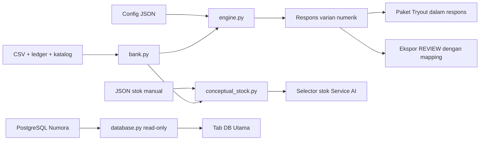

# Arsitektur dan integrasi

**Klarifikasi beta, 8 November 2026:** [dua belas kebijakan operasional](AI_IRT_V2_CONTEXT.md#klarifikasi-dua-belas-kebijakan-operasional) menerima paparan keluarga dari fitur lain seperti Pretest/PvP untuk evidence beta Drill, dengan provenance dan tanpa menghitung retry sebagai evidence baru. Komposisi paket: Drill 3 common anchor + 7 focal; Tryout 5 + 25. Metode mapping nilai IRT memakai paket acuan dan hasil terbit serentak per batch maksimal 72 jam dengan mode per arm; validasi statistik dan detail mapping tetap diperlukan. Nomor 7 disetujui: saat varian dihentikan tanpa pengganti siap, original aktif boleh menjadi fallback distribusi sementara; pin sesi, pertahankan assignment vs delivered arm, dan jangan campurkan crossover sebagai evidence varian/original acak. Eksperimen baru tidak membuat siswa lama fresh. Aturan lama yang bertentangan tidak menjadi target aktif.

**ENGINEERING DECISION — pemilik, 8 November 2026:** [konteks varian/IRT v2](AI_IRT_V2_CONTEXT.md) merupakan acuan target bersama Numora: A/B Drill reguler tanpa pilot original terpisah, tiga model IRT, Tryout multi-arm tanpa ranking nilai, review manusia awal dan adjustment hanya DRIFT. Status implementasi di bawah tidak otomatis berubah oleh persetujuan desain.

## Kepemilikan

Dua repo/deployment untuk dua VPS. Numora memiliki aplikasi, identitas canonical, lifecycle assessment, scoring, XP, adopsi kandidat dan publikasi. Repo AI memiliki engine/config, workbench lokal dan service generator `numora_service/` dengan kandidat/artifact compute durable. Scientific engine/worker kalibrasi IRT belum tersedia.

Migrasi/schema tetap milik Numora. [Handoff generator v1](handoffs/NUMORA_GENERATOR_INTEGRATION_V1.md) menjelaskan autentikasi HTTP, registration, executor/lease, retry dan penulisan kandidat/artifact SEALED ke `irt_compute`; main memiliki request/outbox, import canonical dan publication. Klaim lama bahwa repo ini belum memiliki lease atau writer compute sudah tidak berlaku untuk generator. Ini belum mencakup kalibrasi atau hasil IRT peserta.

Kontrak Numora tambahan: [ADR compute terpisah](../../Numora/docs/adr/ADR-011-separated-irt-compute.md) dan [persistence](../../Numora/docs/data/VARIANT_IRT_DATABASE.md); dua link ini membutuhkan repo berdampingan. Salinan [konteks v2 dan sumber](AI_IRT_V2_CONTEXT.md) dalam repo ini dapat dibaca mandiri.

## Dua jalur eksekusi saat ini

| Jalur | Penyimpanan dan batas |
|---|---|
| Engine/CLI/workbench `variant_gen/` | Hasil numerik dalam respons/memori, tanpa cache varian atau riwayat penggunaan; browser database memakai koneksi read-only. Asset stok konseptual adalah sumber offline. |
| Integrasi `numora_service/` | HTTP generator-service-v1 memakai envelope compute v3; satu kandidat/request, input/config/seed dipin, lease dan artifact durable. Main melakukan preview lalu Simpan VARIANT DRAFT; tidak otomatis approve/publish. Teks PG/MCMA/KATEGORI didukung; stok manual dan media aktif belum didukung endpoint execution v1. |

Target v2 memakai versi item/paket tetap untuk distribusi dan evidence; bukan generate seed berbeda tiap siswa. SEALED teknis tidak berarti approval Curriculum, `FROZEN_ITEM`, atau `VALIDATED_FOR_REUSE`.

## Alur lokal dan modul



| Modul dalam `variant_gen/` | Tanggung jawab |
|---|---|
| `bank.py` | CSV, ledger, katalog/metadata, loader workspace |
| `config_store.py` | Versi config, hash, schema |
| `randomizer.py`, `expr.py` | RNG per variabel; evaluator, aritmetika, render |
| `filters.py`, `engine.py` | Filter/validator; pipeline kandidat dan respons |
| `store.py` | Error validasi respons/ekspor; tanpa penyimpanan |
| `conceptual_stock.py` | Pembaca/validator stok manual VERIFIED; provenance, maksimum empat, tanpa penulisan |
| `lint.py` | Reproduksi original dan probe in-memory |
| `tryout.py` | Paket dalam respons, validasi manifest |
| `handoff.py` | Envelope Numora dengan canonical mapping |
| `cli.py` | Orchestration generate/preview/ekspor tanpa cache |
| `webui.py`, `webui.html` | HTTP localhost dan UI operator |
| `database.py` | Pembacaan PostgreSQL terpisah dari generator |

Workspace default menggabungkan bank dasar, tambahan level/revisi dan stok: Drill 1.150 original (1.067 generator + 83 original berstok), Tryout 30 (27 generator + 3 berstok), 0 HOLD. [Inventaris](PROGRESS.md) adalah cakupan lokal, bukan approval akademik atau kesetaraan IRT. `--bank` custom tetap standalone. Bank lokal tidak otomatis diimpor dari database utama.

## Respons dan versi

Pada jalur engine/CLI/workbench, original/config berbasis file dan generator numerik tidak menyimpan varian, manifest, atau riwayat; tidak mengakses DB. GET `/api/question` pada soal numerik memuat original/config dengan `variant: null`; POST `/api/generate` mengembalikan hasil langsung. POST `/api/tryout/generate-package` mengembalikan seluruh paket dalam satu respons. Jalur service integrasi memiliki snapshot config serta kandidat/artifact durable seperti dijelaskan pada handoff.

Stok konseptual adalah asset offline yang digabung dari sumber workspace: 83 original Drill dan 3 original Tryout memiliki stok. GET `/api/questions` memberi `stock_count` dan `variant_mode`; GET `/api/question?id=...&stock_variant=N` membaca stok pilihan (default1), bukan menjalankan generator. Respons memakai `source_kind: conceptual_stock`, `stock_index`, `variant_id`, versi stok, hash/versi original dan kategori sumber; seed/config null. Tidak ada pencatatan penggunaan atau endpoint tulis stok di workbench. Hash/versi source usang, item invalid dan indeks tidak tersedia ditolak; DRAFT tidak dilayani. Server memuat asset saat startup, sehingga perubahan memerlukan restart.

`same_answer_as_original` dikecualikan hanya untuk stok; validator numerik tetap ketat. Review variasi/kesulitan menilai tugas aktual, bukan hanya label kognitif: [audit lengkap](audits/2026-10-06-conceptual-stock-audit.md). Kesetaraan IRT belum diukur.

Respons mempertahankan bentuk record existing: ID `<question_id>:s<seed>:v1`, seed, versi/hash config dan original, variabel, stem, opsi, key, pembahasan, klasifikasi, dan waktu pembuatan. `variant_ver` selalu 1; `replacement_of`/`regen_reason` null. ID tersebut bukan identitas unik setiap panggilan; service utama harus menentukan identitas record DB jika menyimpan beberapa respons identik.

Seed/config sama menghasilkan konten sama. Tidak ada deduplikasi terhadap panggilan sebelumnya atau penghentian karena stok terpakai. Validasi terhadap original dan batas draw tetap berlaku. Hash original menormalkan CRLF menjadi LF agar checkout Windows/Linux tidak mengubah identitas isi soal.

Pada jalur lokal, backup mencakup sumber, ledger, katalog/metadata, serta config. Tampilan halaman menyimpan hasil sementara dalam memori browser, tanpa localStorage/sessionStorage atau unduh paket. Kandidat/artifact durable service integrasi mengikuti backup/retention database yang dikelola Numora; bukan bagian dari klaim stateless workbench.

## Ekspor ke Numora

Paket respons berstatus **LOCAL_PREVIEW**; validasi struktur, roster, status, dan original konseptual memakai bank. Tidak membuat file atau canonical mapping.

Ekspor **individual** menghitung respons baru dengan seed/config terbaru dan mapping dari pemilik ID Numora:

```powershell
python -B variant_gen/cli.py export tryout-1-b1-q01 s5 --mapping mapping.json
```

Mapping satu objek JSON, bukan dictionary per question:

| Field | Sumber/validasi |
|---|---|
| `questionExternalId` | Sama `question_id` respons |
| `originalHash`, `originalVersion` | Sama identitas original respons |
| `familyId` | UUID canonical keluarga dari Numora |
| `parentQuestionVersionId` | UUID versi original canonical yang dipin |
| `scoringRubricVersionId` | UUID versi rubric |
| `generationWaveItemId` | UUID opsional dari Numora |

UUID non-zero; generator tidak membuat/mencari ID. Pemeriksaan offline tidak membuktikan existence/relasi UUID; importer Numora wajib memvalidasi DB, original/rubric. Mapping harus cocok versi/hash original pada respons.

Envelope: `questionExternalId`, `variantExternalId`, `payload`, `answer`, `explanation`, `generation` dengan `reviewStatus=REVIEW`. PG satu ID benar; MCMA list ID benar; KATEGORI truth value **seluruh** pernyataan termasuk false. Snapshot tanpa pembahasan lengkap ditolak. Ekspor kanonik menerima satu label kognitif C1–C6 dan kategori boolean Benar/Salah; label kognitif gabungan atau kategori khusus tetap lokal sampai mapping semantiknya disahkan. Command tidak insert/upload/adopt/publish.

## Browser database

Membaca `public.assessment_packages`, `public.package_items`, `public.question_versions`, `public.question_variants`. Paket menampilkan versi dari `package_items.question_version_id`, bukan selalu latest. Keluarga menunjukkan original/varian/history. Paket DRAFT/demo/kosong mengikuti hak akun; pagination dapat menelusuri seluruh hasil.

`DATABASE_URL` dari environment/.env root. Koneksi read-only, repeatable-read; timeout connect/query lima detik; TLS remote. Tidak membuat role/grant/view/schema. Browser menerima data/error tersanitasi, bukan kredensial. Markup/media/JSON ditampilkan sebagai teks; tidak mengeksekusi HTML atau render media/LaTeX aktif. Mutasi DB ditolak.

API operator localhost: GET `/api/questions`, `/api/catalog`, `/api/question`; POST `/api/generate`, `/api/lint`, `/api/config`, `/api/tryout/generate-package`. Route DB GET `/api/database/status`, `/api/database/packages`, `/api/database/package`, `/api/database/family`. Host/origin lokal divalidasi; belum kontrak service-to-service produksi.

## Batas dan gap implementasi

- Soal konseptual memakai stok manual, bukan generator numerik; seluruh original Drill dan Tryout di katalog lokal memiliki generator atau stok. Dukungan katalog lokal tidak membuktikan dukungan stok/media pada service HTTP v1. Pretest bukan bagian katalog generator ini; arsip/import Pretest terpisah.
- Registry kapasitas exact generator numerik belum tersedia. Stok manual memiliki jumlah pasti dan dapat dibaca ulang tanpa habis; tidak memerlukan fallback penggunaan ulang.
- Alur kandidat service → preview → Simpan VARIANT DRAFT tersedia pada integrasi Numora. Paket A/B/multi-arm v2, review/aktivasi otomatis dan publication baru belum end-to-end.
- Scientific engine kalibrasi IRT, model/linking Indikator/Bab, decision engine dan adjuster config otomatis belum tersedia. Exposure/scoring/progres siswa tetap milik Numora.
- Contoh deployment dan autentikasi HTTP generator tersedia; bukti deployment/live readiness, konfigurasi runtime privat, review akademik dan QA penerimaan tetap terpisah. Jangan menganggap persetujuan v2 mengaktifkan layanan.

Max_draws membatasi pencarian; generator/lint tidak menetapkan validitas akademik, kesetaraan kesulitan atau kesiapan publikasi.
