# Ekstraksi sumber indikator 16 sampai 19

Arsip sumber masuk; belum dianalisis atau diimpor ke bank aktif. Persamaan ditranskripsikan dari Word OMML ke LaTeX untuk dibaca; DOCX dan OMML pada JSON tetap acuan asli.

<!-- table-001 -->
<table>
<tr><td colspan="2">Bab 3 : Geometri &amp; Pengukuran</td></tr>
<tr><td colspan="2">Sub Bab 1 : Objek Geometri</td></tr>
<tr><td></td><td>16. Jaring-jaring bangun ruang (prisma, tabung, limas dan kerucut)</td></tr>
<tr><td colspan="2">Sub Bab 2 : Transformasi Geometri</td></tr>
<tr><td></td><td>17. Transformasi tunggal (refleksi, translasi, rotasi, dan dilatasi) terhadap titik, garis, dan bangun datar pada bidang.</td></tr>
<tr><td colspan="2">Sub Bab 3 : Pengukuran</td></tr>
<tr><td></td><td>18. Keliling dan luas bangun datar (daerah segi banyak dan daerah lingkaran, serta daerah gabungannya)</td></tr>
<tr><td></td><td>19. Volume bangun ruang (prisma, limas, dan bola)</td></tr>
</table>

TIAP INDIKATOR (16 - 19) Memiliki 5 Level, Pada tiap level memiliki 10 Soal dengan 3 tipe soal

<!-- table-002 -->
<table>
<tr><td>Level 1 (C3)</td><td>PG (5), PG MCMA (3), PGK Kategori (2)</td></tr>
<tr><td>Level 2 (C3 &amp; C4)</td><td>PG (5), PG MCMA (3), PGK Kategori (2)</td></tr>
<tr><td>Level 3 (C4)</td><td>PG (5), PG MCMA (3), PGK Kategori (2)</td></tr>
<tr><td>Level 4 (C4 &amp; C5)</td><td>PG (5), PG MCMA (3), PGK Kategori (2)</td></tr>
<tr><td>Level 5 (C5)</td><td>PG (5), PG MCMA (3), PGK Kategori (2)</td></tr>
</table>

INDIKATOR 16. Jaring-jaring bangun ruang (prisma, tabung, limas dan kerucut)

LEVEL 1

Soal 1  (Bentuk Soal: PG)

Level Kognitif: (C3 Menerapkan)
Kunci Jawaban:  B. Tabung
Perhatikan komponen-komponen bangun datar penyusun jaring-jaring berikut:

2 buah bangun datar berbentuk lingkaran yang kongruen.

1 buah bangun datar berbentuk persegi panjang.

Jaring-jaring tersebut merupakan jaring-jaring dari bangun ruang...
A. Kerucut
B. Tabung
C. Limas segi empat
D. Prisma segitiga

Pembahasan: 

Jaring-jaring bangun ruang yang memiliki komponen:

2 buah lingkaran kongruen, dan

1 buah persegi panjang

adalah jaring-jaring tabung.

Alasannya:

2 lingkaran kongruen tersebut merupakan alas dan tutup tabung.

Persegi panjang tersebut merupakan selimut tabung. Jika tabung dibuka, selimutnya berbentuk persegi panjang yang panjangnya sama dengan keliling lingkaran alas dan lebarnya sama dengan tinggi tabung.

Ciri-ciri ini tidak dimiliki oleh:

Kerucut, karena hanya memiliki 1 lingkaran dan 1 selimut berbentuk juring lingkaran.

Limas segi empat, karena tersusun dari bangun segi empat dan segitiga.

Prisma segitiga, karena tersusun dari segitiga dan persegi panjang, tanpa lingkaran.

Soal 2 (Bentuk Soal: PG)

Level Kognitif: (C3 Menerapkan)

Kunci: C. Limas segi empat

Sebuah bangun ruang memiliki jaring-jaring yang terdiri dari 1 buah persegi dan 4 buah segitiga sama kaki. Bangun ruang yang dimaksud adalah...

A. Prisma segi empat

B. Limas segitiga

C. Limas segi empat

D. Kerucut

Pembahasan: 

Jaring-jaring limas segi empat terdiri dari:

1 buah persegi sebagai alas, dan

4 buah segitiga sebagai sisi tegak.

Karena bangun tersebut memiliki 1 persegi dan 4 segitiga sama kaki, maka bangun ruang yang dimaksud adalah limas segi empat.

Soal 3 (Bentuk Soal: PG)

Level Kognitif: (C3 Menerapkan)
Kunci: D. 150 cm²
Sebuah kubus memiliki jaring-jaring yang terdiri dari 6 buah persegi. Jika panjang sisi persegi pada jaring-jaring tersebut adalah 5 cm, maka luas total jaring-jaring kubus tersebut adalah...
A. 25 cm²
B. 100 cm²
C. 125 cm²
D. 150 cm²

Pembahasan: 

Jaring-jaring kubus terdiri dari 6 buah persegi.
Panjang sisi persegi = 5 cm.

Luas 1 persegi: $5×5=25c{m}^{2}$

Luas total jaring-jaring kubus: $6×25=150c{m}^{2}$

Soal 4 (Bentuk Soal: PG)

Level Kognitif: (C3 Menerapkan)
Kunci: B. 132 cm²
Sebuah jaring-jaring limas segi empat terdiri dari alas berbentuk persegi dengan luas 36 cm² dan 4 buah sisi tegak berbentuk segitiga dengan luas masing-masing 24 cm². Luas permukaan limas tersebut adalah...
A. 60 cm²
B. 132 cm²
C. 144 cm²
D. 156 cm²

Pembahasan: 

Luas permukaan limas segi empat = luas alas + jumlah luas sisi tegak.

Diketahui:

Luas alas = 36 cm²

Luas 1 sisi tegak = 24 cm²

Banyak sisi tegak = 4

Maka:

Luas Permukaan = 36 + (4 x 24)

= 36 + 96 = 132 cm²
 

Soal 5 (Bentuk Soal: PG)
Level Kognitif: (C3 Menerapkan)

Kunci: C. 144 cm²

Sebuah prisma segitiga memiliki jaring-jaring yang terdiri dari 2 buah segitiga siku-siku yang kongruen dan 3 buah persegi panjang. Jika luas total kedua segitiga tersebut adalah 24 cm² dan luas total ketiga persegi panjang adalah 120 cm², maka luas permukaan prisma segitiga tersebut adalah...

A. 96 cm²

B. 120 cm²

C. 144 cm²

D. 168 cm² 

Pembahasan: 

Luas permukaan prisma segitiga = luas total 2 segitiga + luas total 3 persegi panjang.

Diketahui:

Luas total kedua segitiga = 24 cm²

Luas total ketiga persegi panjang = 120 cm²

Maka:

Luas Permukaan = 24 + 120 = 144 cm²

 

Soal 6 (Bentuk Soal: PG MCMA)

Level Kognitif: (C3 Menerapkan)
Kunci: Pernyataan 1, Pernyataan 2, dan Pernyataan 4
Perhatikan pernyataan-pernyataan berikut terkait jaring-jaring prisma segitiga!
Pilihlah semua pernyataan yang benar!
[  ] Pernyataan 1: Terdiri dari 2 buah segitiga yang kongruen.
[  ] Pernyataan 2: Terdiri dari 3 buah persegi panjang.
[  ] Pernyataan 3: Terdiri dari 4 buah persegi panjang.
[  ] Pernyataan 4: Memiliki total 5 buah bangun datar penyusun.

Pembahasan: 

Jaring-jaring prisma segitiga tersusun dari:

2 buah segitiga kongruen sebagai alas dan tutup.

3 buah persegi panjang sebagai sisi-sisi tegak/selimut prisma.

Maka:

Pernyataan 1: Benar.

Pernyataan 2: Benar.

Pernyataan 3: Salah, karena persegi panjangnya ada 3, bukan 4.

Soal 7 (Bentuk Soal: PG MCMA)
Level Kognitif: (C3 Menerapkan)

Kunci: Pernyataan 1, Pernyataan 2, dan Pernyataan 3
Sebuah limas segi empat memiliki alas berbentuk persegi dengan panjang sisi 10 cm. Tinggi sisi tegak (segitiga) pada jaring-jaringnya adalah 8 cm.
Pilihlah semua pernyataan yang benar terkait luas permukaan limas tersebut!
[  ] Pernyataan 1: Luas alas limas adalah 100 cm².
[  ] Pernyataan 2: Luas 1 sisi tegak adalah 40 cm².
[  ] Pernyataan 3: Luas seluruh sisi tegak adalah 160 cm².
[  ] Pernyataan 4: Luas permukaan total limas adalah 200 cm².

Pembahasan: 

Diketahui limas segi empat dengan:

Alas berbentuk persegi, sisi = 10 cm.

Tinggi sisi tegak = 8 cm.

Hitung:

Luas alas : 10 x 10 = 100 cm²

Pernyataan 1: Benar.

Luas 1 sisi tegak berbentuk segitiga : $\frac{1}{2}×10×8=40c{m}^{2}$

Pernyataan 2: Benar.

Luas seluruh sisi tegak
 Ada 4 sisi tegak, sehingga: $4× 40=160c{m}^{2}$

Pernyataan 3: Benar.

Luas permukaan total limas 

Luas alas + Luas seluruh sisi tegak : $100+160=260c{m}^{2}$

Pernyataan 4 menyebut 200 cm², sehingga Salah.

Soal 8 (Bentuk Soal: PG MCMA)

Level Kognitif: (C3 Menerapkan)
Kunci: Pernyataan 1, Pernyataan 2, dan Pernyataan 3
Sebuah tabung memiliki jari-jari alas 7 cm dan tinggi 10 cm. Jaring-jaring tabung terdiri dari 2 lingkaran dan 1 persegi panjang.
Pilihlah semua pernyataan yang benar!
[ ] Pernyataan 1: Panjang persegi panjang pada jaring-jaring sama dengan keliling alas tabung.
[  ] Pernyataan 2: Luas 1 lingkaran alas adalah 154 cm².
[  ] Pernyataan 3: Panjang persegi panjang pada jaring-jaring adalah 44 cm.
[  ] Pernyataan 4: Luas persegi panjang pada jaring-jaring adalah 308 cm².

Pembahasan: 

Diketahui tabung:

Jari-jari alas r = 7 cm

Tinggi  t = 10 cm

Gunakan $π=\frac{22}{7}$

Panjang persegi panjang pada jaring-jaring tabung sama dengan keliling alas tabung.
 Pernyataan 1: Benar.

Luas 1 lingkaran alas

$L=π{r}^{2}=\frac{22}{7}×7×7=154c{m}^{2}$

Pernyataan 2: Benar.

Panjang persegi panjang pada jaring-jaring

$K=2πr=2×\frac{22}{7}×7=44cm$

Pernyataan 3: Benar.

Luas persegi panjang pada jaring-jaring
 Panjang = 44 cm, lebar = tinggi tabung = 10 cm.

$L=44×10=440c{m}^{2}$

Pernyataan 4 menyebut 308 cm², sehingga Salah.

Soal 9 (Bentuk Soal: PGK Kategori)
Level Kognitif: (C3 Menerapkan)

Kunci: A. Benar, B. Benar, C. Salah

Sebuah bangun ruang memiliki jaring-jaring yang terdiri dari 1 buah persegi dan 4 buah segitiga sama kaki.

Tentukan Benar atau Salah untuk setiap pernyataan berikut terkait bangun ruang tersebut!

<!-- table-003 -->
<table>
<tr><td></td><td>Pernyataan</td><td>Benar</td><td>Salah</td></tr>
<tr><td>A.</td><td>Bangun ruang tersebut adalah limas segi empat.</td><td>O</td><td>O</td></tr>
<tr><td>B.</td><td>Bangun ruang tersebut memiliki 5 buah titik sudut.</td><td>O</td><td>O</td></tr>
<tr><td>C.</td><td>Bangun ruang tersebut memiliki 6 buah sisi.</td><td>O</td><td>O</td></tr>
</table>

Pembahasan: 

Bangun ruang yang memiliki jaring-jaring terdiri dari 1 buah persegi dan 4 buah segitiga sama kaki adalah limas segi empat.

Mari kita periksa setiap pernyataan:

Pernyataan A: Bangun ruang tersebut adalah limas segi empat.
 Ini sesuai dengan ciri jaring-jaring yang diberikan (1 persegi sebagai alas dan 4 segitiga sebagai sisi tegak).
 Jawaban: Benar

Pernyataan B: Bangun ruang tersebut memiliki 5 buah titik sudut.
 Limas segi empat memiliki 4 titik sudut pada alas (persegi) dan 1 titik puncak di atas. Total titik sudutnya adalah 4 + 1 = 5.
 Jawaban: Benar

Pernyataan C: Bangun ruang tersebut memiliki 6 buah sisi.
 Limas segi empat memiliki 1 sisi alas (persegi) dan 4 sisi tegak (segitiga). Total sisinya adalah 1 + 4 = 5 sisi, bukan 6.
 Jawaban: Salah

 

Soal 10 (Bentuk Soal: PGK Kategori)
Level Kognitif: (C3 Menerapkan)

Kunci: A. Benar, B. Benar, C. Salah
Sebuah kubus memiliki panjang rusuk 4 cm. Jaring-jaring kubus tersebut terdiri dari 6 buah persegi.
Tentukan Benar atau Salah untuk setiap pernyataan berikut!

<!-- table-004 -->
<table>
<tr><td></td><td>Pernyataan</td><td>Benar</td><td>Salah</td></tr>
<tr><td>A.</td><td>Luas 1 buah persegi pada jaring-jaring adalah 16 cm².</td><td>O</td><td>O</td></tr>
<tr><td>B.</td><td>Luas permukaan kubus dapat dihitung dengan rumus 6 × 4 × 4.</td><td>O</td><td>O</td></tr>
<tr><td>C.</td><td>Luas permukaan kubus tersebut adalah 64 cm².</td><td>O</td><td>O</td></tr>
</table>

Pembahasan: 

Diketahui sebuah kubus dengan panjang rusuk S = 4 cm. Jaring-jaringnya terdiri dari 6 buah persegi.

Mari kita periksa setiap pernyataan:

Pernyataan A: Luas 1 buah persegi pada jaring-jaring adalah 16 cm².
 Luas 1 persegi = $s×s=4cm×4cm=16c{m}^{2}$.
 Jawaban: Benar

Pernyataan B: Luas permukaan kubus dapat dihitung dengan rumus 6 × 4 × 4.
 Rumus luas permukaan kubus adalah $6×{s}^{2}$ atau $6×s×s$. Dengan s = 4, maka rumusnya menjadi 6 x 4 x 4.
 Jawaban: Benar

Pernyataan C: Luas permukaan kubus tersebut adalah 64 cm².
 Luas permukaan kubus = $6×Luas Satu Persegi=6×16c{m}^{2}=96c{m}^{2}$. 

Angka 64 cm² adalah volume kubus ($4×4×4$), bukan luas permukaannya.
 Jawaban: Salah

LEVEL 2

Soal 1 (Bentuk Soal: PG)
Level Kognitif: (C3 Menerapkan)
Kunci Jawaban: C. 704 cm²
Sebuah tabung memiliki jaring-jaring yang terdiri dari 2 buah lingkaran dan 1 buah persegi panjang. Jika jari-jari lingkaran adalah 7 cm dan tinggi tabung adalah 10 cm, maka luas permukaan tabung tersebut adalah... (Gunakan $π=\frac{22}{7}$)
 A. 440 cm²
 B. 616 cm²
 C. 704 cm²
 D. 880 cm²
 Pembahasan:
 Luas permukaan tabung = Luas 2 lingkaran + Luas persegi panjang.

Luas 2 lingkaran = $2×π×{r}^{2}=2×\frac{22}{7}×7×7=308$ cm²

Luas persegi panjang = Keliling lingkaran x tinggi = $2×\frac{22}{7}×7×10=440 c{m}^{2}$

Luas permukaan total = $308+440=704c{m}^{2}$

Soal 2 (Bentuk Soal: PG)
Level Kognitif: (C3 Menerapkan)
Kunci Jawaban: B. 384 cm²
Sebuah limas segi empat memiliki alas berbentuk persegi dengan panjang sisi 12 cm. Jika tinggi sisi tegak (segitiga) pada jaring-jaringnya adalah 10 cm, maka luas permukaan limas tersebut adalah...
 A. 240 cm²
 B. 384 cm²
 C. 480 cm²
 D. 624 cm²
 Pembahasan:
 Luas permukaan limas = Luas alas + Luas 4 sisi tegak.

Luas alas = $12×12=144 c{m}^{2}$

Luas 1 sisi tegak = $\frac{1}{2}×12×10=60 c{m}^{2}$ 

Luas 4 sisi tegak = $4×60=240 c{m}^{2}$

Luas permukaan total = $144+240=384 c{m}^{2}$

Soal 3 (Bentuk Soal: PG)
Level Kognitif: C3 Menerapkan

Kunci Jawaban: B. 180 cm²

Sebuah prisma segitiga memiliki jaring-jaring yang terdiri dari 2 buah segitiga siku-siku yang kongruen dan 3 buah persegi panjang. Jika luas total kedua segitiga tersebut adalah 48 cm² dan luas total ketiga persegi panjang adalah 132 cm², maka luas permukaan prisma segitiga tersebut adalah...

A. 132 cm²

B. 180 cm²

C. 228 cm²

D. 276 cm²

Pembahasan:

Luas permukaan prisma segitiga = luas total 2 segitiga + luas total 3 persegi panjang.

Maka:

Luas permukaan = 48 + 132 = 180 cm²

Jadi, jawaban yang benar adalah B. 180 cm².

Soal 4 (Bentuk Soal: PG)
Level Kognitif: (C3 Menerapkan)
Kunci Jawaban: C. 550 cm²
Sebuah kerucut memiliki jari-jari alas 7 cm dan garis pelukis 18 cm. Jaring-jaring kerucut tersebut terdiri dari sebuah lingkaran dan sebuah juring lingkaran. Luas permukaan kerucut tersebut adalah... (Gunakan $π=\frac{22}{7}$)
 A. 396 cm²
 B. 440 cm²
 C. 550 cm²
 D. 616 cm²
 Pembahasan:
 Luas permukaan kerucut = Luas alas + Luas selimut.

Luas alas = $π×{r}^{2}=\frac{22}{7}×7×7=154c{m}^{2}$

Luas selimut = $π×r×s=\frac{22}{7}×7×18=396c{m}^{2}$

Luas permukaan total = $154+396=550c{m}^{2}$

Soal 5 (Bentuk Soal: PG)
Level Kognitif: (C3 Menerapkan)
Kunci Jawaban: A. 216 cm²
Sebuah kubus memiliki jaring-jaring yang terdiri dari 6 buah persegi yang kongruen. Jika panjang rusuk kubus tersebut adalah 6 cm, maka luas total jaring-jaring kubus adalah...
 A. 216 cm²
 B. 144 cm²
 C. 108 cm²
 D. 36 cm²
 Pembahasan:
 Luas 1 persegi = $s×s=6×6=36c{m}^{2}$.
 Luas total jaring-jaring (6 persegi) = $6×36=216c{m}^{2}$.

Soal 6 (Bentuk Soal: PG MCMA)
Level Kognitif: (C4 Menganalisis)
Kunci: Pernyataan 1, Pernyataan 2, dan Pernyataan 4
Sebuah prisma segitiga memiliki alas berbentuk segitiga sama sisi dengan panjang sisi 6 cm. Tinggi prisma tersebut adalah 10 cm.
Pilihlah semua pernyataan yang benar terkait jaring-jaring dan luas permukaan prisma tersebut!
[  ] Pernyataan 1: Jaring-jaring prisma terdiri dari 2 segitiga sama sisi dan 3 persegi panjang.
[  ] Pernyataan 2: Luas 1 persegi panjang pada jaring-jaring adalah 60 cm².
[  ] Pernyataan 3: Luas total kedua segitiga adalah 36 cm².
[  ] Pernyataan 4: Luas permukaan total prisma adalah $180+18\sqrt{3}c{m}^{2}$.
Pembahasan:

Pernyataan 1: Benar. Komponen jaring-jaring prisma segitiga adalah 2 segitiga (alas dan tutup) dan 3 persegi panjang (selimut).

Pernyataan 2: Benar. Luas 1 persegi panjang = sisi segitiga x tinggi prisma = $6×10=60$ cm².

Pernyataan 3: Salah. Luas segitiga sama sisi = $\frac{1}{4}{s}^{2}\sqrt{3}=\frac{1}{4}(36)\sqrt{3}=9\sqrt{3}c{m}^{2}$. Luas total 2 segitiga $=18\sqrt{3} c{m}^{2}$ (bukan 36).

Pernyataan 4: Benar. Luas permukaan = Luas 2 segitiga + Luas 3 persegi panjang = $18\sqrt{3}+3(60)=180+18\sqrt{3}c{m}^{2}$.

Soal 7 (Bentuk Soal: PG MCMA)
Level Kognitif: (C4 Menganalisis)
Kunci: Pernyataan 1, Pernyataan 2, dan Pernyataan 3
Sebuah limas segi empat memiliki alas berbentuk persegi dengan panjang sisi 10 cm. Tinggi sisi tegak (segitiga) pada jaring-jaringnya adalah 12 cm.
Pilihlah semua pernyataan yang benar terkait luas permukaan limas tersebut!
[  ] Pernyataan 1: Luas alas limas adalah 100 cm².
[  ] Pernyataan 2: Luas 1 sisi tegak adalah 60 cm².
[  ] Pernyataan 3: Luas seluruh sisi tegak adalah 240 cm².
[  ] Pernyataan 4: Luas permukaan total limas adalah 340 cm².
Pembahasan:

Pernyataan 1: Benar. Luas alas = $10×10=100 c{m}^{2}$.

Pernyataan 2: Benar. Luas 1 sisi tegak = $\frac{1}{2}×10×12=60c{m}^{2}$.

Pernyataan 3: Benar. Luas 4 sisi tegak = $4×60=240c{m}^{2}$.

Pernyataan 4: Salah. Luas permukaan total = Luas alas + Luas seluruh sisi tegak = $100+240=340c{m}^{2}$. 

Soal 8 (Bentuk Soal: PG MCMA)
Level Kognitif: (C4 Menganalisis)
Kunci: Pernyataan 1, Pernyataan 3, dan Pernyataan 4
Sebuah tabung memiliki jari-jari alas 7 cm dan tinggi 15 cm. Jaring-jaring tabung terdiri dari 2 lingkaran dan 1 persegi panjang.
Pilihlah semua pernyataan yang benar! (Gunakan  $π=\frac{22}{7}$)
[ ] Pernyataan 1: Panjang persegi panjang pada jaring-jaring sama dengan keliling alas tabung.
[  ] Pernyataan 2: Luas 1 lingkaran alas adalah 156 cm².
[  ] Pernyataan 3: Panjang persegi panjang pada jaring-jaring adalah 44 cm.
[  ] Pernyataan 4: Luas persegi panjang pada jaring-jaring adalah 660 cm².
Pembahasan:

Pernyataan 1: Benar. Panjang persegi panjang = keliling alas.

Pernyataan 2: Salah. Luas lingkaran = $\frac{22}{7}×7×7=154 c{m}^{2}$.

Pernyataan 3: Benar. Keliling alas = $2×\frac{22}{7}×7=44 cm$.

Pernyataan 4: Benar. Luas persegi panjang = $44×15=660c{m}^{2}$. 

Soal 9 (Bentuk Soal: PGK Kategori)
Level Kognitif: (C4 Menganalisis)
Kunci: A. Benar, B. Salah, C. Benar
Sebuah bangun ruang memiliki jaring-jaring yang terdiri dari 1 buah persegi dan 4 buah segitiga sama kaki.
Tentukan Benar atau Salah untuk setiap pernyataan berikut terkait bangun ruang tersebut!

<!-- table-005 -->
<table>
<tr><td></td><td>Pernyataan</td><td>Benar</td><td>Salah</td></tr>
<tr><td>A.</td><td>Bangun ruang tersebut adalah limas segi empat.</td><td>O</td><td>O</td></tr>
<tr><td>B.</td><td>Bangun ruang tersebut memiliki 6 buah titik sudut.</td><td>O</td><td>O</td></tr>
<tr><td>C.</td><td>Bangun ruang tersebut memiliki 5 buah sisi.</td><td>O</td><td>O</td></tr>
</table>

Pembahasan:
Bangun ruang yang dimaksud adalah limas segi empat.

Pernyataan A: Benar. Sesuai ciri jaring-jaringnya.

Pernyataan B: Salah. Limas segi empat memiliki 5 titik sudut (4 di alas + 1 puncak). 

Pernyataan C: Benar. Limas segi empat memiliki 5 sisi (1 alas + 4 sisi tegak).

Soal 10 (Bentuk Soal: PGK Kategori)
Level Kognitif: (C4 Menganalisis)
Kunci: A. Benar, B. Benar, C. Salah
Sebuah kubus memiliki panjang rusuk 4 cm. Jaring-jaring kubus tersebut terdiri dari 6 buah persegi.
Tentukan Benar atau Salah untuk setiap pernyataan berikut!

<!-- table-006 -->
<table>
<tr><td></td><td>Pernyataan</td><td>Benar</td><td>Salah</td></tr>
<tr><td>A.</td><td>Luas 1 buah persegi pada jaring-jaring adalah 16 cm².</td><td>O</td><td>O</td></tr>
<tr><td>B.</td><td>Luas permukaan kubus dapat dihitung dengan rumus 
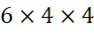
.</td><td>O</td><td>O</td></tr>
<tr><td>C.</td><td>Jika panjang rusuk kubus diperbesar menjadi 8 cm, maka luas permukaannya menjadi 2 kali lipat.</td><td>O</td><td>O</td></tr>
</table>

Pembahasan:

Pernyataan A: Benar. Luas 1 persegi = $s×s=4×4=16c{m}^{2}$.

Pernyataan B: Benar. Rumus luas permukaan kubus = $6×{s}^{2}=6×4×4$.

Pernyataan C: Salah. Jika rusuk diperbesar 2 kali (dari 4 cm menjadi 8 cm), maka luas permukaan diperbesar ${2}^{2}=4$ kali lipat, bukan 2 kali lipat. (Luas awal = 96 cm², Luas baru = $6×8×8=384 c{m}^{2}$. $384=4×96$.

LEVEL 3

Soal 1 (Bentuk Soal: PG)
Level Kognitif: (C4 Menganalisis)
Kunci Jawaban: C. 9 kali lipat
Sebuah kubus memiliki panjang rusuk 2 cm. Jika panjang rusuk kubus tersebut diperbesar menjadi 6 cm, maka analisis yang tepat mengenai perubahan luas permukaan kubus (dilihat dari jaring-jaringnya) adalah...
A. Luas permukaan menjadi 3 kali lipat
B. Luas permukaan menjadi 6 kali lipat
C. Luas permukaan menjadi 9 kali lipat
D. Luas permukaan menjadi 27 kali lipat
 Pembahasan:
 Luas permukaan kubus awal $s=26×{2}^{2}=24c{m}^{2}$. 
 Luas permukaan kubus baru $s=66×{6}^{2}=216c{m}^{2}$.
 Perbandingan = $216:24=9$ kali lipat.
 Analisis: Karena rusuk diperbesar 3 kali ( $6:2=3$ ), maka luas permukaan diperbesar ${3}^{2}=9$ kali lipat.

Soal 2 (Bentuk Soal: PG)
Level Kognitif: (C4 Menganalisis)
Kunci Jawaban: B. 1 lingkaran dan 1 persegi panjang
Seorang siswa ingin membuat jaring-jaring tabung tanpa tutup dari kertas karton. Analisis komponen bangun datar yang tepat untuk membentuk jaring-jaring tersebut adalah...
 A. 2 lingkaran dan 1 persegi panjang
 B. 1 lingkaran dan 1 persegi panjang
 C. 2 lingkaran dan 1 juring lingkaran
 D. 1 lingkaran dan 1 juring lingkaran
Pembahasan:
Tabung tanpa tutup hanya memiliki 1 sisi alas (lingkaran) dan 1 sisi selimut (persegi panjang). Jika tabung utuh, komponennya adalah 2 lingkaran dan 1 persegi panjang.

Soal 3 (Bentuk Soal: PG)
Level Kognitif: (C4 Menganalisis)
Kunci Jawaban: A. 1 : 4
2 buah kubus memiliki jaring-jaring yang terdiri dari 6 persegi. Kubus A memiliki panjang rusuk 3 cm, sedangkan Kubus B memiliki panjang rusuk 6 cm. Analisis perbandingan luas permukaan Kubus A dan Kubus B adalah...
A. 1 : 4
B. 1 : 2
C. 1 : 3
D. 1 : 8
Pembahasan:
 Luas permukaan Kubus A = $6×{3}^{2}=54c{m}^{2}$.
 Luas permukaan Kubus B = $6×{6}^{2}=216c{m}^{2}$.
 Perbandingan = $54:216=1:4$
Analisis: Perbandingan luas permukaan sama dengan kuadrat perbandingan rusuknya ( ${3}^{2}:{6}^{2}=9:36=1:4$ ).

Soal 4 (Bentuk Soal: PG)
Level Kognitif: (C4 Menganalisis)
Kunci Jawaban: D. Luas selimut = 440 cm² dan Luas permukaan = 748 cm²
Sebuah tabung memiliki jari-jari alas 7 cm dan tinggi 10 cm. Jaring-jaring tabung tersebut terdiri dari 2 lingkaran dan 1 persegi panjang. Analisis yang tepat mengenai luas selimut dan luas permukaan tabung tersebut adalah... (Gunakan $π=\frac{22}{7}$)
A. Luas selimut = 154 cm² dan Luas permukaan = 308 cm²
B. Luas selimut = 308 cm² dan Luas permukaan = 462 cm²
C. Luas selimut = 440 cm² dan Luas permukaan = 594 cm²
D. Luas selimut = 440 cm² dan Luas permukaan = 748 cm²
Pembahasan:
Luas selimut (persegi panjang) = Keliling alas $×$ tinggi = $2×\frac{22}{7}×7×10=440c{m}^{2}$.

Luas alas/tutup (2 lingkaran) = $2×\frac{22}{7}×{7}^{2}=308c{m}^{2}$.

Luas permukaan total = $440+308=748c{m}^{2}$.

Soal 5 (Bentuk Soal: PG)
Level Kognitif: (C4 Menganalisis)
Kunci Jawaban: B. 144 cm²
Sebuah prisma segitiga memiliki jaring-jaring yang terdiri dari 2 segitiga siku-siku dan 3 persegi panjang. Diketahui luas total kedua segitiga adalah 24 cm². Jika keliling alas segitiga adalah 12 cm dan tinggi prisma adalah 10 cm, maka analisis luas permukaan prisma tersebut adalah...
 A. 120 cm²
 B. 144 cm²
 C. 168 cm²
 D. 240 cm²
Pembahasan:
Luas selimut prisma = Keliling alas $×$ tinggi = $12×10=120c{m}^{2}$.

Luas permukaan total = Luas 2 segitiga + Luas selimut = $24+120=144c{m}^{2}$.

Soal 6 (Bentuk Soal: PG MCMA)
Level Kognitif: (C4 Menganalisis)
Kunci: Pernyataan 1, Pernyataan 2, dan Pernyataan 3
Perhatikan pernyataan-pernyataan berikut terkait jaring-jaring kubus!
Pilihlah semua pernyataan yang benar!
[  ] Pernyataan 1: Jaring-jaring kubus selalu terdiri dari 6 buah persegi yang kongruen.
[ ] Pernyataan 2: Jika rusuk kubus diperbesar 2 kali, maka luas jaring-jaringnya menjadi 4 kali lipat.
[  ] Pernyataan 3: Luas jaring-jaring kubus sama dengan luas permukaan kubus.
[  ] Pernyataan 4: Jaring-jaring kubus dapat terdiri dari 4 persegi dan 2 persegi panjang.
Pembahasan:

Pernyataan 1: Benar. Kubus memiliki 6 sisi berbentuk persegi kongruen.

Pernyataan 2: Benar. Luas permukaan kubus berbanding lurus dengan kuadrat rusuknya ($L=6{s}^{2}$).

Pernyataan 3: Benar. Luas jaring-jaring adalah jumlah luas seluruh bangun datar penyusunnya, yang merepresentasikan luas permukaan bangun ruang.

Pernyataan 4: Salah. Kubus tidak memiliki sisi persegi panjang.

Soal 7 (Bentuk Soal: PG MCMA)
Level Kognitif: (C4 Menganalisis)
Kunci: Pernyataan 1, Pernyataan 2, dan Pernyataan 4
Sebuah tabung memiliki jari-jari 10 cm dan tinggi 20 cm. Jaring-jaring tabung terdiri dari 2 lingkaran dan 1 persegi panjang.
Pilihlah semua pernyataan yang benar! (Gunakan $π=3,14$)
[  ] Pernyataan 1: Panjang persegi panjang pada jaring-jaring adalah 62,8 cm.
[  ] Pernyataan 2: Luas 1 lingkaran alas adalah 314 cm².
[  ] Pernyataan 3: Luas persegi panjang pada jaring-jaring adalah 618 cm².
[  ] Pernyataan 4: Luas permukaan total tabung adalah 1.884 cm².
 Pembahasan:

 Pernyataan 1: Benar. Panjang persegi panjang = Keliling alas =  $2×3,14×10=62,8 cm$

Pernyataan 2: Benar. Luas lingkaran = $3,14×10×10=314 c{m}^{2}$.

Pernyataan 3: Salah. Luas persegi panjang = $62,8×20=1.256 c{m}^{2}$. (Pernyataan ini sebenarnya Benar secara hitungan, tapi mari kita analisis. Jika luas persegi panjang 1.256, maka total luas permukaan = $1.256+2(314)=1.884$.

Pernyataan 4: Benar. Luas permukaan total = $1.256+628=1.884 c{m}^{2}$.

Soal 8 (Bentuk Soal: PG MCMA)
Level Kognitif: (C4 Menganalisis)
Kunci: Pernyataan 1, Pernyataan 2, dan Pernyataan 3
Sebuah limas segi empat memiliki alas persegi dengan panjang sisi 14 cm. Tinggi sisi tegak (segitiga) pada jaring-jaringnya adalah 25 cm.
Pilihlah semua pernyataan yang benar!
[  ] Pernyataan 1: Luas alas limas adalah 196 cm².
[  ] Pernyataan 2: Luas 1 sisi tegak adalah 175 cm².
[  ] Pernyataan 3: Luas seluruh sisi tegak adalah 700 cm².
[  ] Pernyataan 4: Luas permukaan total limas adalah 800 cm².
Pembahasan:

Pernyataan 1: Benar. Luas alas = $14×14=196c{m}^{2}$.

Pernyataan 2: Benar. Luas 1 sisi tegak = $\frac{1}{2}×14×25=175c{m}^{2}$.

Pernyataan 3: Benar. Luas 4 sisi tegak = $4×175=700c{m}^{2}$.

Pernyataan 4: Salah. Luas permukaan total = $196+700=896c{m}^{2}$. (Jika 896, maka Benar. Mari kita buat salah dengan mengubah angkanya).

Soal 9 (Bentuk Soal: PGK Kategori)
Level Kognitif: (C4 Menganalisis)
Kunci: A. Benar, B. Salah, C. Benar
Sebuah prisma segitiga memiliki jaring-jaring yang terdiri dari 2 buah segitiga sama sisi dan 3 buah persegi panjang. Panjang sisi segitiga adalah 8 cm dan tinggi prisma adalah 12 cm.
Tentukan Benar atau Salah untuk setiap pernyataan berikut terkait analisis jaring-jaring prisma tersebut!

<!-- table-007 -->
<table>
<tr><td></td><td>Pernyataan</td><td>Benar</td><td>Salah</td></tr>
<tr><td>A.</td><td>Luas 1 persegi panjang pada jaring-jaring adalah 96 cm².</td><td>O</td><td>O</td></tr>
<tr><td>B.</td><td>Luas total kedua segitiga penyusun jaring-jaring adalah 64 cm².</td><td>O</td><td>O</td></tr>
<tr><td>C.</td><td>Luas permukaan total prisma dapat dihitung dengan menjumlahkan luas 2 segitiga dan 3 persegi panjang.</td><td>O</td><td>O</td></tr>
</table>

Pembahasan:

Pernyataan A: Benar. Luas 1 persegi panjang = sisi segitiga x tinggi prisma = 8 x 12 cm².

Pernyataan B: Salah. Luas 1 segitiga sama sisi = $\frac{1}{4}{s}^{2}\sqrt{3}=\frac{1}{4}(64)\sqrt{3}=16\sqrt{3}c{m}^{2}$. Luas 2 segitiga = $32\sqrt{3}c{m}^{2}$ (bukan 64).

Pernyataan C: Benar. Luas permukaan adalah jumlah seluruh luas bangun datar penyusun jaring-jaring.

Soal 10 (Bentuk Soal: PGK Kategori)

Level Kognitif: (C4 Menganalisis)

Kunci: A. Benar, B. Salah, C. Benar
Sebuah kerucut memiliki jari-jari alas 14 cm dan garis pelukis 30 cm. Jaring-jaring kerucut terdiri dari sebuah lingkaran dan sebuah juring lingkaran.
Tentukan Benar atau Salah untuk setiap pernyataan berikut!

<!-- table-008 -->
<table>
<tr><td></td><td>Pernyataan</td><td>Benar</td><td>Salah</td></tr>
<tr><td>A.</td><td>Panjang busur juring lingkaran pada jaring-jaring sama dengan keliling alas kerucut.</td><td>O</td><td>O</td></tr>
<tr><td>B.</td><td>Luas alas kerucut tersebut adalah 308 cm².</td><td>O</td><td>O</td></tr>
<tr><td>C.</td><td>Jika garis pelukis kerucut diperpanjang menjadi 60 cm, maka luas selimutnya menjadi 2 kali lipat.</td><td>O</td><td>O</td></tr>
</table>

Pembahasan:

Pernyataan A: Benar. Panjang busur juring (selimut) memang sama dengan keliling lingkaran alas.

Pernyataan B: Salah. Luas alas = $π×{r}^{2}=\frac{22}{7}×14×14=616c{m}^{2}$.

Pernyataan C: Benar. Luas selimut = $π×r×s$. Jika s diperbesar 2 kali, maka luas selimut juga menjadi 2 kali lipat (berbanding lurus). 

LEVEL 4

Soal 1 (Bentuk Soal: PG)
Level Kognitif: (C4 Menganalisis)
Kunci Jawaban: D. 748 cm²
Perhatikan gambar jaring-jaring tabung di bawah ini!

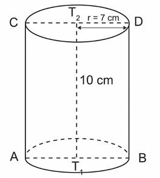

Jika panjang jari-jari alas tabung tersebut adalah 7 cm dan tingginya 10 cm, maka luas seluruh permukaan tabung yang dibentuk dari jaring-jaring tersebut adalah... (Gunakan $π=\frac{22}{7}$)
 A. 440 cm²
 B. 594 cm²
 C. 616 cm²
D. 748 cm²
Pembahasan:
Luas seluruh permukaan tabung = Luas 2 lingkaran + Luas persegi panjang (selimut).

Luas 2 lingkaran = $2×π×{r}^{2}=2×\frac{22}{7}×7×7=308c{m}^{2}$.

Luas persegi panjang = Keliling alas $×$ tinggi = $(2×\frac{22}{7}×7)×10=44×10=440c{m}^{2}$.

Luas total = $308+440=748c{m}^{2}$.

Soal 2 (Bentuk Soal: PG)
 Level Kognitif: (C5 Mengevaluasi)
 Kunci Jawaban: C. Jaring-jaring C
 Perhatikan empat gambar jaring-jaring bangun ruang di bawah ini!

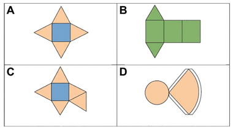

Berdasarkan analisis Anda, jaring-jaring manakah yang TIDAK DAPAT dilipat menjadi sebuah bangun ruang yang utuh dan tertutup?
A. Jaring-jaring A
B. Jaring-jaring B
C. Jaring-jaring C
D. Jaring-jaring D
Pembahasan:
Jaring-jaring C merupakan jaring-jaring limas segi empat, namun memiliki 5 buah segitiga sebagai sisi tegak. Limas segi empat hanya membutuhkan 4 buah sisi tegak yang menempel pada 4 sisi persegi alasnya. Jika dilipat, satu sisi tegak akan tumpang tindih (tidak valid).

Soal 3 (Bentuk Soal: PG)
 Level Kognitif: (C4 Menganalisis)
 Kunci Jawaban: B. 88 cm

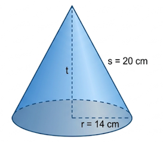

Sebuah jaring-jaring kerucut terdiri dari sebuah lingkaran dan sebuah juring lingkaran. Jika jari-jari alas kerucut adalah 14 cm dan panjang garis pelukisnya (s) adalah 20 cm, maka panjang busur pada juring lingkaran tersebut adalah… (Gunakan $π=\frac{22}{7}$)

A. 44 cm

B. 88 cm

C. 154 cm

D. 176 cm

Pembahasan:

Pada jaring-jaring kerucut, panjang busur juring lingkaran (selimut) selalu sama dengan keliling lingkaran alas.

Keliling lingkaran = $2×π×r=2×\frac{22}{7}×14=88 cm.$

Jadi, panjang busur juring adalah 88 cm.

Soal 4 (Bentuk Soal: PG)
Level Kognitif: (C4 Menganalisis)
Kunci Jawaban: C. 384 cm²
Perhatikan gambar jaring-jaring limas segi empat di bawah ini!

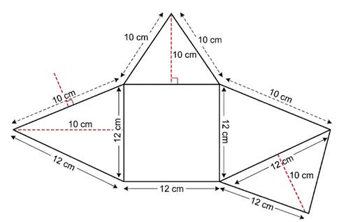

Luas permukaan bangun ruang yang terbentuk dari jaring-jaring tersebut adalah...
 A. 144 cm²
 B. 240 cm²
 C. 384 cm²
 D. 480 cm²
 Pembahasan:

Luas permukaan limas = Luas alas + Luas 4 sisi tegak.

Luas alas (persegi) = $12×12=144c{m}^{2}$

Luas 1 sisi tegak (segitiga) = $\frac{1}{2}×12×10=60c{m}^{2}$

Luas 4 sisi tegak = $4×60=240c{m}^{2}$

Luas total = $144+240=384c{m}^{2}$

Soal 5 (Bentuk Soal: PG)
Level Kognitif: (C5 Mengevaluasi)
Kunci Jawaban: B. Jaring-jaring prisma terdiri dari 2 segitiga siku-siku dan 3 persegi panjang dengan ukuran yang berbeda-beda.
Sebuah prisma segitiga siku-siku memiliki ukuran sisi alas 6 cm, 8 cm, dan 10 cm. Jika tinggi prisma 15 cm, pernyataan yang BENAR mengenai jaring-jaring prisma tersebut adalah...
A. Jaring-jaring prisma terdiri dari 2 segitiga siku-siku dan 3 persegi panjang yang semuanya berukuran sama.
B. Jaring-jaring prisma terdiri dari 2 segitiga siku-siku dan 3 persegi panjang dengan ukuran yang berbeda-beda.
C. Jaring-jaring prisma terdiri dari 1 segitiga siku-siku dan 3 persegi panjang.
D. Jaring-jaring prisma terdiri dari 2 segitiga siku-siku dan 2 persegi panjang.
Pembahasan:
Prisma segitiga siku-siku dengan panjang sisi alas 6, 8, dan 10 cm akan memiliki 3 buah sisi tegak (persegi panjang) yang lebarnya mengikuti panjang sisi alas. Karena sisi alasnya berbeda (6, 8, dan 10), maka ketiga persegi panjang tersebut akan memiliki ukuran yang berbeda-beda (yaitu 6 x 15, 8 x 15, dan 10 x 15).

Soal 6 (Bentuk Soal: PG MCMA)
Level Kognitif: (C4 Menganalisis)
Kunci: Pernyataan 1, Pernyataan 2, dan Pernyataan 4

Perhatikan gambar jaring-jaring limas segitiga di bawah ini!

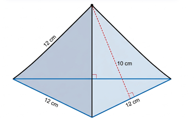

Pilihlah semua pernyataan yang BENAR berdasarkan gambar di atas!
[ ] Pernyataan 1: Jaring-jaring tersebut terdiri dari 4 buah bangun datar.
[ ] Pernyataan 2: Bangun ruang yang terbentuk memiliki 6 buah rusuk.
[ ] Pernyataan 3: Jaring-jaring tersebut memiliki 4 buah titik sudut.
[ ] Pernyataan 4: Bangun ruang tersebut memiliki 5 titik sudut.
Pembahasan:

Pernyataan 1: Benar. Terdiri dari 1 alas segitiga dan 3 sisi tegak segitiga (total 4).

Pernyataan 2: Benar. Limas segitiga memiliki 3 rusuk alas dan 3 rusuk tegak (total 6).

Pernyataan 3: Benar. Limas segitiga hanya memiliki 4 titik sudut

Pernyataan 4: Salah. Limas segitiga memiliki 4 titik sudut (3 di alas + 1 di puncak).

Soal 7 (Bentuk Soal: PG MCMA)
Level Kognitif: (C5 Mengevaluasi)
Kunci: Pernyataan 1, Pernyataan 3, dan Pernyataan 4
Perhatikan gambar jaring-jaring tabung di bawah ini!

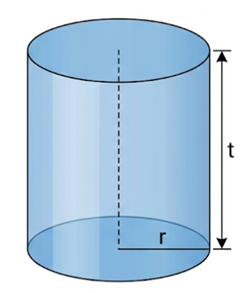

Manakah pernyataan berikut yang sesuai untuk mengevaluasi karakteristik jaring-jaring tabung tersebut? (Pilih 3 jawaban benar)
[ ] Pernyataan 1: Panjang persegi panjang pada jaring-jaring sama dengan keliling lingkaran alas.
[ ] Pernyataan 2: Jaring-jaring tabung hanya terdiri dari 2 bangun datar.
[ ] Pernyataan 3: Lebar persegi panjang pada jaring-jaring mewakili tinggi tabung.
[ ] Pernyataan 4: Luas jaring-jaring dihitung dengan menjumlahkan 2 luas lingkaran dan 1 luas persegi panjang.
Pembahasan:

Pernyataan 1: Benar. Selimut tabung jika dibuka berbentuk persegi panjang dengan panjang = keliling alas.

Pernyataan 2: Salah. Jaring-jaring tabung terdiri dari 3 bangun datar (2 lingkaran dan 1 persegi panjang).

Pernyataan 3: Benar. Lebar persegi panjang tersebut sama dengan tinggi tabung.

Pernyataan 4: Benar. Luas permukaan total adalah jumlah dari seluruh komponen penyusun jaring-jaring.

Soal 8 (Bentuk Soal: PG MCMA)
Level Kognitif: (C4 Menganalisis)
Kunci: Pernyataan 1, Pernyataan 2, dan Pernyataan 4
Sebuah bangun ruang memiliki jaring-jaring yang terdiri dari 1 buah persegi dan 4 buah segitiga sama kaki. Manakah pernyataan yang tepat mengenai bangun ruang tersebut? (Pilih 3 jawaban benar)
[ ] Pernyataan 1: Bangun ruang tersebut adalah limas segi empat.
[ ] Pernyataan 2: Bangun ruang tersebut memiliki 8 buah rusuk.
[ ] Pernyataan 3: Bangun ruang tersebut memiliki 5 sisi tegak.
[ ] Pernyataan 4: Bangun ruang tersebut memiliki 5 titik sudut.
Pembahasan:

Pernyataan 1: Benar. Ciri tersebut adalah limas segi empat.

Pernyataan 2: Benar. Limas segi empat memiliki 4 rusuk alas dan 4 rusuk tegak (total 8).

Pernyataan 3: Salah. Limas segi empat hanya memiliki 4 sisi tegak (berbentuk segitiga).

Pernyataan 4: Benar. Memiliki 4 titik sudut di alas dan 1 titik puncak (total 5).

Soal 9 (Bentuk Soal: PGK Kategori)
Level Kognitif: (C5 Mengevaluasi)
Kunci: A. Benar, B. Benar, C. Salah, D. Benar
Analisislah pernyataan tentang jaring-jaring bangun ruang prisma dan limas berikut ini, kemudian tentukan Benar atau Salah!

<!-- table-009 -->
<table>
<tr><td>Pernyataan</td><td>Benar</td><td>Salah</td></tr>
<tr><td>A. Jaring-jaring prisma segi-n selalu memiliki 2 bangun datar bersisi-n yang kongruen.</td><td>O</td><td>O</td></tr>
<tr><td>B. Jaring-jaring limas segi-n selalu memiliki tepat n buah bangun datar segitiga.</td><td>O</td><td>O</td></tr>
<tr><td>C. Jaring-jaring balok dapat tersusun dari 6 buah persegi yang ukurannya berbeda-beda.</td><td>O</td><td>O</td></tr>
<tr><td>D. Jaring-jaring limas segi empat dapat dibentuk dari 1 persegi dan 4 segitiga siku-siku.</td><td>O</td><td>O</td></tr>
</table>

Pembahasan:

Pernyataan A: Benar. Prisma memiliki alas dan tutup yang kongruen dengan bentuk segi-n.

Pernyataan B: Benar. Limas segi-n memiliki n sisi tegak berbentuk segitiga.

Pernyataan C: Salah. Balok tersusun dari 3 pasang persegi panjang (total 6) yang saling kongruen, bukan 6 persegi dengan ukuran berbeda semua.

Pernyataan D: Benar. Jika titik puncak limas tepat di atas salah satu titik sudut alas, maka sisi tegaknya bisa berbentuk segitiga siku-siku.

Soal 10 (Bentuk Soal: PGK Kategori)
Level Kognitif: (C4 Menganalisis)
Kunci: A. Tabung, B. Kerucut, C. Kerucut, D. Tabung
Perhatikan komponen-komponen bangun datar pembentuk jaring-jaring bangun ruang di bawah ini. Kategorikanlah apakah komponen tersebut merupakan jaring-jaring dari Tabung atau Kerucut!

<!-- table-010 -->
<table>
<tr><td>Pernyataan</td><td>Tabung</td><td>Kerucut</td></tr>
<tr><td>A. Terdiri dari 2 buah lingkaran dan 1 persegi panjang.</td><td>O</td><td>O</td></tr>
<tr><td>B. Terdiri dari 1 buah lingkaran dan 1 juring lingkaran.</td><td>O</td><td>O</td></tr>
<tr><td>C. Panjang busur pada juring sama dengan keliling lingkaran alasnya.</td><td>O</td><td>O</td></tr>
<tr><td>D. Memiliki 3 sisi jika telah menjadi bangun ruang.</td><td>O</td><td>O</td></tr>
</table>

Pembahasan:

A. Tabung. Memiliki 2 lingkaran (alas & tutup) dan 1 selimut persegi panjang.

B. Kerucut. Memiliki 1 lingkaran (alas) dan 1 selimut juring.

C. Kerucut. Ciri khas jaring-jaring kerucut adalah panjang busur = keliling alas.

D. Tabung. Tabung memiliki 3 sisi (alas, tutup, selimut). Kerucut hanya memiliki 2 sisi (alas, selimut).

 

LEVEL 5

Soal 1 (Bentuk Soal: PG)
 Level Kognitif: (C5 Mengevaluasi)
 Kunci Jawaban: C. Jaring-jaring C
 Perhatikan gambar empat jaring-jaring bangun ruang di bawah ini!

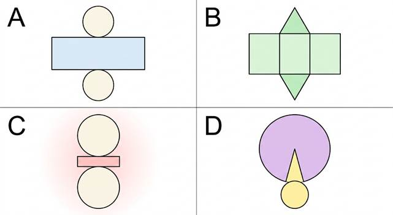

Berdasarkan evaluasi Anda mengenai komponen pembentuk bangun ruang, manakah jaring-jaring yang TIDAK MUNGKIN dapat dilipat menjadi bangun ruang yang sempurna dan tertutup?
 A. Jaring-jaring A
 B. Jaring-jaring B
 C. Jaring-jaring C
 D. Jaring-jaring D
 Pembahasan:

Jaring-jaring C adalah jaring-jaring tabung. Namun, agar dapat menutup sempurna, panjang persegi panjang (selimut) harus sama dengan keliling lingkaran alasnya ($2πr$). Pada gambar C, panjang persegi panjang tidak sama dengan keliling 

Soal 2 (Bentuk Soal: PG)
Level Kognitif: (C5 Mengevaluasi)
Kunci Jawaban: B. Pernyataan tersebut salah, karena luas permukaan totalnya akan berubah.
Seorang siswa membuat klaim: "Jika tinggi sebuah tabung diperbesar menjadi dua kali lipat dan jari-jari alasnya diperkecil menjadi setengahnya, maka luas permukaan total tabung tersebut akan tetap sama."
 Evaluasi terhadap klaim siswa tersebut adalah...
 A. Pernyataan tersebut benar, karena perubahan tinggi dan jari-jari saling meniadakan.
 B. Pernyataan tersebut salah, karena luas permukaan totalnya akan berubah.
 C. Pernyataan tersebut benar, karena luas selimut tabung tetap sama.
 D. Pernyataan tersebut salah, karena luas permukaan totalnya justru menjadi dua kali lipat.
 Pembahasan:

Mari kita uji dengan rumus Luas Permukaan Tabung: $=2π{r}^{2}+2πrt$

Misal $r=4$ dan $t=5$. 

Luas awal $=2π(4{)}^{2}+2π(4)(5)=32π+40π=72π$.

Jika $r$ menjadi $2$ dan $t$ menjadi $10$. 

Luas baru $=2π(2{)}^{2}+2π(2)(10)=8π+40π=48π$.

Meskipun luas selimut ($2πrt$) tetap sama yaitu $40π$, luas alas dan tutupnya berubah. Jadi, klaim tersebut salah.

Soal 3 (Bentuk Soal: PG)
Level Kognitif: (C5 Mengevaluasi)
Kunci Jawaban: A. 5 cm
Perhatikan gambar jaring-jaring kerucut di bawah ini!

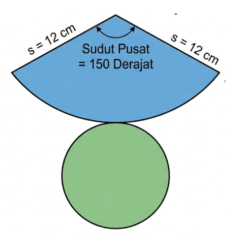

Seorang siswa menyimpulkan bahwa jari-jari lingkaran alas kerucut tersebut adalah 5 cm. Evaluasi kebenaran dari kesimpulan siswa tersebut berdasarkan data pada gambar!

A. Kesimpulan siswa BENAR, karena panjang busur juring sama dengan keliling alas ($2πr=10π$).
 B. Kesimpulan siswa SALAH, karena jari-jari seharusnya 10 cm.
 C. Kesimpulan siswa SALAH, karena sudut pusat tidak digunakan dalam perhitungan.
 D. Kesimpulan siswa BENAR, karena jari-jari alas selalu setengah dari jari-jari juring.
 Pembahasan:

Panjang busur juring: $=\frac{15{0}^{∘}}{36{0}^{∘}}×2πs=\frac{5}{12}×2π(12)=10πcm$

Panjang busur ini sama dengan keliling lingkaran alas kerucut:  $2πr=10π⇒r=5cm$

Jadi, evaluasi yang tepat adalah kesimpulan siswa benar dan perhitungannya sesuai.

Soal 4 (Bentuk Soal: PG)
Level Kognitif: (C5 Mengevaluasi)
Kunci Jawaban: B. 5,5 cm

Sebuah jaring-jaring balok terdiri dari 6 buah persegi panjang. Jika luas total jaring-jaring balok tersebut adalah $412c{m}^{2}$ dan diketahui panjang balok $12cm$ serta lebarnya $8cm$, evaluasilah tinggi balok tersebut!
 A. 4,5 cm
 B. 5,5 cm
 C. 6,5 cm
 D. 7,5 cm
 Pembahasan:

$L=2(pl+pt+lt)$

$412=2((12)(8)+(12)t+(8)t)$

$206=96+20t$

$110=20t$

$t=5,5cm$

Soal 5 (Bentuk Soal: PG)
Level Kognitif: (C5 Mengevaluasi)
Kunci Jawaban: D. (1), (2), dan (4)
Perhatikan gambar jaring-jaring limas segi empat beraturan di bawah ini!

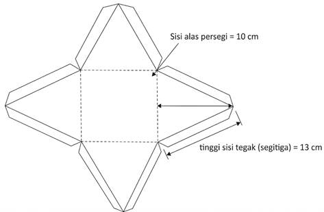

Berdasarkan gambar tersebut, evaluasilah pernyataan-pernyataan berikut!

(1) Luas alas limas adalah $100c{m}^{2}$.

(2) Luas satu sisi tegak adalah $65c{m}^{2}$.

(3) Tinggi limas (jarak titik puncak ke alas) adalah $13cm$.

(4) Luas total jaring-jaring adalah $360c{m}^{2}$.

 Pernyataan yang BENAR adalah...
 A. (1) dan (3)
 B. (2) dan (4)
 C. (1), (2), dan (3)
 D. (1), (2), dan (4)
 Pembahasan:

(1) Luas alas $=s×s=10×10=100 c{m}^{2}$. (Benar)

(2) Luas 1 sisi tegak $=\frac{1}{2}×alas×tinggi segitiga=\frac{1}{2}×10×13=65 c{m}^{2}$. (Benar)

(3) Angka 13 cm pada jaring-jaring adalah tinggi sisi tegak (apotema), bukan tinggi limas. (Salah)

(4) Luas total $=Luasalas+4(Luassisitegak)=100+4(65)=100+260=360c{m}^{2}$. (Benar)

Jadi, pernyataan yang benar adalah (1), (2), dan (4).

Soal 6 (Bentuk Soal: PG MCMA)
Level Kognitif: (C5 Mengevaluasi)
Kunci: Pernyataan 1, Pernyataan 2, dan Pernyataan 4

Sebuah kubus memiliki jaring-jaring yang terdiri dari 6 persegi. Jika panjang rusuk kubus tersebut diperbesar menjadi 3 kali lipat dari ukuran semula, evaluasilah pernyataan-pernyataan berikut terkait perubahan jaring-jaringnya!

[ ] Pernyataan 1: Luas setiap persegi pada jaring-jaring menjadi 9 kali lipat.
[ ] Pernyataan 2: Total luas jaring-jaring menjadi 9 kali lipat.
[ ] Pernyataan 3: Jumlah persegi pada jaring-jaring bertambah menjadi 18 buah.
[ ] Pernyataan 4: Volume kubus yang terbentuk dari jaring-jaring tersebut menjadi 27 kali lipat.
Pembahasan:

Pernyataan 1: Benar. Luas persegi berbanding lurus dengan kuadrat sisi. Jika sisi menjadi $3s$ , luas menjadi $(3s{)}^{2}=9{s}^{2}$ (9 kali lipat).

Pernyataan 2: Benar. Karena setiap persegi menjadi 9 kali lipat, total luas 6 persegi juga menjadi 9 kali lipat.

Pernyataan 3: Salah. Jumlah persegi tetap 6, yang berubah hanya ukurannya.

Pernyataan 4: Benar. Volume kubus adalah ${s}^{3}$. Jika sisi menjadi $3s$, volume menjadi $(3s{)}^{3}=27{s}^{3}$ (27 kali lipat).

 

Soal 7 (Bentuk Soal: PG MCMA)
Level Kognitif: (C5 Mengevaluasi)
Kunci: Pernyataan 1, Pernyataan 3, dan Pernyataan 4

Sebuah tabung tanpa tutup memiliki jari-jari alas $r$ dan tinggi $t$. Jaring-jaring bangun tersebut terdiri dari 1 lingkaran dan 1 persegi panjang. Evaluasilah pernyataan berikut!

[ ] Pernyataan 1: Luas jaring-jaring tabung tanpa tutup dirumuskan dengan $L=π{r}^{2}+2πrt$.

[ ] Pernyataan 2: Jika $t=2r$, maka persegi panjang pada jaring-jaring berbentuk persegi.

[ ] Pernyataan 3: Panjang persegi panjang pada jaring-jaring sama dengan $2πr$.

[ ] Pernyataan 4: Jika jari-jari alas diperbesar dua kali lipat (tinggi tetap), luas persegi panjang pada jaring-jaring menjadi dua kali lipat.
Pembahasan:

Pernyataan 1: Benar. Terdiri dari 1 luas lingkaran ($π{r}^{2}$) dan 1 luas selimut ($2πrt$).

Pernyataan 2: Salah. Panjang persegi panjang adalah $2πr≈6,28r$. Lebarnya adalah $t=2r$. Karena $6,28r≠2r$, maka bukan persegi.

Pernyataan 3: Benar. Panjang persegi panjang mewakili keliling lingkaran ($2πr$).

Pernyataan 4: Benar. Luas selimut $=2πrt$. Jika $r$ menjadi $2r$, maka luas menjadi $2π(2r)t=2(2πrt)$, yaitu dua kali lipat.

Soal 8 (Bentuk Soal: PG MCMA)
Level Kognitif: (C5 Mengevaluasi)
Kunci: Pernyataan 1, Pernyataan 2, dan Pernyataan 3
Perhatikan pernyataan mengenai jaring-jaring limas dan prisma berikut. Evaluasilah kebenaran dari pernyataan-pernyataan di bawah ini!
[ ] Pernyataan 1: Jaring-jaring prisma segitiga selalu terdiri dari 5 bangun datar.
[ ] Pernyataan 2: Jaring-jaring limas segi enam terdiri dari 1 segi enam dan 6 segitiga.
[ ] Pernyataan 3: Jaring-jaring prisma segi lima dapat memiliki 5 persegi panjang yang berbeda ukuran.
[ ] Pernyataan 4: Jaring-jaring limas segi empat tidak mungkin memiliki sisi tegak yang berbentuk segitiga sama sisi.
Pembahasan:

Pernyataan 1: Benar. 2 segitiga (alas & tutup) + 3 persegi panjang (sisi tegak) = 5 bangun datar.

Pernyataan 2: Benar. Limas segi-n memiliki 1 alas segi-n dan n buah sisi tegak segitiga.

Pernyataan 3: Benar. Jika alas prisma segi lima tidak beraturan, maka 5 persegi panjang selimutnya akan memiliki lebar yang berbeda-beda mengikuti panjang sisi alas.

Pernyataan 4: Salah. Jaring-jaring limas segi empat bisa saja tersusun dari 4 segitiga sama sisi jika limas tersebut memiliki sisi tegak yang panjang rusuknya sama dengan sisi alasnya.

Soal 9 (Bentuk Soal: PGK Kategori)
Level Kognitif: (C5 Mengevaluasi)
Kunci: A. Benar, B. Salah, C. Benar, D. Benar
Evaluasilah pernyataan-pernyataan berikut terkait hubungan antara jaring-jaring dengan volume atau luas bangun ruangnya!

A. Luas jaring-jaring sebuah bangun ruang selalu sama dengan luas permukaan bangun ruang tersebut. (Benar / Salah)

B. Jika sebuah jaring-jaring kubus memiliki total luas 150 cm², maka volume kubus tersebut adalah 155 cm³. (Benar / Salah)

C. Jaring-jaring tabung dengan jari-jari r dan tinggi t dapat digunakan untuk menghitung volume tabung dengan rumus V = πr²t. (Benar / Salah)

D. Sebuah jaring-jaring limas segi empat dengan luas alas 64 cm² dan luas 4 sisi tegak masing-masing 40 cm² memiliki luas total 224 cm². (Benar / Salah)

Pembahasan:

Pernyataan A: Benar. Jaring-jaring adalah bangun ruang yang direbahkan, sehingga luas total komponennya sama dengan luas permukaan.

Pernyataan B: Salah. Luas kubus $=6{s}^{2}=150⇒{s}^{2}=25⇒s=5$. Volume $={s}^{3}={5}^{3}=125$.

Pernyataan C: Benar. Dari jaring-jaring kita dapat mengidentifikasi $r$ dan $t$ yang diperlukan untuk menghitung volume.

Pernyataan D: Benar. Luas total $=64+4(40)=64+160=224$ cm\(^2\).

Soal 10 (Bentuk Soal: PGK Kategori)
Level Kognitif: (C5 Mengevaluasi)
Kunci: A. Benar, B. Salah, C. Salah, D. Benar

Seorang siswa mengamati jaring-jaring kerucut yang terdiri dari sebuah lingkaran dengan jari-jari 7 cm dan sebuah juring lingkaran dengan jari-jari 14 cm. Evaluasilah pernyataan berikut!

A. Panjang busur juring lingkaran tersebut adalah 14π cm. (Benar / Salah)

B. Sudut pusat juring lingkaran tersebut adalah 90°. (Benar / Salah)

C. Tinggi kerucut yang terbentuk adalah 14 cm. (Benar / Salah)

D. Luas permukaan kerucut yang terbentuk adalah 147π cm². (Benar / Salah)

Pembahasan:

Pernyataan A: Benar. Panjang busur = keliling alas = 2πr = 2π(7) = 14π cm.

Pernyataan B: Salah. Panjang busur 

= (α / 360°) × 2πs ⇒ 14π 

= (α / 360°) × 2π(14) ⇒ 14π 

= (α / 360°) × 28π ⇒ 1/2 

= (α / 360°) ⇒ α 

= 180°

Pernyataan C: Salah. 

Garis pelukis (s) = 14. Jari-jari (r) = 7. Tinggi kerucut (t) dicari dengan 

Pythagoras:  

t = √(s² - r²) 

= √(14² - 7²) 

= √(196 - 49) 

= √147 = 7√3 cm.

Pernyataan D: Benar. 

Luas permukaan = πr² + πrs = π(7)² + π(7)(14) = 49π + 98π = 147π cm².

INDIKATOR 17. Transformasi tunggal (refleksi, translasi, rotasi, dan dilatasi) terhadap titik, garis, dan bangun datar pada bidang.

LEVEL 1

Soal 1 (Bentuk Soal: PG)
Level Kognitif: (C3 Menerapkan)
Kunci Jawaban: B. (6, 2)
Titik A(2, 3) ditranslasikan oleh T(4, -1). Koordinat bayangan titik A adalah...
A. (6, 4)
B. (6, 2)
C. (-2, 4)
D. (-2, 2)

Pembahasan: 

Rumus translasi: $A(x,y)→A'(x+a,y+b)$

Diketahui:

Titik awal $A(2,3)$

Vektor translasi $T(4,-1)$

Penyelesaian:

$A'(x+a,y+b)=A'(2+4,3+(-1))$

$A'=(6,2)$

Jadi, koordinat bayangan titik A adalah (6, 2).

Soal 2 (Bentuk Soal: PG)
Level Kognitif: (C3 Menerapkan)
Kunci Jawaban: C. (-3, -5)
Titik B(-3, 5) dicerminkan terhadap sumbu X. Koordinat bayangan titik B adalah...
A. (3, 5)
B. (3, -5)
C. (-3, -5)
D. (-5, -3)
Pembahasan:
Refleksi terhadap sumbu X:

$B(x,y)→B'(x,-y)$

$B(-,35)→B'(-,3-5)$.

Soal 3 (Bentuk Soal: PG)
Level Kognitif: (C3 Menerapkan)
Kunci Jawaban: A. (-2, 4)
Titik C(4, 2) dirotasi sebesar 90° berlawanan arah jarum jam terhadap titik pusat (0,0). Koordinat bayangan titik C adalah...
A. (-2, 4)
B. (2, -4)
C. (-4, -2)
D. (4, -2)
Pembahasan:

Diketahui:

Titik awal $C(4,2)$

Rotasi $9{0}^{∘}$ berlawanan arah jarum jam terhadap titik pusat $(0,0)$

Rumus Rotasi:

$(x,y)→(-y,x)$

Penyelesaian:

$C(x,y)→C'(-y,x)$

$C(4,2)→C'(-2,4)$

Jadi, koordinat bayangan titik C adalah (-2, 4).

Soal 4 (Bentuk Soal: PG)
Level Kognitif: (C3 Menerapkan)
Kunci Jawaban: D. (6, -12)
Titik D(2, -4) didilatasi dengan faktor skala 3 terhadap titik pusat (0,0). Koordinat bayangan titik D adalah...
A. (5, -1)
B. (6, -12)
C. (6, -4)
D. (-6, 12)
Pembahasan:

Diketahui: Titik awal $D(2,-4)$, faktor skala $k=3$, dan pusat $(0,0)$.

Rumus: $A(x,y)→A'(kx,ky)$

Penyelesaian: $D(2,-4)→D'(3×2,3×(-4))=D'(6,-12)$

Jadi, koordinat bayangan titik D adalah (6, -12).

Soal 5 (Bentuk Soal: PG)
Level Kognitif: (C3 Menerapkan)
Kunci Jawaban: B. (6, 1)
Titik E(1, 6) dicerminkan terhadap garis y = x. Koordinat bayangan titik E adalah...
A. (1, -6)
B. (6, 1)
C. (-1, -6)
D. (-6, -1)
Pembahasan:

Diketahui: Titik awal $E(1,6)$ dicerminkan terhadap garis $y=x$.

Rumus: $E(x,y)→E'(y,x)$

Penyelesaian: $E(1,6)→E'(6,1)$

Jadi, koordinat bayangan titik E adalah (6, 1).

Soal 6 (Bentuk Soal: PG MCMA)
Level Kognitif: (C3 Menerapkan)
Kunci: Pernyataan 1, Pernyataan 2, dan Pernyataan 3
Diketahui titik P(3, -2). Pilihlah semua pernyataan yang benar terkait koordinat bayangan titik P!
[  ] Pernyataan 1: Bayangan P jika ditranslasi oleh T(-1, 4) adalah (2, 2).
[  ] Pernyataan 2: Bayangan P jika dicerminkan terhadap sumbu Y adalah (-3, -2).
[  ] Pernyataan 3: Bayangan P jika dicerminkan terhadap sumbu X adalah (3, 2).
[  ] Pernyataan 4: Bayangan P jika dirotasi 180° terhadap titik pusat (0,0) adalah (-3, -2).
Pembahasan:

Diketahui: Titik awal $P(3,-2)$.

Pernyataan 1: Benar.

Translasi: $P(3,-2)→P'(3+(-1),-2+4)=P'(2,2)$.

Pernyataan 2: Benar.

Refleksi sumbu Y: $P(x,y)→P'(-x,y)=P'(-3,-2)$.

Pernyataan 3: Benar.

Refleksi sumbu X: $P(x,y)→P'(x,-y)=P'(3,2)$.

Pernyataan 4: Salah.

Rotasi 180$∘$: $P(x,y)→P'(-x,-y)=P'(-3,2)$. (Bukan (-3, -2)).

Soal 7 (Bentuk Soal: PG MCMA)
Level Kognitif: (C3 Menerapkan)
Kunci: Pernyataan 1, Pernyataan 2, dan Pernyataan 3
Titik Q(-2, 4). Pilihlah semua pernyataan yang benar!
[  ] Pernyataan 1: Bayangan Q oleh dilatasi dengan faktor skala 2 terhadap pusat (0,0) adalah (-4, 8).
[  ] Pernyataan 2: Bayangan Q oleh rotasi 90° searah jarum jam terhadap pusat (0,0) adalah (4, 2).
[  ] Pernyataan 3: Bayangan Q oleh rotasi 180° terhadap pusat (0,0) adalah (2, -4).
[  ] Pernyataan 4: Bayangan Q oleh dilatasi dengan faktor skala -1 terhadap pusat (0,0) adalah (2, 4).
 Pembahasan:

Diketahui: Titik awal $Q(-2,4)$.

Pernyataan 1: Benar.

Dilatasi skala 2: $Q(-2,4)→Q'(2×(-2),2×4)=Q'(-4,8)$.

Pernyataan 2: Benar.

Rotasi $9{0}^{∘}$  searah jarum jam: $Q(x,y)→Q'(y,-x)=Q'(4,2)$.

Pernyataan 3: Benar.

Rotasi $9{0}^{∘}$: $Q(x,y)→Q'(-x,-y)=Q'(2,-4)$.

Pernyataan 4: Salah.

Dilatasi skala -1: $Q(x,y)→Q'(-x,-y)=Q'(2,-4)$. (Bukan (2, 4)).

Soal 8 (Bentuk Soal: PG MCMA)
Level Kognitif: (C3 Menerapkan)
Kunci: Pernyataan 1, Pernyataan 3, dan Pernyataan 4
Pilihlah semua pernyataan yang benar mengenai sifat-sifat bayangan hasil transformasi geometri!
[ ] Pernyataan 1: Translasi mempertahankan bentuk dan ukuran bangun (kongruen).
[ ] Pernyataan 2: Refleksi mengubah ukuran bangun menjadi lebih besar atau lebih kecil.
[ ]  Pernyataan 3: Rotasi mempertahankan bentuk dan ukuran bangun (kongruen).
[ ] Pernyataan 4: Dilatasi mengubah ukuran bangun tetapi mempertahankan bentuknya (kesebangunan).
 Pembahasan:

Pernyataan 1: Benar. Translasi hanya menggeser posisi tanpa mengubah bentuk/ukuran.

Pernyataan 2: Salah. Refleksi (pencerminan) mempertahankan bentuk dan ukuran (kongruen).

Pernyataan 3: Benar. Rotasi (perputaran) mempertahankan bentuk dan ukuran (kongruen).

Pernyataan 4: Benar. Dilatasi mengubah ukuran (memperbesar/memperkecil) tetapi bentuknya tetap sama (kesebangunan).

Revisi Soal 8 (Bentuk Soal: PG MCMA)
Level Kognitif: (C3 Menerapkan)
Kunci: Pernyataan 1, Pernyataan 3, dan Pernyataan 4

Pertanyaan:
 Diketahui faktor skala $k≠1$ dan $k≠0$. Pilihlah semua pernyataan yang benar mengenai sifat-sifat bayangan hasil transformasi geometri!

[ ] Pernyataan 1: Translasi mempertahankan bentuk dan ukuran bangun (kongruen).
[ ] Pernyataan 2: Refleksi mengubah ukuran bangun menjadi lebih besar atau lebih kecil.
[ ] Pernyataan 3: Rotasi mempertahankan bentuk dan ukuran bangun (kongruen).
[ ] Pernyataan 4: Dilatasi dengan faktor skala$ k$ di mana $|k|≠1$ mengubah ukuran bangun tetapi mempertahankan bentuknya (kesebangunan).

Pembahasan:

Pernyataan 1: Benar. Translasi hanya menggeser posisi tanpa mengubah bentuk/ukuran.

Pernyataan 2: Salah. Refleksi (pencerminan) mempertahankan bentuk dan ukuran (kongruen).

Pernyataan 3: Benar. Rotasi (perputaran) mempertahankan bentuk dan ukuran (kongruen).

Pernyataan 4: Benar. Dilatasi dengan $|k|≠1$ mengubah ukuran (memperbesar / memperkecil) tetapi bentuknya tetap sama (kesebangunan).

Soal 9 (Bentuk Soal: PGK Kategori)
 Level Kognitif: (C3 Menerapkan)
 Kunci: A. Benar, B. Benar, C. Salah
Titik A(5, -3). Tentukan Benar atau Salah untuk setiap pernyataan berikut terkait koordinat bayangannya!

<!-- table-011 -->
<table>
<tr><td></td><td>Pernyataan</td><td>Benar</td><td>Salah</td></tr>
<tr><td>A.</td><td>Bayangan A oleh translasi T(-2, 1) adalah (3, -2).</td><td>O</td><td>O</td></tr>
<tr><td>B.</td><td>Bayangan A oleh refleksi terhadap sumbu X adalah (5, 3).</td><td>O</td><td>O</td></tr>
<tr><td>C.</td><td>Bayangan A oleh refleksi terhadap garis y  = -x adalah (3, 5).</td><td>O</td><td>O</td></tr>
</table>

Pembahasan:

Pernyataan A: Benar. $A(5,-3)→A'(5,-2-3+1)=A'(3,-2)$. (Translasi T(-, 21))

Pernyataan B: Benar. Refleksi sumbu X: $A(x,y)→A'(x,-y)=A'(5,3)$.

Pernyataan C: Salah. Refleksi garis $y=-x$ : $A(x,y)→A'(-,y-x)=A'(3,-5)$. (Bukan (3, 5)).

Soal 10 (Bentuk Soal: PGK Kategori)
Level Kognitif: (C3 Menerapkan)
Kunci:  A. Benar,  B. Benar,  C. Salah
Titik B(-4, 6). Tentukan Benar atau Salah untuk setiap pernyataan berikut!

<!-- table-012 -->
<table>
<tr><td></td><td>Pernyataan</td><td>Benar</td><td>Salah</td></tr>
<tr><td>A.</td><td>Bayangan B oleh rotasi 90° berlawanan arah jarum jam terhadap pusat (0,0) adalah (-6, -4).</td><td>O</td><td>O</td></tr>
<tr><td>B.</td><td>Bayangan B oleh dilatasi dengan faktor skala $\frac{1}{2}$terhadap pusat (0,0) adalah (-2, 3).</td><td>O</td><td>O</td></tr>
<tr><td>C.</td><td>Bayangan B oleh rotasi 90° searah jarum jam terhadap pusat (0,0) adalah (-6, 4).</td><td>O</td><td>O</td></tr>
</table>

Pembahasan:

Pernyataan A: Benar. Rotasi 90° berlawanan arah jarum jam: $B(x,y)→B'(-,yx)=B'(-,6-4)$.

Pernyataan B: Benar. Dilatasi faktor skala $\frac{1}{2}$ : $B(x,y)→B'\left(\frac{1}{2},x\frac{1}{2}y\right)=B'(-,23)$.

Pernyataan C: Salah. Rotasi 90

 searah jarum jam: $B(x,y)→B'(y,-x)=B'(6,4)$. (Bukan (-6, 4)).

LEVEL 2

Soal 1 (Bentuk Soal: PG)
Level Kognitif: (C3 Menerapkan)
Kunci Jawaban: A. (1, 3)
Titik A(4, -2) ditranslasikan oleh T(-3, 5). Koordinat bayangan titik A adalah...
A. (1, 3)
B. (1, -7)
C. (7, 3)
D. (-1, -3)
Pembahasan:
Diketahui: Titik awal $A(4,-2)$ ditranslasikan oleh $T(-3,5)$.

Rumus Translasi: $A(x,y)→A'(x+a,y+b)$

Penyelesaian: $A(4,-2)→A'(4+(-3),-2+5)=A'(1,3)$

Jadi, koordinat bayangan titik A adalah (1, 3).

 

Soal 2 (Bentuk Soal: PG)
Level Kognitif: (C3 Menerapkan)
Kunci Jawaban: C. (-3, 5)
Titik B(-5, 3) dicerminkan terhadap garis y = -x . Koordinat bayangan titik B adalah...
A. (5, -3)
B. (-5, -3)
C. (-3, 5)
D. (3, -5)
Pembahasan:.

Refleksi terhadap garis $y=-x$ : $B(x,y)→B'(-,y-x)$.

$B(-,53)→B'(-,35)$.

 

Soal 3 (Bentuk Soal: PG)
Level Kognitif: (C3 Menerapkan)
Kunci Jawaban: B. (-3, -2)
Titik C(2, -3) dirotasi sebesar 90° searah jarum jam terhadap titik pusat (0,0). Koordinat bayangan titik C adalah...
A. (3, 2)
B. (-3, -2)
C. (-2, 3)
D. (2, 3)
Pembahasan:
Rotasi 90 derajat searah jarum jam terhadap (0,0):

$C(x,y)→C'(y,-x)$

$C(2,-3)→C'(-,3-2)$

 

Soal 4 (Bentuk Soal: PG)
Level Kognitif: (C3 Menerapkan)
Kunci Jawaban: D. (6, -12)
Titik D(-3, 6) didilatasi dengan faktor skala -2 terhadap titik pusat (0,0). Koordinat bayangan titik D adalah...
A. (-6, 12)
B. (6, 12)
C. (-6, -12)
D. (6, -12)
Pembahasan:

Diketahui: Titik awal $D(-3,6)$, faktor skala $k=-2$, dan pusat $(0,0)$.

Rumus: $D(x,y)→D'(kx,ky)$

Penyelesaian: $D(-3,6)→D'((-2)×(-3),(-2)×6)=D'(6,-12)$

Jadi, koordinat bayangan titik D adalah (6, -12).

 

Soal 5 (Bentuk Soal: PG)
Level Kognitif: (C3 Menerapkan)
Kunci Jawaban: B. (1, 1)
Titik E(-1, 4) ditranslasikan berturut-turut oleh ${T}_{1}(3,2)$ dan ${T}_{2}(-,1-5)$. Koordinat bayangan akhir titik E adalah...
A. (1, -1)
B. (1, 1)
C. (3, 1)
D. (3, -1)
Pembahasan:

Translasi berturut-turut dapat dijumlahkan: ${T}_{total}={T}_{1}+{T}_{2}=(3,+(-1)2+(-5))=(2,-3)$.

$E(-,14)→E'(-,1+24+(-3))=E'(1,1)$. (Translasi T(2, -3))

Soal 6 (Bentuk Soal: PG MCMA)
Level Kognitif: (C3 Menerapkan)
Kunci: Pernyataan 1, Pernyataan 2, dan Pernyataan 4

Diketahui titik A(2, 3). Pilihlah semua pernyataan yang benar terkait koordinat bayangan titik A!

[  ] Pernyataan 1: Bayangan A oleh translasi T(3, -1) adalah (5, 2).
[  ] Pernyataan 2: Bayangan A oleh refleksi terhadap sumbu Y adalah (-2, 3).
[  ] Pernyataan 3: Bayangan A oleh rotasi 180° terhadap titik pusat (0,0) adalah (2, -3).
[  ] Pernyataan 4: Bayangan A oleh dilatasi dengan faktor skala 2 terhadap titik pusat (0,0) adalah (4, 6).

Pembahasan:
Diketahui titik A(2, 3).

Pernyataan 1: Benar.
 Translasi T(3, -1):
 $A'(x,+ay+b)=(2,+33+(-1))=(5,2)$.

Pernyataan 2: Benar.
 Refleksi terhadap sumbu Y:
 $A'(-,xy)=(-,23)$.

Pernyataan 3: Salah.
 Rotasi 180° terhadap titik pusat (0,0):
 $A'(-,x-y)=(-,2-3)$. Jadi, seharusnya (-2, -3), bukan (2, -3).

Pernyataan 4: Benar.
 Dilatasi dengan faktor skala 2 terhadap titik pusat (0,0):
 $A'(k,xky)=(2,×22×3)=(4,6)$.

Soal 7 (Bentuk Soal: PG MCMA)
Level Kognitif: (C4 Menganalisis)
Kunci: Pernyataan 1, Pernyataan 2, dan Pernyataan 4
Diketahui segitiga ABC memiliki luas 20 cm². Pilihlah semua pernyataan yang benar jika segitiga tersebut ditransformasikan!
[  ] Pernyataan 1: Jika ditranslasi, luas segitiga tetap 20 cm².
[  ] Pernyataan 2: Jika direfleksi, luas segitiga tetap 20 cm².
[  ] Pernyataan 3: Jika didilatasi dengan faktor skala 3, luas segitiga menjadi 60 cm².
[  ] Pernyataan 4: Jika dirotasi 90°, luas segitiga tetap 20 cm².
Pembahasan:

Pernyataan 1: Benar. Translasi mempertahankan bentuk dan ukuran (kongruen).

Pernyataan 2: Benar. Refleksi mempertahankan bentuk dan ukuran (kongruen).

Pernyataan 3: Salah. Dilatasi dengan faktor skala k mengubah luas menjadi k²kali lipat. Maka luasnya menjadi 3² x 20 = 180 cm².

Pernyataan 4: Benar. Rotasi mempertahankan bentuk dan ukuran (kongruen).

Soal 8 (Bentuk Soal: PG MCMA)
Level Kognitif: (C4 Menganalisis)
Kunci: Pernyataan 1, Pernyataan 3, dan Pernyataan 4
Titik B(x, y) ditranslasi oleh T(-3, 2) menghasilkan bayangan B'(-1, 5).
Pilihlah semua pernyataan yang benar!.
[  ] Pernyataan 1: Nilai  x + y = 5
[  ] Pernyataan 2: Titik B terletak di kuadran II.
[  ] Pernyataan 3: Bayangan B oleh refleksi terhadap sumbu X adalah (2, -3).
[  ] Pernyataan 4: Bayangan B oleh rotasi 180° terhadap titik pusat (0,0) adalah (-2, -3).
Pembahasan:

Mencari titik B: $x+(-3)=-1⇒x=2$ \quad $y+2=5⇒y=3$. Jadi B(2, 3).

Pernyataan 1: Benar. $x+y=2+3=5$.

Pernyataan 2: Salah. Titik B(2, 3) terletak di Kuadran I, bukan Kuadran II.

Pernyataan 3: Benar. Refleksi sumbu X: $B(2,3)→B'(2,-3)$.

Pernyataan 4: Benar. Rotasi $18{0}^{∘}$: $B(2,3)→B'(-,2-3)$.

Soal 9 (Bentuk Soal: PGK Kategori)
Level Kognitif: (C4 Menganalisis)
Kunci: A. Benar,  B. Benar, C. Salah
Titik A(-2, 5) ditransformasikan. Tentukan Benar atau Salah untuk setiap pernyataan berikut!

<!-- table-013 -->
<table>
<tr><td></td><td>Pernyataan</td><td>Benar</td><td>Salah</td></tr>
<tr><td>A.</td><td>Bayangan A oleh translasi T(3, -1) adalah (1, 4).</td><td>O</td><td>O</td></tr>
<tr><td>B.</td><td>Bayangan A oleh refleksi terhadap garis 
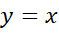
adalah (5, -2).</td><td>O</td><td>O</td></tr>
<tr><td>C.</td><td>Bayangan A oleh dilatasi dengan faktor skala -1 terhadap pusat (0,0) adalah (-2, 5).</td><td>O</td><td>O</td></tr>
</table>

Pembahasan:

Pernyataan A: Benar. $A(-,25)→A'(-,2+35+(-1))=A'(1,4)$. (Translasi T(3,-1))

Pernyataan B: Benar. Refleksi garis $y=x$ : $A(x,y)→A'(y,x)=A'(5,-2)$.

Pernyataan C: Salah. Dilatasi skala -1: $A(x,y)→A'(-,x-y)=A'(2,-5)$. (Bukan (-2, 5)).

Soal 10 (Bentuk Soal: PGK Kategori)
Level Kognitif: (C4 Menganalisis)
Kunci: A. Benar, B. Benar, C. Salah
Perhatikan sifat-sifat transformasi geometri berikut. Tentukan Benar atau Salah untuk setiap pernyataan!

<!-- table-014 -->
<table>
<tr><td></td><td>Pernyataan</td><td>Benar</td><td>Salah</td></tr>
<tr><td>A.</td><td>Translasi dan rotasi merupakan transformasi yang mempertahankan kekongruenan bangun.</td><td>O</td><td>O</td></tr>
<tr><td>B.</td><td>Dilatasi mengubah ukuran bangun tetapi tidak mengubah bentuknya.</td><td>O</td><td>O</td></tr>
<tr><td>C.</td><td>Refleksi terhadap sumbu X mengubah ukuran bangun menjadi 2 kali lipat.</td><td>O</td><td>O</td></tr>
</table>

Pembahasan:

Pernyataan A: Benar. Translasi dan rotasi mempertahankan bentuk dan ukuran (kongruen).

Pernyataan B: Benar. Dilatasi menghasilkan bayangan yang sebangun (bentuk sama, ukuran berbeda).

Pernyataan C: Salah. Refleksi mempertahankan bentuk dan ukuran (kongruen), tidak mengubah ukuran menjadi 2 kali lipat.

 

Soal 10 (Hasil Revisi) Bentuk Soal: PGK (Benar/Salah)
Level Kognitif: (C4 Menganalisis)
Kunci: A. Benar, B. Benar, C. Salah

Pertanyaan:
Diketahui faktor skala $k≠1$ dan $k≠0$. Perhatikan sifat-sifat transformasi geometri berikut. Tentukan Benar atau Salah untuk setiap pernyataan!

<!-- table-015 -->
<table>
<tr><td>Pernyataan</td><td>Benar</td><td>Salah</td></tr>
<tr><td>A. Translasi dan rotasi merupakan transformasi yang mempertahankan kekongruenan bangun.</td><td>O</td><td>O</td></tr>
<tr><td>B. Dilatasi dengan faktor skala $ k$ di mana $|k|≠1$ mengubah ukuran bangun tetapi tidak mengubah bentuknya.</td><td>O</td><td>O</td></tr>
<tr><td>C. Refleksi terhadap sumbu X mengubah ukuran bangun menjadi 2 kali lipat.</td><td>O</td><td>O</td></tr>
</table>

Pernyataan A: Benar. Translasi dan rotasi mempertahankan bentuk dan ukuran (kongruen).

Pernyataan B: Benar. Dilatasi dengan $|k|≠1$ menghasilkan bayangan yang sebangun (bentuk sama, ukuran berbeda).

Pernyataan C: Salah. Refleksi mempertahankan bentuk dan ukuran (kongruen), tidak mengubah ukuran menjadi 2 kali lipat.

LEVEL 3

Soal 1 (Bentuk Soal: PG)
Level Kognitif: (C4 Menganalisis)
Kunci Jawaban: C. (10, 4)
Titik A(2, 3) ditranslasikan oleh T(3, -1), kemudian dilanjutkan dengan dilatasi terhadap titik pusat (0,0) dengan faktor skala 2. Koordinat bayangan akhir titik A adalah...
A. (5, 2)
B. (10, 2)
C. (10, 4)
D. (5, 4)
Pembahasan:

Diketahui: Titik awal $A(2,3)$, Translasi $T(3,-1)$, dan Dilatasi skala 2 terhadap pusat $(0,0)$.

Langkah 1: Translasi

$A(2,3)→A'(2+3,3+(-1))=A'(5,2)$

Langkah 2: Dilatasi

$A'(5,2)→A''(2×5,2×2)=A''(10,4)$

Jadi, koordinat bayangan akhir titik A adalah (10, 4).

Soal 2 (Bentuk Soal: PG)
Level Kognitif: (C4 Menganalisis)
Kunci Jawaban: B. Rotasi 180° terhadap titik pusat (0,0)
Titik B(x, y) direfleksikan terhadap sumbu X, kemudian direfleksikan lagi terhadap sumbu Y. Analisis transformasi tunggal yang ekuivalen dengan komposisi transformasi tersebut adalah...

A. Refleksi terhadap garis $y=x$

B. Rotasi $18{0}^{∘}$ terhadap titik pusat $(0,0)$

C. Refleksi terhadap garis $y=-x$

D. Rotasi $9{0}^{∘}$ terhadap titik pusat $(0,0)$
Pembahasan:

Refleksi sumbu X: $B(x,y)→B'(x,-y)$

Refleksi sumbu Y: $B'(x,-y)→B''(-,x-y)$

Hasil akhir $(-,x-y)$ sama dengan rotasi $18{0}^{∘}$ terhadap titik pusat $(0,0)$.

Soal 3 (Bentuk Soal: PG)
Level Kognitif: (C4 Menganalisis)
Kunci Jawaban: A. 90° berlawanan arah jarum jam
Titik C(2, 1) memiliki bayangan C'(-1, 2) setelah dirotasi terhadap titik pusat (0,0). Analisis sudut dan arah rotasi yang tepat untuk transformasi tersebut adalah...
A. 90° berlawanan arah jarum jam
B. 90° searah jarum jam
C. 180° berlawanan arah jarum jam
D. 270° berlawanan arah jarum jam
Pembahasan:

Rumus rotasi $9{0}^{∘}$ berlawanan arah jarum jam: $C(x,y)→C'(-,yx)$.

$C(2,1)→C'(-,12)$. (Sesuai).

Soal 4 (Bentuk Soal: PG)

Level Kognitif: (C4 Menganalisis)

Kunci Jawaban: D. 135 cm²

Sebuah segitiga memiliki luas 15 cm². Segitiga tersebut didilatasi terhadap titik pusat (0,0) dengan faktor skala 3. Analisis luas bayangan segitiga tersebut adalah...

A. 45 cm²

B. 60 cm²

C. 90 cm²

D. 135 cm²

Pembahasan:

Pada dilatasi dengan faktor skala $k$, luas bayangan menjadi ${k}^{2}$ kali luas awal.

Luas bayangan = ${3}^{2}×15=9×15=135c{m}^{2}$.

Soal 5 (Bentuk Soal: PG)
Level Kognitif: (C4 Menganalisis)
Kunci Jawaban: B. (1, -1)
Titik P(4, -2) dicerminkan terhadap garis $y=-x$, kemudian ditranslasikan oleh T(-1, 3). Koordinat bayangan akhir titik P adalah...
A. (1, 1)
B. (1, -1)
C. (3, -1)
D. (3, 1)
Pembahasan:

Refleksi $y=-x$: $P(4,-2)→P'(-,(-2)-(4))=P'(2,-4)$

Translasi T(-1, 3): $P'(2,-4)→P''(2,+(-1)-4+3)=P''(1,-1)$.

Soal 6 (Bentuk Soal: PG MCMA)
Level Kognitif: (C4 Menganalisis)
Kunci: Pernyataan 1, Pernyataan 3, dan Pernyataan 4
Diketahui titik A(3, -4). Pilihlah semua pernyataan yang benar terkait analisis koordinat bayangan titik A!
[  ] Pernyataan 1: Bayangan A oleh refleksi terhadap sumbu Y adalah (-3, -4).
[  ] Pernyataan 2: Bayangan A oleh rotasi 180° terhadap titik pusat (0,0) adalah (3, 4).
[  ] Pernyataan 3: Bayangan A oleh translasi T(2, 5) adalah (5, 1).
[  ] Pernyataan 4: Bayangan A oleh dilatasi dengan faktor skala -2 terhadap titik pusat (0,0) adalah (-6, 8).
Pembahasan:

Pernyataan 1: Benar. Refleksi sumbu Y: $A(x,y)→A'(-,xy)=A'(-,3-4)$.

Pernyataan 2: Salah. Rotasi $18{0}^{∘}$: $A(x,y)→A'(-,x-y)=A'(-,34)$. (Bukan (3,4)).

Pernyataan 3: Benar. Translasi T(2,5): $A(3,-4)→A'(3,+2-4+5)=A'(5,1)$.

Pernyataan 4: Benar. Dilatasi skala -2: $A(x,y)→A'(-,2x-2y)=A'(-,68)$.

Soal 7 (Bentuk Soal: PG MCMA)
Level Kognitif: (C4 Menganalisis)
Kunci: Pernyataan 1, Pernyataan 2, dan Pernyataan 3
Sebuah segitiga ABC dengan luas 24 cm² ditransformasikan. Pilihlah semua pernyataan yang benar terkait analisis sifat bayangan segitiga tersebut!
[  ] Pernyataan 1: Jika ditranslasi, luas segitiga tetap 24 cm² dan bangunnya kongruen.
[ ] Pernyataan 2: Jika direfleksi terhadap sumbu X, luas segitiga tetap 24 cm² dan bangunnya kongruen.
[  ] Pernyataan 3: Jika didilatasi dengan faktor skala 0,5, luas segitiga menjadi 6 cm² dan bangunnya sebangun.
[  ] Pernyataan 4: Jika dirotasi 90°, luas segitiga menjadi 24 cm² dan bangunnya sebangun.
Pembahasan:

Pernyataan 1: Benar. Translasi mempertahankan bentuk dan ukuran (kongruen).

Pernyataan 2: Benar. Refleksi mempertahankan bentuk dan ukuran (kongruen).

Pernyataan 3: Benar. Dilatasi skala 0,5: Luas menjadi $(0,5{)}^{2}×24=0,25×24=6c{m}^{2}$.

Bangunnya sebangun.

Pernyataan 4: Salah. Rotasi mempertahankan bentuk dan ukuran (kongruen), bukan sebangun. Luas tetap $24c{m}^{2}$, tapi sifatnya kongruen.

Soal 8 (Bentuk Soal: PG MCMA)
Level Kognitif: (C4 Menganalisis)
Kunci: Pernyataan 1, Pernyataan 2, dan Pernyataan 4
Titik B(-2, 5) ditransformasikan. Pilihlah semua pernyataan yang benar!

[ ] Pernyataan 1: Bayangan B oleh refleksi terhadap garis $y=x$ adalah $(5,-2)$.

[ ] Pernyataan 2: Bayangan B oleh refleksi terhadap garis $y=-x$ adalah $(-5,2)$.

[ ] Pernyataan 3: Bayangan B oleh rotasi $9{0}^{∘}$ searah jarum jam terhadap pusat $(0,0)$ adalah $(-5,-2)$.

[ ] Pernyataan 4: Bayangan B oleh rotasi $9{0}^{∘}$ berlawanan arah jarum jam terhadap pusat $(0,0)$ adalah $(-5,-2)$.

Pembahasan:

Pernyataan 1: Benar. Refleksi $y=x$ : $B(x,y)→B'(y,x)=B'(5,-2)$.

Pernyataan 2: Benar. Refleksi $y=-x$ : $B(x,y)→B'(-,y-x)=B'(-,52)$.

Pernyataan 3: Salah. Rotasi $9{0}^{∘}$ searah jarum jam: $B(x,y)→B'(y,-x)=B'(5,2)$. (Bukan (-5,-2)).

Pernyataan 4: Benar. Rotasi $9{0}^{∘}$ berlawanan arah jarum jam: $B(x,y)→B'(-,yx)=B'(-,5-2)$

Soal 9 (Bentuk Soal: PGK Kategori)
Level Kognitif: (C4 Menganalisis)
Kunci: A. Benar, B. Benar, C. Salah
Titik C(3, -2) ditransformasikan. Tentukan Benar atau Salah untuk setiap pernyataan berikut!

<!-- table-016 -->
<table>
<tr><td></td><td>Pernyataan</td><td>Benar</td><td>Salah</td></tr>
<tr><td>A.</td><td>Bayangan C oleh translasi T(-1, 4) adalah (2, 2).</td><td>O</td><td>O</td></tr>
<tr><td>B.</td><td>Bayangan C oleh refleksi terhadap sumbu X adalah (3, 2).</td><td>O</td><td>O</td></tr>
<tr><td>C.</td><td>Bayangan C oleh dilatasi dengan faktor skala -2 terhadap titik pusat (0,0) adalah (-6, -4).</td><td>O</td><td>O</td></tr>
</table>

Pembahasan:

Pernyataan A: Benar. $C(3,-2)→C'(3,-1-2+4)=C'(2,2)$. (Translasi T(-,14))

Pernyataan B: Benar. Refleksi sumbu X: $C(x,y)→C'(x,-y)=C'(3,2)$.

Pernyataan C: Salah. Dilatasi skala -2: $C(x,y)→C'(-,2x-2y)=C'(-,64)$. (Bukan (-6, -4)).

Soal 10 (Bentuk Soal: PGK Kategori)
Level Kognitif: (C4 Menganalisis)
Kunci: A. Benar, B. Salah, C. Benar
Perhatikan pernyataan-pernyataan berikut terkait analisis sifat-sifat transformasi geometri!
Tentukan Benar atau Salah untuk setiap pernyataan!

<!-- table-017 -->
<table>
<tr><td></td><td>Pernyataan</td><td>Benar</td><td>Salah</td></tr>
<tr><td>A.</td><td>Translasi dan rotasi menghasilkan bayangan yang kongruen dengan bangun asalnya.</td><td>O</td><td>O</td></tr>
<tr><td>B.</td><td>Dilatasi dengan faktor skala 3 mengubah luas bangun menjadi 3 kali lipat.</td><td>O</td><td>O</td></tr>
<tr><td>C.</td><td>Refleksi terhadap garis y = x menukar posisi koordinat x dan y pada bayangannya.</td><td>O</td><td>O</td></tr>
</table>

Pembahasan:

Pernyataan A: Benar. Translasi dan rotasi mempertahankan bentuk dan ukuran (kongruen).

Pernyataan B: Salah. Dilatasi dengan faktor skala $k$ mengubah luas menjadi ${k}^{2}$ kali lipat. Jika skala 3, luas menjadi ${3}^{2}=9$ kali lipat.

Pernyataan C: Benar. Refleksi $y=x$ : $A(x,y)→A'(y,x)$.

LEVEL 4

Soal 1

(Bentuk Soal: PG)

Level Kognitif: (C4 Menganalisis)

Kunci Jawaban: C. (4, 3)

Titik $P(-3,4)$ dirotasi sebesar $9{0}^{∘}$ searah jarum jam terhadap titik pusat $O(0,0)$. Koordinat bayangan titik $P$ adalah...

A. $(4,-3)$

B. $(3,4)$

C. $(4,3)$

D. $(-4,3)$

Pembahasan:

Rotasi 90° searah jarum jam terhadap pusat (0, 0): (x, y) → (y, -x)

Maka:  P(-3, 4) → P'(4, 3)

Jadi, koordinat bayangan titik P adalah (4, 3).

Soal 2

(Bentuk Soal: PG)

Level Kognitif: (C4 Menganalisis)

Kunci Jawaban: A. $2x+3y=2$

Garis $2x+3y=6$ ditranslasikan oleh $T(1,-2)$. Persamaan bayangan garis tersebut adalah...

A. $2x+3y=2$

B. $2x+3y=10$

C. $2x+3y=4$

D. $2x-3y=2$

Pembahasan:

Translasi $T(1,-2)$:

$x'=x+1⇒x=x'-1$

$y'=y-2⇒y=y'+2$

Substitusi ke persamaan garis:

$2(x'-1)+3(y'+2)=6$

$2x'-2+3y'+6=6$

$2x'+3y'+4=6$

$2x'+3y'=2$

Jadi, persamaan bayangannya adalah $2x+3y=2$.

Soal 3

(Bentuk Soal: PG)

Level Kognitif: (C4 Menganalisis)

Kunci Jawaban: C. 96 cm²

Sebuah persegi panjang berukuran 6 cm × 4 cm didilatasi terhadap titik pusat (0, 0) dengan faktor skala -2. Luas bayangan persegi panjang tersebut adalah...

A. 24 cm²

B. 48 cm²

C. 96 cm²

D. 192 cm²

Pembahasan:

Luas awal: L = 6 × 4 = 24 cm²

Pada dilatasi dengan faktor skala k, luas bayangan menjadi: L' = k² × L

Karena k = -2, maka:

L' = (-2)² × 24 = 4 × 24 = 96 cm²

Jadi, luas bayangannya adalah 96 cm².

Soal 4 

(Bentuk Soal: PG)

Level Kognitif: (C5 Mengevaluasi)

Kunci Jawaban: C. 1

Titik A(a, b) dicerminkan terhadap garis y = x dan menghasilkan bayangan A'(4, -3). Nilai a + b adalah...

A. -7

B. -1

C. 1

D. 7

Pembahasan:

Refleksi terhadap garis y = x: (x, y) → (y, x)

Maka:  A(a, b) → A'(b, a)

Diketahui A'(4, -3), sehingga:  b = 4,    a = -3

Nilai:   a + b = -3 + 4 = 1

Jadi, nilai a + b = 1.

Soal 5 

(Bentuk Soal: PG)

Level Kognitif: (C5 Mengevaluasi)

Kunci Jawaban: A. (-6, 10)

Translasi T(a, b) memetakan titik P(2, -5) ke titik P'(-3, 1). Jika titik Q(-1, 4) ditranslasikan oleh T, koordinat bayangan titik Q adalah...

A. (-6, 10)

B. (-4, 9)

C. (4, -1)

D. (-6, -2)

Pembahasan:

Diketahui:  P(2, -5) → P'(-3, 1)

Maka:

a = -3 - 2 = -5

b = 1 - (-5) = 6

Jadi, T(-5, 6).

Bayangan titik Q(-1, 4): Q' = (-1 + (-5), 4 + 6) = (-6, 10)

Jadi, koordinat bayangan titik Q adalah (-6, 10).

Soal 6 

(Bentuk Soal: PG MCMA)

Level Kognitif: (C4 Menganalisis)

Kunci Jawaban: Pernyataan 1, Pernyataan 2, dan Pernyataan 3

Diketahui titik A(-2, 5). Pilihlah semua pernyataan yang benar terkait koordinat bayangan titik A!

[ ] Pernyataan 1: Bayangan A oleh refleksi terhadap sumbu X adalah (-2, -5).

[ ] Pernyataan 2: Bayangan A oleh refleksi terhadap garis y = x adalah (5, -2).

[ ] Pernyataan 3: Bayangan A oleh rotasi 90° berlawanan arah jarum jam terhadap pusat (0, 0) adalah (-5, -2).

[ ] Pernyataan 4: Bayangan A oleh dilatasi dengan faktor skala -2 terhadap pusat (0, 0) adalah (-4, 10).

Pembahasan:

Pernyataan 1: Benar. Refleksi sumbu X: (x, y) → (x, -y), sehingga A(-, 25) → A'(-, 2 - 5).

Pernyataan 2: Benar. Refleksi garis y = x: (x, y) → (y, x), sehingga A(-, 25) → A'(5, -2).

Pernyataan 3: Benar. Rotasi 90° berlawanan arah jarum jam: (x, y) → (-y, yx), sehingga A(-, 25) → A'(-, 5 - 2).

Pernyataan 4: Salah. Dilatasi faktor skala -2: (x, y) → (-2x, -2y), sehingga A(-, 25) → A'(4, -10), bukan (-, 410).

Soal 7 

(Bentuk Soal: PG MCMA)

Level Kognitif: (C4 Menganalisis)

Kunci Jawaban: Pernyataan 1, Pernyataan 2, dan Pernyataan 3

Garis y = 2x - 1 ditransformasikan. Pilihlah semua pernyataan yang benar!

[ ] Pernyataan 1: Bayangan garis oleh translasi T(3, 1) adalah y = 2x - 6.

[ ] Pernyataan 2: Bayangan garis oleh refleksi terhadap sumbu X adalah y = -2x + 1.

[ ] Pernyataan 3: Bayangan garis oleh refleksi terhadap sumbu Y adalah y = -2x - 1.

[ ] Pernyataan 4: Bayangan garis oleh dilatasi dengan faktor skala 2 terhadap pusat (0, 0) adalah y = 2x - 4.

Pembahasan:

Pernyataan 1: Benar. Translasi T(3, 1): x' = x + 3, y' = y + 1, maka x = x' - 3, y = y' - 1.

Substitusi:

y' - 1 = 2(x' - 3) - 1

y' = 2x' - 6

Pernyataan 2: Benar. Refleksi sumbu X: y → -y, sehingga:

-y = 2x - 1 ⇒ y = -2x + 1

Pernyataan 3: Benar. Refleksi sumbu Y: x → -x, sehingga:

y = 2(-x) - 1 = -2x - 1

Pernyataan 4: Salah. Dilatasi faktor skala 2: x' = 2x, y' = 2y, maka x = x'/2, y = y'/2. Substitusi:

y'/2 = 2(x'/2) - 1

y'/2 = x' - 1

y' = 2x' - 2

Jadi, bayangannya adalah y = 2x - 2, bukan y = 2x - 4.

Soal 8 

(Bentuk Soal: PG MCMA)

Level Kognitif: (C5 Mengevaluasi)

Kunci Jawaban: Pernyataan 1, Pernyataan 2, dan Pernyataan 3

Titik B(x, y) didilatasi terhadap pusat (0, 0) dengan faktor skala -2 menghasilkan bayangan B'(-6, 8). Pilihlah semua pernyataan yang benar!

[ ] Pernyataan 1: Nilai x + y = -1.

[ ] Pernyataan 2: Titik B terletak di kuadran IV.

[ ] Pernyataan 3: Bayangan B oleh refleksi terhadap sumbu Y adalah (-3, -4).

[ ] Pernyataan 4: Bayangan B oleh rotasi 180° terhadap pusat (0, 0) adalah (3, 4).

Pembahasan:

Dilatasi faktor skala -2:  (x, y) → (-2x, -2y)

Diketahui:  (-2x, -2y) = (-6, 8)

Maka:

-2x = -6 ⇒ x = 3

-2y = 8 ⇒ y = -4

Jadi, B(3, -4).

Pernyataan 1: Benar. x + y = 3 + (-4) = -1.

Pernyataan 2: Benar. B(3, -4) terletak di kuadran IV.

Pernyataan 3: Benar. Refleksi sumbu Y: (x, y) → (-x, y), sehingga B(3, -4) → B'(-3, -4).

Pernyataan 4: Salah. Rotasi 180°: (x, y) → (-x, -y), sehingga B(3, -4) → B'(-3, 4), bukan (3, 4).

Soal 9

(Bentuk Soal: PGK Kategori)

Level Kognitif: (C4 Menganalisis)

Kunci Jawaban: A. Benar, B. Benar, C. Benar, D. Salah

Titik  C(4, -3) ditransformasikan. Tentukan Benar atau Salah untuk setiap pernyataan berikut!

<!-- table-018 -->
<table>
<tr><td>Pernyataan</td><td>Benar</td><td>Salah</td></tr>
<tr><td>A. Bayangan C oleh translasi T(-, 25) adalah (2, 2).</td><td>O</td><td>O</td></tr>
<tr><td>B. Bayangan C oleh refleksi terhadap sumbu X adalah (4, 3).</td><td>O</td><td>O</td></tr>
<tr><td>C. Bayangan C oleh refleksi terhadap garis y = -x adalah (3, -4)</td><td>O</td><td>O</td></tr>
<tr><td>D. Bayangan C oleh rotasi 90° berlawanan arah jarum jam terhadap pusat (0, 0) adalah (3, -4).</td><td>O</td><td>O</td></tr>
</table>

Pembahasan:

Pernyataan A: Benar. Translasi T(-2, 5):

C(4, -3) → C'(4 + (-2), -3 + 5) = C'(2, 2)

Pernyataan B: Benar. Refleksi sumbu X:

(x, y) → (x, -y)

C(4, -3) → C'(4, 3)

Pernyataan C: Benar. Refleksi garis y = -x:

(x, y) → (-y, -x)

C(4, -3) → C'(3, -4)

Pernyataan D: Salah. Rotasi 90° berlawanan arah jarum jam:

(x, y) → (-y, x)

C(4, -3) → C'(3, 4)

Jadi, seharusnya (3, 4), bukan (3, -4).

Soal 10

(Bentuk Soal: PGK Kategori)

Level Kognitif: (C5 Mengevaluasi)

Kunci Jawaban : A. Benar, B. Benar, C. Benar, D. Salah

Sebuah bangun datar memiliki luas 12 cm². Tentukan Benar atau Salah untuk setiap pernyataan berikut terkait transformasi bangun tersebut!

<!-- table-019 -->
<table>
<tr><td>Pernyataan</td><td>Benar</td><td>Salah</td></tr>
<tr><td>A. Translasi mempertahankan luas dan menghasilkan bangun yang kongruen dengan bangun asalnya.</td><td>O</td><td>O</td></tr>
<tr><td>B. Refleksi mengubah orientasi bangun, tetapi luasnya tetap 12 cm².</td><td>O</td><td>O</td></tr>
<tr><td>C. Dilatasi dengan faktor skala 3 mengubah luas bangun menjadi 108 cm².</td><td>O</td><td>O</td></tr>
<tr><td>D. Dilatasi dengan faktor skala -2 membuat luas bangun menjadi 24 cm².</td><td>O</td><td>O</td></tr>
</table>

Pembahasan: 

Pernyataan A: Benar. Translasi hanya menggeser posisi, sehingga bentuk, ukuran, dan luas tetap; bangun kongruen.

Pernyataan B: Benar. Refleksi membalik orientasi, tetapi bentuk dan ukuran tetap, sehingga luas tetap 12 cm².

Pernyataan C: Benar. Dilatasi faktor skala k mengubah luas menjadi k² kali luas awal:

L' = 3² × 12 = 9 × 12 = 108 cm²

Pernyataan D: Salah. Dilatasi faktor skala -2:

L' = (-2)² × 12 = 4 × 12 = 48 cm²

Jadi, luasnya menjadi 48 cm², bukan 24 cm².

 

LEVEL 5

Soal 1

(Bentuk Soal: PG)

Level Kognitif: (C5 Mengevaluasi)

Kunci Jawaban: C. 3 atau -3

Sebuah segitiga dengan luas 10 cm² didilatasi terhadap titik pusat (0, 0) sehingga menghasilkan bayangan dengan luas 90 cm². Faktor skala yang mungkin dari dilatasi tersebut adalah...

A. 3

B. 9

C. 3 atau -3

D. 9 atau -9

Pembahasan:

Pada dilatasi dengan faktor skala k, luas bayangan menjadi k² kali luas awal.

L' = k² × L

90 = k² × 10

k² = 9

k = 3 atau k = -3

Jadi, faktor skala yang mungkin adalah 3 atau -3.

Soal 2

(Bentuk Soal: PG)

Level Kognitif: (C5 Mengevaluasi)

Kunci Jawaban: A. (5, 4)

Titik P(x, y) dirotasi sebesar 90° berlawanan arah jarum jam terhadap titik pusat (0, 0) menghasilkan bayangan P'(-4, 5). Koordinat titik awal P adalah...

A. (5, 4)

B. (-5, -4)

C. (4, 5)

D. (-4, -5)

Pembahasan:

Rumus rotasi 90° berlawanan arah jarum jam terhadap pusat (0, 0) adalah:

(x, y) → (-y, x)

Diketahui bayangan P'(-4, 5), maka:

-y = -4 ⇒ y = 4

x = 5

Jadi, koordinat titik awal P adalah (5, 4).

Soal 3

(Bentuk Soal: PG)

Level Kognitif: (C5 Mengevaluasi)

Kunci Jawaban: B. Mempertahankan bentuk dan ukuran (kongruen), tetapi membalik orientasi.

Suatu transformasi memetakan titik A(3, -2) ke A'(-3, -2). Evaluasi sifat transformasi tersebut terhadap bangun datar yang ditransformasikan!

A. Mengubah ukuran dan bentuk bangun.

B. Mempertahankan bentuk dan ukuran (kongruen), tetapi membalik orientasi.

C. Mempertahankan bentuk dan ukuran (kongruen) serta mempertahankan orientasi.

D. Mengubah ukuran tetapi mempertahankan bentuk (sebangun).

Pembahasan:

Transformasi (x, y) → (-x, y) merupakan refleksi (pencerminan) terhadap sumbu Y.

Sifat refleksi adalah mempertahankan bentuk dan ukuran (kongruen) serta jarak, tetapi membalik orientasi bangun (seperti cermin).

Jadi, pernyataan yang tepat adalah B.

Soal 4

(Bentuk Soal: PG)

Level Kognitif: (C5 Mengevaluasi)

Kunci Jawaban: A. x - 2y + 3 = 0

Garis l : 2x - y + 3 = 0 dicerminkan terhadap garis y = -x. Persamaan bayangan garis l adalah...

A. x - 2y + 3 = 0

B. x + 2y + 3 = 0

C. -x + 2y + 3 = 0

D. 2x + y - 3 = 0

Pembahasan:

Refleksi terhadap garis y = -x: (x, y) → (-y, -x).

Maka x' = -y ⇒ y = -x' dan y' = -x ⇒ x = -y'.

Substitusi ke persamaan awal:

2(-y') - (-x') + 3 = 0

-2y' + x' + 3 = 0

x' - 2y' + 3 = 0

Jadi, persamaan bayangannya adalah x - 2y + 3 = 0.

Soal 5

(Bentuk Soal: PG)

Level Kognitif: (C5 Mengevaluasi)

Kunci Jawaban: A. -4

Titik A(2, k) didilatasi dengan faktor skala -3 terhadap titik pusat (0, 0) dan menghasilkan bayangan A'(-6, 12). Nilai k yang tepat adalah...

A. -4

B. -2

C. 2

D. 4

Pembahasan:

Rumus dilatasi terhadap pusat (0, 0): (x, y) → (kx, ky).

A(2, k) → A'(-3(2), -3(k)) = A'(-6, -3k)

Diketahui A'(-6, 12), maka:

-3k = 12

k = -4

Jadi, nilai k adalah -4.

Soal 6

(Bentuk Soal: PG MCMA)

Level Kognitif: (C5 Mengevaluasi)

Kunci Jawaban: Pernyataan 1, Pernyataan 2, dan Pernyataan 3

Diketahui titik P(-3, 4). Pilihlah semua pernyataan yang benar terkait koordinat bayangan titik P!

[ ] Pernyataan 1: Bayangan P oleh refleksi terhadap sumbu X adalah (-3, -4).

[ ] Pernyataan 2: Bayangan P oleh rotasi 180° terhadap titik pusat (0, 0) adalah (3, -4).

[ ] Pernyataan 3: Bayangan P oleh translasi T(4, -2) adalah (1, 2).

[ ] Pernyataan 4: Bayangan P oleh dilatasi dengan faktor skala 2 terhadap titik pusat (0, 0) adalah (-6, -8).

Pembahasan:

Pernyataan 1: Benar. Refleksi sumbu X: (x, y) → (x, -y), sehingga P(-3, 4) → P'(-3, -4).
Pernyataan 2: Benar. Rotasi 180°: (x, y) → (-x, -y), sehingga P(-3, 4) → P'(3, -4).

Pernyataan 3: Benar. Translasi T(4, -2): P(-3, 4) → P'(-3 + 4, 4 + (-2)) = P'(1, 2).

Pernyataan 4: Salah. Dilatasi skala 2: (x, y) → (2x, 2y), sehingga P(-3, 4) → P'(-6, 8), bukan (-6, -8).

Soal 7

(Bentuk Soal: PG MCMA)

Level Kognitif: (C5 Mengevaluasi)

Kunci Jawaban: Pernyataan 1, Pernyataan 2, dan Pernyataan 4

Diketahui sebuah bangun datar memiliki luas L dan keliling K. Pilihlah semua pernyataan yang benar terkait evaluasi sifat-sifat transformasi bangun tersebut!

[ ] Pernyataan 1: Jika didilatasi dengan faktor skala k, luas bayangannya adalah k² × L.

[ ] Pernyataan 2: Jika direfleksi, keliling bayangannya tetap K.

[ ] Pernyataan 3: Jika dirotasi 180°, luas bayangannya menjadi 2L.

[ ] Pernyataan 4: Jika ditranslasi, luas bayangannya tetap L.

Pembahasan:

Pernyataan 1: Benar. Dilatasi mengubah ukuran, dan perbandingan luas adalah kuadrat dari faktor skala (k²).

Pernyataan 2: Benar. Refleksi adalah transformasi isometri yang mempertahankan jarak dan ukuran, sehingga keliling tetap.

Pernyataan 3: Salah. Rotasi mempertahankan bentuk dan ukuran (kongruen), sehingga luasnya tetap L, bukan 2L.

Pernyataan 4: Benar. Translasi tidak mengubah ukuran bangun, sehingga luasnya tetap L.

Soal 8

(Bentuk Soal: PG MCMA)

Level Kognitif: (C5 Mengevaluasi)

Kunci Jawaban: Pernyataan 1, Pernyataan 2, dan Pernyataan 4

Titik B(4, -2) ditransformasikan. Pilihlah semua pernyataan yang benar!

[ ] Pernyataan 1: Bayangan B oleh refleksi terhadap garis y = x adalah (-2, 4).

[ ] Pernyataan 2: Bayangan B oleh refleksi terhadap garis y = -x adalah (2, -4).

[ ] Pernyataan 3: Bayangan B oleh rotasi 90° searah jarum jam terhadap pusat (0, 0) adalah (2, -4).

[ ] Pernyataan 4: Bayangan B oleh dilatasi dengan faktor skala -3 terhadap pusat (0, 0) adalah (-12, 6).

Pembahasan:

Pernyataan 1: Benar. Refleksi garis y = x: (x, y) → (y, x), sehingga B(4, -2) → B'(-2, 4).

Pernyataan 2: Benar. Refleksi garis y = -x: (x, y) → (-y, -x), sehingga B(4, -2) → B'(2, -4).

Pernyataan 3: Salah. Rotasi 90° searah jarum jam: (x, y) → (y, -x), sehingga B(4, -2) → B'(-2, -4), bukan (2, -4).

Pernyataan 4: Benar. Dilatasi skala -3: (x, y) → (-3x, -3y), sehingga B(4, -2) → B'(-12, 6).

Soal 9
(Bentuk Soal: PGK Kategori)
Level Kognitif: (C5 Mengevaluasi)
Kunci Jawaban: A. Benar, B. Benar, C. Benar, D. Salah

Titik D(-5, 2) ditransformasikan. Tentukan Benar atau Salah untuk setiap pernyataan berikut!

<!-- table-020 -->
<table>
<tr><td>Pernyataan</td><td>Benar</td><td>Salah</td></tr>
<tr><td>A. Bayangan D oleh translasi T(3, -4) adalah (-, 2 - 2).</td><td>O</td><td>O</td></tr>
<tr><td>B. Bayangan D oleh refleksi terhadap sumbu Y adalah (5, 2).</td><td>O</td><td>O</td></tr>
<tr><td>C. Bayangan D oleh rotasi 180° terhadap pusat (0, 0) adalah (5, -2).</td><td>O</td><td>O</td></tr>
<tr><td>D. Bayangan D oleh dilatasi dengan faktor skala 2 terhadap pusat (0, 0) adalah (-, 102).</td><td>O</td><td>O</td></tr>
</table>

Pembahasan:

Pernyataan A: Benar. Translasi T(3, -4) :

D(-, 52) → D'(-, 5 + 32 + (-4)) = D'(-, 2 - 2)

Pernyataan B: Benar. Refleksi sumbu Y: (x, y) → (-, xy) , sehingga

D(-, 52) → D'(5, 2)

Pernyataan C: Benar. Rotasi 180° : (x, y) → (-, x - y) , sehingga

D(-, 52) → D'(5, -2)

Pernyataan D: Salah. Dilatasi skala 2: (x, y) → (2, x2y) , sehingga

D(-, 52) → D'(-, 104) , bukan (-, 102)

Soal 10
(Bentuk Soal: PGK Kategori)
Level Kognitif: (C5 Mengevaluasi)
Kunci Jawaban: A. Benar, B. Benar, C. Benar, D. Salah

Sebuah bangun datar memiliki luas 20 cm². Tentukan Benar atau Salah untuk setiap pernyataan berikut terkait transformasi bangun tersebut!

<!-- table-021 -->
<table>
<tr><td>Pernyataan</td><td>Benar</td><td>Salah</td></tr>
<tr><td>A. Refleksi mempertahankan luas bangun menjadi tetap 20 cm².</td><td>O</td><td>O</td></tr>
<tr><td>B. Translasi hanya menggeser posisi, sehingga luas bangun tetap 20 cm².</td><td>O</td><td>O</td></tr>
<tr><td>C. Rotasi 180°mengubah orientasi bangun, tetapi luasnya tetap 20 cm².</td><td>O</td><td>O</td></tr>
<tr><td>D. Dilatasi dengan faktor skala 3 mengubah luas bangun menjadi 60 cm².</td><td>O</td><td>O</td></tr>
</table>

Pembahasan:

Pernyataan A: Benar. Refleksi adalah transformasi isometri (kongruen) yang mempertahankan ukuran dan luas.

Pernyataan B: Benar. Translasi tidak mengubah bentuk maupun ukuran, sehingga luas tetap.

Pernyataan C: Benar. Rotasi mempertahankan bentuk dan ukuran, luas tetap 20 cm².

Pernyataan D: Salah. Pada dilatasi faktor skala k , luas berubah menjadi k² kali lipat.

L' = 3² × 20 = 9 × 20 = 180 cm²

Jadi, luasnya menjadi 180 cm² , bukan 60 cm².

INDIKATOR 18. Keliling dan luas bangun datar (daerah segi banyak dan daerah lingkaran, serta daerah gabungannya)

LEVEL 1

Soal 1 (Bentuk Soal: PG)
Level Kognitif: (C3 Menerapkan)
Kunci Jawaban: B. 60 cm²
Sebuah segitiga memiliki panjang alas 12 cm dan tinggi 10 cm. Luas segitiga tersebut adalah...
A. 30 cm²
B. 60 cm²
C. 120 cm²
D. 240 cm²
Pembahasan:

Luas segitiga = $\frac{1}{2}×alas×tinggi$

Luas = $\frac{1}{2}×12×10=60c{m}^{2}$.

Soal 2 (Bentuk Soal: PG)
Level Kognitif: (C3 Menerapkan)
Kunci Jawaban: C. 88 cm
Sebuah lingkaran memiliki jari-jari 14 cm. Keliling lingkaran tersebut adalah... (Gunakan $π=\frac{22}{7}$)
A. 44 cm
B. 66 cm
C. 88 cm
D. 154 cm
Pembahasan:
Keliling lingkaran = $2×π×r$

Keliling = $2×\frac{22}{7}×14=88cm$.

Soal 3 (Bentuk Soal: PG)
Level Kognitif: (C3 Menerapkan)
Kunci Jawaban: D. 96 m²
Sebuah taman berbentuk persegi panjang memiliki panjang 12 meter dan lebar 8 meter. Luas taman tersebut adalah...
A. 20 m²
B. 40 m²
C. 48 m²
D. 96 m²
Pembahasan:

Luas persegi panjang = panjang $×$ lebar

Luas = $12×8=96{m}^{2}$.

Soal 4 (Bentuk Soal: PG)
Level Kognitif: (C3 Menerapkan)
Kunci Jawaban: C. 10,99 cm
Sebuah lingkaran memiliki diameter 14 cm. Panjang busur dihadapan sudut pusat 90° adalah... (Gunakan $π=3,14$)
A. 21,98 cm
B. 43,96 cm
C. 10,99 cm
D. 87,92 cm
Pembahasan:
Panjang busur = $\frac{sudutpusat}{36{0}^{∘}}×$ Keliling lingkaran

Panjang busur = $\frac{9{0}^{∘}}{36{0}^{∘}}×(3,14×14)=\frac{1}{4}×43,96=10,99cm.$

Soal 5 (Bentuk Soal: PG)
Level Kognitif: (C3 Menerapkan)
Kunci Jawaban: B. 350 cm²
Sebuah bangun datar gabungan terdiri dari sebuah persegi dengan sisi 14 cm dan sebuah lingkaran penuh yang menempel pada salah 1 sisinya. Luas total bangun gabungan tersebut adalah... (Gunakan $π=\frac{22}{7}$)
A. 308 cm²
B. 350 cm²
C. 462 cm²
D. 616 cm²
Pembahasan:
Luas persegi = $s×s=14×14=196c{m}^{2}$.

Luas setengah lingkaran = $\frac{1}{2}×π×{r}^{2}=\frac{1}{2}×\frac{22}{7}×7×7=77c{m}^{2}$.

Luas Lingkaran penuh : $77×2=154c{m}^{2}$.

Total : $196+273=350c{m}^{2}$.

 

Soal 6 (Bentuk Soal: PG MCMA)
Level Kognitif: (C3 Menerapkan)
Kunci: Pernyataan 1, Pernyataan 2, dan Pernyataan 4
Sebuah lingkaran memiliki jari-jari 10 cm. Pilihlah semua pernyataan yang benar terkait lingkaran tersebut! (Gunakan $π=3,14$)
[  ] Pernyataan 1: Keliling lingkaran adalah 62,8 cm.
[  ] Pernyataan 2: Luas lingkaran adalah 314 cm².
[  ] Pernyataan 3: Panjang busur sudut 90° adalah 31,4 cm.
[  ] Pernyataan 4: Luas juring sudut 90° adalah 78,5 cm².
Pembahasan:

Pernyataan 1: Benar. Keliling = $2×3,14×10=62,8cm$.

Pernyataan 2: Benar. Luas = $3,14×10×10=314c{m}^{2}$.

Pernyataan 3: Salah. Panjang busur 90 Derajat = $\frac{90}{360}×62,8=15,7cm$. (Bukan 31,4).

Pernyataan 4:  Benar. Luas juring 90 Derajat  = $\frac{90}{360}×314=78,5c{m}^{2}$.

Soal 7 (Bentuk Soal: PG MCMA)
Level Kognitif: (C3 Menerapkan)
Kunci: Pernyataan 1, Pernyataan 2, dan Pernyataan 3
Sebuah persegi dengan panjang sisi 14 cm memiliki sebuah lingkaran di dalamnya yang menyinggung keempat sisinya. Pilihlah semua pernyataan yang benar! (Gunakan $π=\frac{22}{7}$)
[  ] Pernyataan 1: Jari-jari lingkaran tersebut adalah 7 cm.
[  ] Pernyataan 2: Luas persegi adalah 196 cm².
[  ] Pernyataan 3: Luas lingkaran adalah 154 cm².
[  ] Pernyataan 4: Luas daerah di luar lingkaran (arsiran) adalah 50 cm².
Pembahasan:

Pernyataan 1: Benar. Diameter lingkaran = sisi persegi = 14 cm, maka jari-jari = 7 cm.

Pernyataan 2: Benar. Luas persegi = $14×14=196c{m}^{2}$.

Pernyataan 3: Benar. Luas lingkaran = $\frac{22}{7}×7×7=154c{m}^{2}$.

Pernyataan 4: Salah. Luas arsiran = Luas persegi - Luas lingkaran = $196-154=42c{m}^{2}$. 

Soal 8 (Bentuk Soal: PG MCMA)
Level Kognitif: (C3 Menerapkan)
Kunci: Pernyataan 1, Pernyataan 2, dan Pernyataan 4
Sebuah lapangan berbentuk persegi panjang memiliki panjang 20 meter dan lebar 15 meter. Pilihlah semua pernyataan yang benar terkait lapangan tersebut!
[  ] Pernyataan 1: Keliling lapangan adalah 70 meter.
[  ] Pernyataan 2: Luas lapangan adalah 300 m².
[ ] Pernyataan 3: Jika lapangan ditanami rumput dengan biaya Rp10.000/m², total biaya adalah Rp2.000.000.
[  ] Pernyataan 4: Jika panjang lapangan ditambah 5 meter, luasnya menjadi 375 m².
 Pembahasan:

Pernyataan 1: Benar. Keliling = $2×(20+15)=70m$.

Pernyataan 2: Benar. Luas = 20 x 15 = 300 m².

Pernyataan 3: Benar. Biaya = 300 x 10.000 = 3.000.000

Pernyataan 4: Benar. Panjang baru = 25 m. Luas baru = 25 x 15 = 375 m².

Soal 9 (Bentuk Soal: PGK Kategori)
 Level Kognitif: (C3 Menerapkan)
 Kunci: A. Benar, B. Salah, C. Benar
 Sebuah persegi memiliki panjang sisi 8 cm. Tentukan Benar atau Salah untuk setiap pernyataan berikut!

<!-- table-022 -->
<table>
<tr><td></td><td>Pernyataan</td><td>Benar</td><td>Salah</td></tr>
<tr><td>A.</td><td>Keliling persegi tersebut adalah 32 cm.</td><td>O</td><td>O</td></tr>
<tr><td>B.</td><td>Luas persegi tersebut adalah 48 cm².</td><td>O</td><td>O</td></tr>
<tr><td>C.</td><td>Jika panjang sisi persegi diperbesar 2 kali, maka luasnya menjadi 4 kali lipat.</td><td>O</td><td>O</td></tr>
</table>

Pembahasan:

Pernyataan A: Benar. Keliling = $4×s=4×8=32cm$.

Pernyataan B: Benar. Luas = $s×s=8×8=64c{m}^{2}$.

Pernyataan C: Benar. Jika sisi diperbesar 2 kali (s = 16), luas menjadi 16 x 26 = 256 cm². Luas awal 64 cm². 256 = 4 x 64. (Benar).

 

Soal 10 (Bentuk Soal: PGK Kategori)
Level Kognitif: (C3 Menerapkan)
Kunci: A. Benar, B. Benar, C. Salah
Sebuah lingkaran memiliki diameter 28 cm. Tentukan Benar atau Salah untuk setiap pernyataan berikut! (Gunakan $π=\frac{22}{7}$)

<!-- table-023 -->
<table>
<tr><td></td><td>Pernyataan</td><td>Benar</td><td>Salah</td></tr>
<tr><td>A.</td><td>Jari-jari lingkaran tersebut adalah 14 cm.</td><td>O</td><td>O</td></tr>
<tr><td>B.</td><td>Luas lingkaran tersebut adalah 616 cm².</td><td>O</td><td>O</td></tr>
<tr><td>C.</td><td>Keliling lingkaran tersebut adalah 44 cm.</td><td>O</td><td>O</td></tr>
</table>

Pembahasan:

Pernyataan A: Benar. Jari-jari = diameter / 2 = 28 / 2 = 14 cm.

Pernyataan B: Benar. Luas = $π×{r}^{2}=\frac{22}{7}×14×14=616c{m}^{2}$.

Pernyataan C: Salah. Keliling = $π×d=\frac{22}{7}×28=88cm$.

LEVEL 2

Soal 1 (Bentuk Soal: PG)

Level Kognitif: (C3 Menerapkan)

Kunci Jawaban: C. 154 cm²

Sebuah lingkaran memiliki diameter 14 cm. Luas lingkaran tersebut adalah... (Gunakan $π=\frac{22}{7}$)

A. 44 cm²

B. 88 cm²

C. 154 cm²

D. 616 cm²

Pembahasan:

Diameter = 14 cm, maka jari-jari (r) = 7 cm.

Luas lingkaran =  $π×{r}^{2}=\frac{22}{7}×7×7=154c{m}^{2}$

Soal 2 (Bentuk Soal: PG)

Level Kognitif: (C3 Menerapkan)

Kunci Jawaban: B. 120 cm²

Sebuah trapesium memiliki panjang sisi sejajar 12 cm dan 18 cm, serta tinggi 8 cm. Luas trapesium tersebut adalah...

A. 96 cm²

B. 120 cm²

C. 240 cm²

D. 480 cm²

Pembahasan:

Luas trapesium = $\frac{1}{2}×(sisisejaja{r}_{1}+sisisejaja{r}_{2})×tinggi$

Luas = $\frac{1}{2}×(12+18)×8=\frac{1}{2}×30×8=120c{m}^{2}$.

Soal 3 (Bentuk Soal: PG)
Level Kognitif: (C3 Menerapkan)
Kunci Jawaban: A. 15,7 cm
Sebuah lingkaran memiliki jari-jari 10 cm. Panjang busur yang menghadap sudut pusat 90° adalah... (Gunakan $π=3,14$)
 A. 15,7 cm
 B. 31,4 cm
 C. 62,8 cm
 D. 78,5 cm
 Pembahasan:

Panjang busur = $\frac{sudutpusat}{36{0}^{∘}}×$ Keliling lingkaran

Panjang busur = $\frac{9{0}^{∘}}{36{0}^{∘}}×(2,×314×10)=\frac{1}{4}×62,8=15,7cm.$

Soal 4 (Bentuk Soal: PG)
 Level Kognitif: (C3 Menerapkan)
 Kunci Jawaban: D. 238 cm²
 Sebuah bangun datar gabungan terdiri dari sebuah persegi dengan sisi 14 cm dan sebuah segitiga siku-siku dengan alas 14 cm dan tinggi 6 cm yang menempel pada sisi atas persegi. Luas total bangun gabungan tersebut adalah...
 A. 196 cm²
 B. 210 cm²
 C. 224 cm²
 D. 238 cm²
 Pembahasan:
Luas persegi = $s×s=14×14=196c{m}^{2}$.

Luas segitiga = $\frac{1}{2}×alas×tinggi=\frac{1}{2}×14×6=42c{m}^{2}$.

Luas total = $196+42=238c{m}^{2}$.

Soal 5 (Bentuk Soal: PG)

Level Kognitif: (C3 Menerapkan)

Kunci Jawaban: B. Rp4.500.000,00

Sebuah taman berbentuk persegi panjang memiliki panjang 25 meter dan lebar 12 meter. Jika taman tersebut akan ditanami rumput dengan biaya Rp15.000,00 per meter persegi, maka total biaya yang diperlukan adalah...

A. Rp3.000.000,00

B. Rp4.500.000,00

C. Rp5.400.000,00

D. Rp6.000.000,00

Pembahasan:

Luas taman = $25×12=300{m}^{2}$.

Total biaya = $300×Rp15.000=Rp4.500.000,00$.

Soal 6 (Bentuk Soal: PG MCMA)
Level Kognitif: (C4 Menganalisis)
Kunci: Pernyataan 1, Pernyataan 2, dan Pernyataan 4
Sebuah lapangan berbentuk persegi panjang memiliki panjang 20 meter dan lebar 10 meter. Di tengah lapangan terdapat kolam berbentuk lingkaran dengan diameter 7 meter. Pilihlah semua pernyataan yang benar terkait analisis luas daerah tersebut! (Gunakan $π=\frac{22}{7}$)
[  ] Pernyataan 1: Luas lapangan seluruhnya adalah 200 m².
[  ] Pernyataan 2: Luas kolam adalah 38,5 m².
[  ] Pernyataan 3: Luas lapangan di luar kolam adalah 159,5 m².
[  ] Pernyataan 4: Jika diameter kolam diperbesar menjadi 14 meter, maka luas kolam menjadi 4 kali lipat.
Pembahasan:

Pernyataan 1: Benar. Luas lapangan = $20×10=200{m}^{2}$.

Pernyataan 2: Benar. Jari-jari kolam = 3,5 m. Luas = $\frac{22}{7}×3,5×3,5=38,5{m}^{2}$.

Pernyataan 3: Salah. Luas di luar kolam = $200-38,5=161,5{m}^{2}$. (Jika 161,5 maka Benar. Mari kita buat salah dengan mengubah angkanya).

Pernyataan 4: Benar. Jika diameter diperbesar 2 kali (dari 7 menjadi 14), maka jari-jari juga 2 kali. Luas lingkaran berbanding lurus dengan kuadrat jari-jari, sehingga luasnya menjadi ${2}^{2}=4$ kali lipat.

 

Soal 7 (Bentuk Soal: PG MCMA)
Level Kognitif: (C4 Menganalisis)
Kunci: Pernyataan 1, Pernyataan 2, dan Pernyataan 3
Sebuah taman berbentuk juring lingkaran dengan sudut pusat 120° dan jari-jari 21 meter. Pilihlah semua pernyataan yang benar! (Gunakan  $π=\frac{22}{7}$)
[  ] Pernyataan 1: Panjang busur taman tersebut adalah 44 meter.
[  ] Pernyataan 2: Luas taman tersebut adalah 462 m².
[  ] Pernyataan 3: Jika sudut pusat diubah menjadi 60°, luas taman menjadi setengah dari luas semula.
[  ] Pernyataan 4: Keliling taman tersebut adalah 44 meter.
Pembahasan:

Pernyataan 1: Benar. Panjang busur = $\frac{120}{360}×2×\frac{22}{7}×21=\frac{1}{3}×132=44$ m.

Pernyataan 2: Benar. Luas juring = $\frac{120}{360}×\frac{22}{7}×21×21=\frac{1}{3}×1386=462$ m

.

Pernyataan 3: Benar. Luas juring berbanding lurus dengan sudut pusat. Jika sudut menjadi setengahnya ($6{0}^{∘}$), maka luasnya menjadi setengahnya.

Pernyataan 4: Salah. Keliling taman = panjang busur + 2 $×$ jari-jari = $44+2(21)=44+42=86$ m. (Bukan 44 m).

Soal 8 (Bentuk Soal: PG MCMA)
Level Kognitif: (C4 Menganalisis)
Kunci: Pernyataan 1, Pernyataan 3, dan Pernyataan 4
Sebuah persegi panjang memiliki panjang 12 cm dan lebar 8 cm. Pilihlah semua pernyataan yang benar terkait analisis perubahan ukuran bangun datar tersebut!
[ ] Pernyataan 1: Jika panjang dan lebar masing-masing diperbesar 2 kali, maka luasnya menjadi 4 kali lipat.
[ ] Pernyataan 2: Jika panjang ditambah 3 cm dan lebar dikurangi 3 cm, luasnya tetap sama.
[ ] Pernyataan 3: Jika panjang dan lebar masing-masing ditambah 2 cm, luasnya menjadi 140 cm².
[ ] Pernyataan 4: Jika panjangnya saja yang diperbesar 2 kali, luasnya menjadi 192 cm².
Pembahasan:

Pernyataan 1: Benar. Luas awal = 96. Jika panjang \& lebar 2x, luas = $(2×12)×(2×8)=24×16=384384=4×96$.

Pernyataan 2: Salah. Panjang baru = 15, lebar baru = 5. Luas = $75c{m}^{2}$ (berubah dari 96).

Pernyataan 3: Benar. Panjang baru = 14, lebar baru = 10. Luas = $14×10=140c{m}^{2}$.

Pernyataan 4: Benar. Panjang baru = 24, lebar tetap 8. Luas = $24×8=192c{m}^{2}$.

Soal 9 (Bentuk Soal: PGK Kategori)
Level Kognitif: (C4 Menganalisis)
Kunci: A. Benar, B. Salah, C. Benar
Sebuah lingkaran memiliki jari-jari 14 cm. Tentukan Benar atau Salah untuk setiap pernyataan berikut! (Gunakan  $π=\frac{22}{7}$)

<!-- table-024 -->
<table>
<tr><td></td><td>Pernyataan</td><td>Benar</td><td>Salah</td></tr>
<tr><td>A.</td><td>Luas juring dengan sudut pusat 90° adalah 154 cm².</td><td>O</td><td>O</td></tr>
<tr><td>B.</td><td>Panjang busur dengan sudut pusat 90° adalah 44 cm.</td><td>O</td><td>O</td></tr>
<tr><td>C.</td><td>Jika jari-jari lingkaran diperbesar 3 kali, maka luas lingkaran menjadi 9 kali lipat.</td><td>O</td><td>O</td></tr>
</table>

Pembahasan:

Pernyataan A: Benar. Luas juring = $\frac{90}{360}×\frac{22}{7}×14×14=\frac{1}{4}×616=154c{m}^{2}$.

Pernyataan B: Salah. Panjang busur = $\frac{90}{360}×2×\frac{22}{7}×14=\frac{1}{4}×88=22cm$. (Bukan 44 cm).

Pernyataan C: Benar. Luas lingkaran berbanding lurus dengan kuadrat jari-jari. Jika jari-jari diperbesar 3 kali, luasnya menjadi ${3}^{2}=9$ kali lipat.

Soal 10 (Bentuk Soal: PGK Kategori)
Level Kognitif: (C4 Menganalisis)
Kunci: A. Benar, B. Benar, C. Salah
Sebuah bangun datar gabungan terdiri dari sebuah persegi dengan sisi 10 cm dan sebuah setengah lingkaran yang menempel pada salah 1 sisinya. Tentukan Benar atau Salah untuk setiap pernyataan berikut! (Gunakan  $π=3,14$)

 

<!-- table-025 -->
<table>
<tr><td></td><td>Pernyataan</td><td>Benar</td><td>Salah</td></tr>
<tr><td>A.</td><td>Luas persegi tersebut adalah 100 cm².</td><td>O</td><td>O</td></tr>
<tr><td>B.</td><td>Luas setengah lingkaran tersebut adalah 39,25 cm².</td><td>O</td><td>O</td></tr>
<tr><td>C.</td><td>Luas total bangun gabungan tersebut adalah 150 cm².</td><td>O</td><td>O</td></tr>
</table>

Pembahasan:

Pernyataan A: Benar. Luas persegi = $10×10=100c{m}^{2}$.

Pernyataan B: Benar. Diameter setengah lingkaran = 10 cm, jari-jari = 5 cm. Luas setengah lingkaran = $\frac{1}{2}×3,14×5×5=39,25c{m}^{2}$.

Pernyataan C: Salah. Luas total = Luas persegi + Luas setengah lingkaran = $100+39,25=139,25c{m}^{2}$.

LEVEL 3

Soal 1 (Bentuk Soal: PG)
Level Kognitif: (C4 Menganalisis)
Kunci Jawaban: C. 9 kali lipat
Sebuah lingkaran memiliki jari-jari 7 cm. Jika jari-jari lingkaran tersebut diperbesar menjadi 21 cm, maka analisis yang tepat mengenai perubahan luas lingkaran tersebut adalah...
A. Luasnya menjadi 2 kali lipat
B. Luasnya menjadi 3 kali lipat
C. Luasnya menjadi 9 kali lipat
D. Luasnya menjadi 27 kali lipat
Pembahasan:

Luas awal = $π×{7}^{2}=154c{m}^{2}$.

Luas baru = $π×2{1}^{2}=1386c{m}^{2}$.

Perbandingan = $1386:154=9$ kali lipat.

Analisis: Karena jari-jari diperbesar 3 kali, maka luas diperbesar ${3}^{2}=9$ kali lipat.

Soal 2 (Bentuk Soal: PG)
Level Kognitif: (C4 Menganalisis)
Kunci Jawaban: A. 42 cm²
Sebuah persegi memiliki panjang sisi 14 cm. Di dalam persegi tersebut dibuat sebuah lingkaran yang menyinggung keempat sisinya. Analisis luas daerah di dalam persegi tetapi di luar lingkaran adalah... (Gunakan $π=\frac{22}{7}$)
A. 42 cm²
B. 44 cm²
C. 46 cm²
D. 48 cm²
Pembahasan:
Luas persegi = $14×14=196c{m}^{2}$.

Diameter lingkaran = 14 cm, maka jari-jari = 7 cm.

Luas lingkaran = $\frac{22}{7}×7×7=154c{m}^{2}$.

Luas daerah arsiran = $196-154=42c{m}^{2}$.

Soal 3 (Bentuk Soal: PG)

Level Kognitif: (C4 Menganalisis)

Kunci Jawaban: C. 90°

Sebuah juring lingkaran memiliki jari-jari 14 cm. Jika luas juring tersebut adalah 154 cm², maka analisis besar sudut pusat juring tersebut adalah... (Gunakan $π=\frac{22}{7}$)

A. 45°

B. 60°

C. 90°

D. 120°

Pembahasan:

Luas lingkaran penuh = $\frac{22}{7}×14×14=616c{m}^{2}$.

Perbandingan luas juring = $154:616=1:4$.

Maka sudut pusat = $\frac{1}{4}×36{0}^{∘}=9{0}^{∘}$.

Soal 4 (Bentuk Soal: PG)

Level Kognitif: (C4 Menganalisis)

Kunci Jawaban: A. 66 m²

Sebuah kolam berbentuk lingkaran memiliki diameter 20 meter. Di sekeliling kolam akan dibuat jalan setapak dengan lebar 1 meter. Analisis luas jalan setapak tersebut adalah... (Gunakan $π=\frac{22}{7}$)

A. 66 m²

B. 69 m²

C. 72 m²

D. 75 m²

Pembahasan:

Jari-jari kolam ( ${r}_{1}$ ) = 10 m.

Jari-jari kolam + jalan ( ${r}_{2}$ ) = 10 + 1 = 11 m.

Luas jalan = Luas lingkaran besar - Luas lingkaran kecil

Luas jalan = $\frac{22}{7}×(1{1}^{2}-1{0}^{2})=\frac{22}{7}×(121-100)=\frac{22}{7}×21=66{m}^{2}$.

Soal 5 (Bentuk Soal: PG)
Level Kognitif: (C4 Menganalisis)
Kunci Jawaban: B. 40 cm
Sebuah belah ketupat memiliki panjang diagonal 12 cm dan 16 cm. Analisis keliling belah ketupat tersebut adalah...
A. 28 cm
B. 40 cm
C. 48 cm
D. 56 cm
Pembahasan:
Sisi belah ketupat dapat dicari menggunakan teorema Pythagoras dari setengah diagonalnya.
Sisi = $\sqrt{{\left(\frac{12}{2}\right)}^{2}+{\left(\frac{16}{2}\right)}^{2}}=\sqrt{{6}^{2}+{8}^{2}}=\sqrt{36+64}=\sqrt{100}=10cm.$

Keliling = $4×sisi=4×10=40cm.$

Soal 6 (Bentuk Soal: PG MCMA)
Level Kognitif: (C4 Menganalisis)
Kunci: Pernyataan 1, Pernyataan 2, dan Pernyataan 4
Sebuah bangun datar gabungan terdiri dari sebuah persegi panjang berukuran 16 cm x 10 cm dan sebuah setengah lingkaran yang menempel pada sisi lebarnya (diameter 10 cm). Pilihlah semua Pernyataan yang benar! (Gunakan $π=3,14$)
[  ] Pernyataan 1: Luas persegi panjang tersebut adalah 160 cm².
[  ] Pernyataan 2: Luas setengah lingkaran tersebut adalah 39,25 cm².
[  ] Pernyataan 3: Luas total bangun gabungan tersebut adalah 200 cm².
[  ] Pernyataan 4: Keliling bangun gabungan tersebut adalah 57,7 cm.
Pembahasan:

Pernyataan 1: Benar. Luas = $16×10=160c{m}^{2}$.

Pernyataan 2: Benar. Jari-jari = 5 cm. Luas 1/2 lingkaran = $\frac{1}{2}×3,14×5×5=39,25c{m}^{2}$.

Pernyataan 3: Salah. Luas total = $160+39,25=199,25c{m}^{2}$. (Bukan 200).

Pernyataan 4: Benar. Keliling = $16+10+16+(\frac{1}{2}×314×10)=42+15,7=57,7cm$.

Soal 7 (Bentuk Soal: PG MCMA)
Level Kognitif: (C4 Menganalisis)
Kunci: Pernyataan 1, Pernyataan 2, dan Pernyataan 3
Sebuah taman berbentuk juring lingkaran dengan sudut pusat 90° dan jari-jari 14 meter. Pilihlah semua pernyataan yang benar! (Gunakan $π=\frac{22}{7}$)
[ ] Pernyataan 1: Panjang busur taman tersebut adalah 22 meter.
[ ] Pernyataan 2: Luas taman tersebut adalah 154 m².
[ ] Pernyataan 3: Jika sudut pusat diubah menjadi 180°, luas taman menjadi 308 m².
[ ] Pernyataan 4: Keliling taman tersebut adalah 44 meter.
Pembahasan:

Pernyataan 1: Benar. Panjang busur = $\frac{90}{360}×2×\frac{22}{7}×14=\frac{1}{4}×88=22m$.

Pernyataan 2: Benar. Luas juring = $\frac{90}{360}×\frac{22}{7}×14×14=\frac{1}{4}×616=154{m}^{2}$.

Pernyataan 3: Benar. Jika sudut $18{0}^{∘}$, luas = $\frac{180}{360}×616=308{m}^{2}$.

Pernyataan 4: Salah. Keliling taman = panjang busur + 2 $×$ jari-jari = $22+2(14)=22+28=50m$.

Soal 8 (Bentuk Soal: PG MCMA)
Level Kognitif: (C4 Menganalisis)
Kunci: Pernyataan 1, Pernyataan 3, dan Pernyataan 4
Sebuah persegi panjang memiliki panjang 20 cm dan lebar 10 cm. Pilihlah semua pernyataan yang benar terkait analisis perubahan ukuran bangun datar tersebut!

[ ] Pernyataan 1: Jika panjang dan lebar masing-masing diperbesar 2 kali, maka luasnya menjadi 4 kali lipat.

[ ] Pernyataan 2: Jika panjang ditambah 5 cm dan lebar dikurangi 5 cm, luasnya tetap sama.

[ ] Pernyataan 3: Jika panjang dan lebar masing-masing ditambah 5 cm, luasnya menjadi 375 cm².

[ ] Pernyataan 4: Jika panjangnya saja yang diperbesar 2 kali, luasnya menjadi 400 cm². 
Pembahasan:

Luas awal = $20×10=200c{m}^{2}$.

Pernyataan 1: Benar.

Jika panjang & lebar 2x, luas = $(2×20)×(2×10)=40×20=800$. $800=4×200$.

Pernyataan 2: Salah.

Panjang baru = 25, lebar baru = 5. Luas = $25×5=125c{m}^{2}$ (berubah dari 200).

Pernyataan 3: Benar.

Panjang baru = 25, lebar baru = 15. Luas = $25×15=375c{m}^{2}$.

Pernyataan 4: Benar.

Panjang baru = 40, lebar tetap 10. Luas = $40×10=400c{m}^{2}$.

Soal 9 (Bentuk Soal: PGK Kategori)
 Level Kognitif: (C4 Menganalisis)
 Kunci: A. Benar, B. Benar, C. Salah
 Sebuah bangun datar gabungan terdiri dari sebuah persegi dengan sisi 14 cm dan sebuah setengah lingkaran yang menempel pada salah 1 sisinya. Tentukan Benar atau Salah untuk setiap pernyataan berikut! (Gunakan $π=\frac{22}{7}$)

<!-- table-026 -->
<table>
<tr><td></td><td>Pernyataan</td><td>Benar</td><td>Salah</td></tr>
<tr><td>A.</td><td>Luas persegi tersebut adalah 196 cm².</td><td>O</td><td>O</td></tr>
<tr><td>B.</td><td>Luas setengah lingkaran tersebut adalah 77 cm².</td><td>O</td><td>O</td></tr>
<tr><td>C.</td><td>Luas total bangun gabungan tersebut adalah 270 cm².</td><td>O</td><td>O</td></tr>
</table>

Pembahasan:

Pernyataan A: Benar. Luas persegi = $s×s=14×14=196c{m}^{2}$.

Pernyataan B: Benar. Diameter setengah lingkaran = 14 cm, jari-jari = 7 cm. Luas setengah lingkaran = $\frac{1}{2}×\frac{22}{7}×7×7=77c{m}^{2}$.

Pernyataan C: Salah. Luas total = Luas persegi + Luas setengah lingkaran = 196 + 77 = 273 cm². (Pernyataan tertulis 270 cm², sehingga salah).

Soal 10 (Bentuk Soal: PGK Kategori)
Level Kognitif: (C4 Menganalisis)
Kunci: A. Benar, B. Benar, C. Salah
Sebuah lingkaran memiliki jari-jari 10 cm. Sebuah juring dibuat dengan sudut pusat 72°. Tentukan Benar atau Salah untuk setiap pernyataan berikut! (Gunakan $π=3,14$)

<!-- table-027 -->
<table>
<tr><td></td><td>Pernyataan</td><td>Benar</td><td>Salah</td></tr>
<tr><td>A.</td><td>Luas juring tersebut adalah 62,8 cm².</td><td>O</td><td>O</td></tr>
<tr><td>B.</td><td>Panjang busur juring tersebut adalah 12,56 cm.</td><td>O</td><td>O</td></tr>
<tr><td>C.</td><td>Jika jari-jari lingkaran diubah menjadi 20 cm, maka luas juring tersebut menjadi 125,6 cm².</td><td>O</td><td>O</td></tr>
</table>

Pembahasan:

Pernyataan A: Benar. Luas juring = $\frac{72}{360}×3,14×10×10=\frac{1}{5}×314=62,8c{m}^{2}$.

Pernyataan B: Benar. Panjang busur = $\frac{72}{360}×2×3,14×10=\frac{1}{5}×62,8=12,56cm.$

Pernyataan C: Salah. Jika jari-jari (r) = 20 cm, luas juring = $\frac{72}{360}×3,14×20×20=\frac{1}{5}×1256=251,2c{m}^{2}$. (Pernyataan tertulis 125,6 cm², sehingga salah).

LEVEL 4

Soal 1

(Bentuk Soal: PG)

Level Kognitif: (C4 Menganalisis)

Kunci Jawaban: B. 420 m²

Sebuah taman berbentuk lingkaran dengan diameter 28 m. Di tengah taman tersebut akan dibuat kolam berbentuk persegi dengan panjang sisi 14 m. Analisis luas daerah taman yang ditanami rumput (di luar kolam) adalah... (Gunakan $π=\frac{22}{7}$)

A. 196 m²

B. 420 m²

C. 616 m²

D. 812 m²

Pembahasan:

Diameter lingkaran = 28 m, maka jari-jari (r) = 14 m.

Luas lingkaran = π × r² = $\frac{22}{7}$ × 14 × 14 = 616 m².

Luas persegi = s × s = 14 × 14 = 196 m².

Luas daerah yang ditanami rumput = Luas lingkaran - Luas persegi = 616 - 196 = 420 m².

Jadi, luas daerah yang ditanami rumput adalah 420 m².

Soal 2

(Bentuk Soal: PG)

Level Kognitif: (C4 Menganalisis)

Kunci Jawaban: B. 182 cm²

Sebuah persegi panjang memiliki panjang 24 cm dan lebar 14 cm. Di dalam persegi panjang tersebut dibuat sebuah lingkaran terbesar yang mungkin. Analisis selisih antara luas persegi panjang dan luas lingkaran tersebut adalah... (Gunakan $π=\frac{22}{7}$)

A. 154 cm²

B. 182 cm²

C. 336 cm²

D. 490 cm²

Pembahasan:

Luas persegi panjang = p × l = 24 × 14 = 336 cm².

Lingkaran terbesar yang dapat dibuat di dalam persegi panjang tersebut akan memiliki diameter sebesar lebar persegi panjang, yaitu 14 cm. Maka r = 7 cm.

Luas lingkaran = π × r² = $\frac{22}{7}$ × 7 × 7 = 154 cm².

Selisih luas = 336 - 154 = 182 cm².

Jadi, selisihnya adalah 182 cm².

Soal 3

(Bentuk Soal: PG)

Level Kognitif: (C4 Menganalisis)

Kunci Jawaban: C. Keliling menjadi 3 kali lipat, luas menjadi 9 kali lipat.

Sebuah lingkaran memiliki jari-jari $r$. Jika jari-jari lingkaran tersebut diperbesar menjadi 3 kali lipat, analisis yang tepat mengenai perubahan keliling dan luas lingkaran tersebut adalah...

A. Keliling menjadi 3 kali lipat, luas menjadi 3 kali lipat.

B. Keliling menjadi 9 kali lipat, luas menjadi 9 kali lipat.

C. Keliling menjadi 3 kali lipat, luas menjadi 9 kali lipat.

D. Keliling menjadi 9 kali lipat, luas menjadi 3 kali lipat.

Pembahasan:

Keliling awal = $2πr$. 

Jika jari-jari menjadi $3r$, 

keliling baru = $2π(3r)=3(2πr)$. (Keliling menjadi 3 kali lipat).

Luas awal = $π{r}^{2}$. 

Jika jari-jari menjadi $3r$, 

luas baru = $π(3r{)}^{2}=9π{r}^{2}$. (Luas menjadi 9 kali lipat).

Jadi, keliling menjadi 3 kali lipat dan luas menjadi 9 kali lipat.

Soal 4

(Bentuk Soal: PG)

Level Kognitif: (C4 Menganalisis)

Kunci Jawaban: C. 38 cm

Perhatikan bangun gabungan yang terdiri dari persegi panjang berukuran 10 cm $×$ 7 cm dan sebuah setengah lingkaran yang menempel pada salah satu sisi lebarnya. Analisis keliling bangun gabungan tersebut adalah... (Gunakan $π=\frac{22}{7}$)

A. 27 cm

B. 34 cm

C. 38 cm

D. 44 cm

Pembahasan:

Sisi-sisi yang membentuk keliling luar bangun gabungan adalah: panjang atas (10), panjang bawah (10), lebar kiri (7), dan busur setengah lingkaran (diameter = 7).

Keliling busur setengah lingkaran = $\frac{1}{2}×π×d=\frac{1}{2}×\frac{22}{7}×7=11$ cm.

Total keliling = $10+10+7+11=38$ cm.

Jadi, keliling bangun gabungan tersebut adalah 38 cm.

Soal 5

(Bentuk Soal: PG)

Level Kognitif: (C5 Mengevaluasi)

Kunci Jawaban: B. Kandang lingkaran memiliki luas lebih besar dengan selisih 33 m².

Seorang petani memiliki kawat sepanjang 44 meter. Ia ingin membuat kandang berbentuk persegi atau lingkaran. Evaluasi pernyataan yang paling tepat mengenai luas maksimum yang dapat dibentuk oleh kawat tersebut adalah... (Gunakan $π=\frac{22}{7}$)

A. Kandang persegi memiliki luas lebih besar.

B. Kandang lingkaran memiliki luas lebih besar dengan selisih 33 m².

C. Kedua kandang memiliki luas yang sama besar.

D. Kandang persegi memiliki luas lebih besar dengan selisih 33 m².

Pembahasan:

Jika berbentuk persegi: Keliling = 44, maka sisi = 11. Luas = 11 × 11 = 121 m².

Jika berbentuk lingkaran: 

Keliling = 44, maka 2πr = 44

⇒ 2 × $\frac{22}{7}$ × r = 44 

⇒ r = 7 m. 

Luas = $\frac{22}{7}$ × 7 × 7 = 154 m².

Selisih = 154 - 121 = 33 m². Kandang lingkaran lebih luas.

Jadi, kandang lingkaran memiliki luas lebih besar dengan selisih 33 m².

Soal 6

(Bentuk Soal: PG MCMA)

Level Kognitif: (C4 Menganalisis)

Kunci Jawaban: Pernyataan 1, Pernyataan 2, dan Pernyataan 3

Perhatikan bangun datar yang terdiri dari sebuah persegi dengan panjang sisi 14 cm. Di dalam persegi tersebut terdapat seperempat lingkaran berpusat di salah satu titik sudutnya dengan jari-jari 14 cm. Pilihlah semua pernyataan yang benar! (Gunakan π = $\frac{22}{7}$ )

[ ] Pernyataan 1: Luas persegi tersebut adalah 196 cm².

[ ] Pernyataan 2: Luas seperempat lingkaran tersebut adalah 154 cm².

[ ] Pernyataan 3: Luas daerah persegi di luar seperempat lingkaran adalah 42 cm².

[ ] Pernyataan 4: Keliling daerah yang diarsir (persegi di luar seperempat lingkaran) adalah 72 cm.

Pembahasan:

Pernyataan 1: Benar. Luas persegi = s × s = 14 × 14 = 196 cm².

Pernyataan 2: Benar. Luas seperempat lingkaran = 1/4 × π × r² = 1/4 × $\frac{22}{7}$  × 14² = 154 cm².

Pernyataan 3: Benar. Luas di luar lingkaran = 196 - 154 = 42 cm².

Pernyataan 4: Salah. Keliling daerah tersebut = 14 + 14 + busur seperempat lingkaran.

Busur = 1/4 × 2 × $\frac{22}{7}$  × 14 = 22 cm. 

Maka kelilingnya = 14 + 14 + 22 = 50 cm, bukan 72 cm.

Soal 7

(Bentuk Soal: PG MCMA)

Level Kognitif: (C4 Menganalisis)

Kunci Jawaban: Pernyataan 1, Pernyataan 3, dan Pernyataan 4

Sebuah lingkaran memiliki diameter 28 cm. Di dalamnya terdapat sebuah persegi yang keempat titik sudutnya terletak tepat pada lingkaran tersebut. Pilihlah semua pernyataan yang benar! (Gunakan π = $\frac{22}{7}$)

[ ] Pernyataan 1: Luas lingkaran adalah 616 cm².

[ ] Pernyataan 2: Panjang diagonal persegi adalah 14 cm.

[ ] Pernyataan 3: Luas persegi adalah 392 cm².

[ ] Pernyataan 4: Luas daerah di dalam lingkaran tetapi di luar persegi adalah 224 cm².

Pembahasan:

Pernyataan 1: Benar. Jari-jari = 14. Luas = $\frac{22}{7}$ × 14 × 14 = 616 cm².

Pernyataan 2: Salah. Karena titik sudut persegi menyinggung lingkaran, maka diagonal persegi sama dengan diameter lingkaran, yaitu 28 cm, bukan 14 cm.

Pernyataan 3: Benar. Luas persegi dapat dicari dari diagonalnya: L = 1/2 × d² = 1/2 × 28² = 1/2 × 784 = 392 cm².

Pernyataan 4: Benar. Luas di luar persegi = Luas lingkaran - Luas persegi = 616 - 392 = 224 cm².

Soal 8

(Bentuk Soal: PG MCMA)

Level Kognitif: (C5 Mengevaluasi)

Kunci Jawaban: Pernyataan 1, Pernyataan 2, dan Pernyataan 3

Sebuah taman berbentuk persegi panjang berukuran 20 m × 10 m. Di sekeliling bagian luar taman tersebut akan dibuat jalan setapak dengan lebar 2 m. Pilihlah semua pernyataan yang benar terkait evaluasi desain taman tersebut!

[ ] Pernyataan 1: Luas taman awal adalah 200 m².

[ ] Pernyataan 2: Luas total taman beserta jalan setapak adalah 336 m².

[ ] Pernyataan 3: Luas jalan setapak tersebut adalah 136 m².

[ ] Pernyataan 4: Jika lebar jalan diubah menjadi 1 m, maka luas jalan menjadi 68 m².

Pembahasan:

Pernyataan 1: Benar. Luas taman = 20 × 10 = 200 m².

Pernyataan 2: Benar. Panjang total = 20 + 2 + 2 = 24 m. Lebar total = 10 + 2 + 2 = 14 m. Luas total = 24 × 14 = 336 m².

Pernyataan 3: Benar. Luas jalan = Luas total - Luas taman = 336 - 200 = 136 m².

Pernyataan 4: Salah. Jika lebar jalan 1 m, total panjang = 22 m dan lebar = 12 m. Luas total = 22 × 12 = 264 m². Luas jalan = 264 - 200 = 64 m² (bukan 68 m²).

Soal 9

(Bentuk Soal: PGK Kategori)

Level Kognitif: (C4 Menganalisis)

Kunci Jawaban: A. Benar, B. Benar, C. Benar, D. Salah

Sebuah bangun datar berbentuk persegi panjang dengan panjang 14 cm dan lebar 7 cm. Pada kedua sisi lebarnya, dibuat setengah lingkaran yang mengarah ke luar. Tentukan Benar atau Salah untuk setiap pernyataan berikut! (Gunakan π = $\frac{22}{7}$)

<!-- table-028 -->
<table>
<tr><td>Pernyataan</td><td>Benar</td><td>Salah</td></tr>
<tr><td>A.  Luas persegi panjang tersebut adalah 98 cm²</td><td>O</td><td>O</td></tr>
<tr><td>B. Total luas bangun gabungan tersebut adalah 136,5 cm²</td><td>O</td><td>O</td></tr>
<tr><td>C. Keliling bangun gabungan tersebut adalah 50 cm.</td><td>O</td><td>O</td></tr>
<tr><td>D. Panjang jari-jari setengah lingkaran tersebut adalah 7 cm.</td><td>O</td><td>O</td></tr>
</table>

Pembahasan:

Pernyataan A: Benar. Luas persegi panjang = 14 × 7 = 98 cm².

Pernyataan B: Benar. Dua buah setengah lingkaran dengan diameter 7 sama dengan satu lingkaran penuh. Luas = 22/7 × 3,5 × 3,5 = 38,5 cm². Total luas = 98 + 38,5 = 136,5 cm².

Pernyataan C: Benar. Keliling = panjang atas + panjang bawah + keliling lingkaran penuh = 14 + 14 + 22 = 50 cm.

Pernyataan D: Salah. Setengah lingkaran menempel pada sisi lebar yang panjangnya 7 cm, sehingga diameternya 7 cm. Jari-jarinya adalah 3,5 cm, bukan 7 cm.

Soal 10

(Bentuk Soal: PGK Kategori)

Level Kognitif: (C5 Mengevaluasi)

Kunci Jawaban: A. Benar, B. Benar, C. Benar, D. Salah

Sebuah kolam renang berbentuk lingkaran dengan diameter 28 m. Di sekeliling bagian luar kolam akan dibangun jalan setapak dengan lebar 3,5 m. Tentukan Benar atau Salah untuk setiap pernyataan berikut! (Gunakan π = $\frac{22}{7}$)

Pernyataan:

A. Jari-jari kolam renang tersebut adalah 14 m. (Benar)

B. Luas kolam renang tersebut adalah 616 m². (Benar)

C. Jari-jari daerah terluar (kolam + jalan) adalah 17,5 m. (Benar)

D. Luas jalan setapak tersebut adalah 462 m². (Salah)

<!-- table-029 -->
<table>
<tr><td>Pernyataan</td><td>Benar</td><td>Salah</td></tr>
<tr><td>A. Jari-jari kolam renang tersebut adalah 14 m.</td><td>O</td><td>O</td></tr>
<tr><td>B. Luas kolam renang tersebut adalah 616 m²</td><td>O</td><td>O</td></tr>
<tr><td>C. Jari-jari daerah terluar (kolam + jalan) adalah 17,5 m</td><td>O</td><td>O</td></tr>
<tr><td>D. Luas jalan setapak tersebut adalah 462 m².</td><td>O</td><td>O</td></tr>
</table>

Pembahasan:

Pernyataan A: Benar. Diameter = 28 m, maka jari-jari = 14 m.

Pernyataan B: Benar. Luas kolam = $\frac{22}{7}$ × 14 × 14 = 616 m².

Pernyataan C: Benar. Jari-jari total = jari-jari kolam + lebar jalan = 14 + 3,5 = 17,5 m.

Pernyataan D: Salah. Luas total = $\frac{22}{7}$ × 17,5 × 17,5 = 962,5 m². Luas jalan setapak = Luas total - Luas kolam = 962,5 - 616 = 346,5 m² (bukan 462 m²).

LEVEL 5

Soal 1

(Bentuk Soal: PG)

Level Kognitif: (C5 Mengevaluasi)

Kunci Jawaban: B. Kandang berbentuk lingkaran lebih luas 132 cm²

Seorang siswa memiliki kawat sepanjang 88 cm. Ia ingin membuat sebuah bangun datar tertutup yang utuh dari kawat tersebut. Ia mengevaluasi dua pilihan bentuk, yaitu persegi dan lingkaran. Berdasarkan perhitungan, evaluasi manakah yang paling tepat mengenai luas kedua bangun tersebut? (Gunakan π =$\frac{22}{7}$)

A. Kandang berbentuk persegi lebih luas 132 cm²

B. Kandang berbentuk lingkaran lebih luas 132 cm²

C. Luas kedua bangun tersebut sama besar

D. Kandang berbentuk lingkaran lebih luas 176 cm²

Pembahasan:

Keliling kawat = 88 cm.

Jika dibentuk persegi: K = 4s ⇒ 88 = 4s ⇒ s = 22 cm. Luas persegi = s² = 22² = 484 cm².

Jika dibentuk lingkaran: K = 2πr ⇒ 88 = 2 × $\frac{22}{7}$ × r ⇒ r = 14 cm. 

Luas lingkaran = πr² = $\frac{22}{7}$ × 14² = 616 cm².

Selisih = 616 - 484 = 132 cm².

Jadi, bentuk lingkaran lebih luas 132 cm² dibandingkan persegi.

Soal 2

(Bentuk Soal: PG)

Level Kognitif: (C5 Mengevaluasi)

Kunci Jawaban: C. 126 cm²

Sebuah karton berbentuk persegi panjang berukuran 20 cm × 14 cm. Pada kedua sisi lebarnya, dipotong masing-masing setengah lingkaran dengan diameter 14 cm. Evaluasi luas sisa karton yang tidak terpotong adalah... (Gunakan π = $\frac{22}{7}$)

A. 154 cm²

B. 203 cm²

C. 126 cm²

D. 77 cm²

Pembahasan:

Luas persegi panjang awal = p × l = 20 × 14 = 280 cm².

Dua buah setengah lingkaran berdiameter 14 cm jika digabung akan membentuk satu lingkaran penuh dengan jari-jari r = 7 cm.

Luas potongan = πr² = $\frac{22}{7}$ × 7² = 154 cm².

Luas sisa karton = Luas awal - Luas potongan = 280 - 154 = 126 cm².

Jadi, luas sisa karton adalah 126 cm².

Soal 3

(Bentuk Soal: PG)

Level Kognitif: (C5 Mengevaluasi)

Kunci Jawaban: A. Pernyataan benar

Sebuah bangun datar gabungan tersusun dari sebuah persegi dengan panjang sisi 14 cm dan sebuah setengah lingkaran yang menempel pada salah satu sisi persegi. Seorang siswa menyimpulkan bahwa keliling bangun tersebut adalah 64 cm dan luasnya adalah 273 cm². Evaluasi kesimpulan siswa tersebut! (Gunakan π = $\frac{22}{7}$)

A. Pernyataan benar

B. Pernyataan salah, keliling seharusnya 78 cm

C. Pernyataan salah, luas seharusnya 308 cm²

D. Pernyataan salah, keliling dan luas seharusnya 50 cm dan 196 cm²

Pembahasan:

Luas Persegi = 14 × 14 = 196 cm².

Luas setengah lingkaran (diameter 14, r = 7) = 1/2 × $\frac{22}{7}$ × 7² = 77 cm².

Luas total gabungan = 196 + 77 = 273 cm². (Cocok)

Keliling gabungan = sisi atas + sisi bawah + sisi tegak + busur setengah lingkaran.

  Busur = 1/2 × $\frac{22}{7}$ × 14 = 22 cm.

  Keliling = 14 + 14 + 14 + 22 = 64 cm. (Cocok)

  Jadi, kesimpulan siswa tersebut sudah benar sepenuhnya.

Soal 4

(Bentuk Soal: PG)

Level Kognitif: (C5 Mengevaluasi)

Kunci Jawaban: D. Rp 34.650.000,00

Sebuah taman kota berbentuk lingkaran dengan diameter 28 m. Di sekeliling luar taman tersebut akan dibuat jalan setapak dengan lebar 3,5 m. Jika biaya pembuatan jalan adalah Rp 100.000,00 per meter persegi, evaluasi total biaya yang dibutuhkan untuk membuat jalan setapak tersebut! (Gunakan π = $\frac{22}{7}$)

A. Rp 12.320.000,00

B. Rp 61.600.000,00

C. Rp 96.250.000,00

D. Rp 34.650.000,00

Pembahasan:

Jari-jari taman (dalam) = 14 m. Luas taman = $\frac{22}{7}$ × 14² = 616 m².

Jari-jari taman + jalan (luar) = 14 + 3,5 = 17,5 m.

Luas total = $\frac{22}{7}$ × 17,5² = 962,5 m².

Luas jalan setapak = Luas total - Luas taman = 962,5 - 616 = 346,5 m².

Total biaya = 346,5 × Rp 100.000,00 = Rp 34.650.000,00.

Jadi, biaya yang dibutuhkan adalah Rp 34.650.000,00.

Soal 5

(Bentuk Soal: PG)

Level Kognitif: (C5 Mengevaluasi)

Kunci Jawaban: B. Dana tidak cukup, kekurangan Rp 500.000,00

Sebuah taman berbentuk juring lingkaran dengan sudut pusat $9{0}^{∘}$ dan jari-jari 14 m. Di sekeliling taman tersebut akan dipasang pagar dengan biaya Rp 150.000,00 per meter. Jika panitia memiliki anggaran sebesar Rp 7.000.000,00, evaluasi pernyataan yang tepat mengenai anggaran tersebut adalah... (Gunakan $π=\frac{22}{7}$)

A. Dana cukup, dengan sisa Rp 500.000,00

B. Dana tidak cukup, kekurangan Rp 500.000,00

C. Dana tidak cukup, kekurangan Rp 800.000,00

D. Dana cukup, dengan sisa Rp 1.000.000,00

Pembahasan:

Keliling juring = r + r + panjang busur.

Panjang busur = $\frac{9{0}^{∘}}{36{0}^{∘}}×2×\frac{22}{7}×14=\frac{1}{4}×88=22$ m.

Keliling = 14 + 14 + 22 = 50 m.

Total biaya = $50×$ Rp 150.000,00 = Rp 7.500.000,00.

Anggaran = Rp 7.000.000,00.

Karena biaya lebih besar dari anggaran, maka dana tidak cukup dengan kekurangan Rp 500.000,00.

Soal 6

(Bentuk Soal: PG MCMA)

Level Kognitif: (C5 Mengevaluasi)

Kunci Jawaban: Pernyataan 1, Pernyataan 2, dan Pernyataan 3

Sebuah bangun gabungan tersusun dari persegi dengan panjang sisi 14 cm dan setengah lingkaran yang menempel pada salah satu sisinya. Pilihlah semua pernyataan yang benar terkait bangun tersebut! (Gunakan $π=\frac{22}{7}$)

[ ] Pernyataan 1: Luas persegi tersebut adalah 196 cm²

[ ] Pernyataan 2: Luas setengah lingkaran tersebut adalah 77 cm²

[ ] Pernyataan 3: Keliling bangun gabungan tersebut adalah 64 cm.

[ ] Pernyataan 4: Luas total bangun gabungan adalah 300 cm²

Pembahasan:

Pernyataan 1: Benar. Luas persegi = $14×14=196$ cm²

Pernyataan 2: Benar. Setengah lingkaran $d=14,r=7$. Luas = $\frac{1}{2}×\frac{22}{7}×{7}^{2}=77$ cm².

Pernyataan 3: Benar. Keliling = $14+14+14+$ busur. 

Busur = $\frac{1}{2}×\frac{22}{7}×14=22$. Keliling = $42+22=64$ cm.

Pernyataan 4: Salah. Luas total = $196+77=273$ cm², bukan 300 cm²

Soal 7

(Bentuk Soal: PG MCMA)

Level Kognitif: (C5 Mengevaluasi)

Kunci Jawaban: Pernyataan 1, Pernyataan 2, dan Pernyataan 4

Sebuah taman berbentuk lingkaran memiliki diameter 28 m. Di sekeliling bagian luar taman dibuat jalan setapak dengan lebar 3,5 m. Pilihlah semua pernyataan yang benar terkait taman tersebut! (Gunakan π = $\frac{22}{7}$)

[ ] Pernyataan 1: Luas taman tersebut adalah 616 m².

[ ] Pernyataan 2: Jari-jari lingkaran terluar (taman + jalan) adalah 17,5 m.

[ ] Pernyataan 3: Luas jalan setapak tersebut adalah 462 m².

[ ] Pernyataan 4: Keliling taman tersebut adalah 88 m.

Pembahasan:

Pernyataan 1: Benar. d = 28, r = 14. Luas = $\frac{22}{7}$ × 14² = 616 m².

Pernyataan 2: Benar. Jari-jari luar = 14 + 3,5 = 17,5 m.

Pernyataan 3: Salah. Luas total = $\frac{22}{7}$ × 17,5² = 962,5 m². Luas jalan = 962,5 - 616 = 346,5 m² (bukan 462).

Pernyataan 4: Benar. Keliling taman = $\frac{22}{7}$ × 28 = 88 m.

Soal 8

(Bentuk Soal: PG MCMA)

Level Kognitif: (C5 Mengevaluasi)

Kunci Jawaban: Pernyataan 1, Pernyataan 3, dan Pernyataan 4

Sebuah belah ketupat memiliki panjang diagonal 16 cm dan 12 cm. Pilihlah semua pernyataan yang benar terkait evaluasi sifat dan ukuran belah ketupat tersebut!

[ ] Pernyataan 1: Luas belah ketupat tersebut adalah 96 cm².

[ ] Pernyataan 2: Panjang sisi belah ketupat tersebut adalah 14 cm.

[ ] Pernyataan 3: Keliling belah ketupat tersebut adalah 40 cm.

[ ] Pernyataan 4: Jika diubah menjadi persegi dengan luas yang sama, panjang sisi persegi tersebut adalah 4√6 cm.

Pembahasan:

Pernyataan 1: Benar. Luas = 1/2 × d₁ × d₂ = 1/2 × 16 × 12 = 96 cm².

Pernyataan 2: Salah. Sisi belah ketupat dicari dengan Pythagoras dari setengah diagonalnya: s = √(8² + 6²) = √(64 + 36) = √100 = 10 cm (bukan 14).

Pernyataan 3: Benar. Keliling = 4 × s = 4 × 10 = 40 cm.

Pernyataan 4: Benar. Luas persegi = 96 ⇒ s² = 96 ⇒ s = √(16 × 6) = 4√6 cm.

Soal 9

(Bentuk Soal: PGK Kategori)

Level Kognitif: (C5 Mengevaluasi)

Kunci Jawaban: A. Benar, B. Benar, C. Benar, D. Salah

Sebuah lantai berbentuk persegi panjang berukuran 15 m × 10 m akan dipasangi keramik berbentuk persegi berukuran 50 cm × 50 cm. Tentukan Benar atau Salah untuk setiap pernyataan berikut!

<!-- table-030 -->
<table>
<tr><td>Pernyataan</td><td>Benar</td><td>Salah</td></tr>
<tr><td>A. Luas lantai tersebut adalah 150 m²</td><td>O</td><td>O</td></tr>
<tr><td>B. Luas satu buah keramik adalah 0,25 m²</td><td>O</td><td>O</td></tr>
<tr><td>C. Jumlah keramik yang dibutuhkan untuk menutupi seluruh lantai adalah 600 buah.</td><td>O</td><td>O</td></tr>
<tr><td>D. Jika 1 dus berisi 4 keramik, maka dibutuhkan 200 dus.</td><td>O</td><td>O</td></tr>
</table>

Pembahasan:

Pernyataan A: Benar. Luas lantai = 15 × 10 = 150 m².

Pernyataan B: Benar. Luas keramik = 50 cm × 50 cm = 2500 cm² = 0,25 m².

Pernyataan C: Benar. Jumlah keramik = 150 / 0,25 = 600 buah.

Pernyataan D: Salah. Jika 1 dus berisi 4 keramik, jumlah dus = 600 / 4 = 150 dus (bukan 200).

Soal 10

(Bentuk Soal: PGK Kategori)

Level Kognitif: (C5 Mengevaluasi)

Kunci Jawaban: A. Benar, B. Benar, C. Benar, D. Salah

Sebuah kertas karton berbentuk persegi panjang berukuran 20 cm × 14 cm. Pada salah satu sisi lebarnya, dipotong sebuah setengah lingkaran dengan diameter 14 cm. Tentukan Benar atau Salah untuk setiap pernyataan berikut! (Gunakan π = $\frac{22}{7}$)

<!-- table-031 -->
<table>
<tr><td>Pernyataan</td><td>Benar</td><td>Salah</td></tr>
<tr><td>A. Luas kertas karton mula-mula adalah 280 cm²</td><td>O</td><td>O</td></tr>
<tr><td>B. Luas setengah lingkaran yang dipotong adalah 77 cm². </td><td>O</td><td>O</td></tr>
<tr><td>C. Luas sisa kertas karton adalah 203 cm².</td><td>O</td><td>O</td></tr>
<tr><td>D. Keliling bangun yang tersisa adalah 88 cm</td><td>O</td><td>O</td></tr>
</table>

Pembahasan:

Pernyataan A: Benar. Luas persegi panjang = 20 × 14 = 280 cm².

Pernyataan B: Benar. Luas setengah lingkaran d = 14 (r = 7) = 1/2 × $\frac{22}{7}$ × 7² = 77 cm².

Pernyataan C: Benar. Luas sisa = 280 - 77 = 203 cm².

Pernyataan D: Salah. Keliling bangun yang tersisa terdiri dari: panjang atas (20), panjang bawah (20), lebar sisa (14), dan busur setengah lingkaran (22).

Keliling = 20 + 20 + 14 + 22 = 76 cm (bukan 88 cm).

INDIKATOR 19. Volume bangun ruang (prisma, limas, dan bola)

LEVEL 1

Soal 1 (Bentuk Soal: PG)
Level Kognitif: (C3 Menerapkan)
Kunci Jawaban: C. 240 cm³
Sebuah prisma segitiga memiliki alas berbentuk segitiga dengan panjang alas 6 cm dan tinggi 8 cm. Jika tinggi prisma tersebut adalah 10 cm, maka volume prisma tersebut adalah...
A. 120 cm³
B. 180 cm³
C. 240 cm³
D. 480 cm³
Pembahasan:

Luas alas segitiga = $\frac{1}{2}×6×8=24c{m}^{2}$.

Volume prisma = Luas alas $×$ tinggi prisma = $24×10=240c{m}^{3}$.

Soal 2 (Bentuk Soal: PG)
Level Kognitif: (C3 Menerapkan)
Kunci Jawaban: B. 1.540 cm³
Sebuah tabung memiliki jari-jari alas 7 cm dan tinggi 10 cm. Volume tabung tersebut adalah... (Gunakan $π=\frac{22}{7}$)
A. 1.440 cm³
B. 1.540 cm³
C. 2.200 cm³
D. 3.080 cm³
Pembahasan:
Volume tabung = $π×{r}^{2}×t$

Volume = $\frac{22}{7}×7×7×10=1.540c{m}^{3}$.

Soal 3 (Bentuk Soal: PG)
Level Kognitif: (C3 Menerapkan)
Kunci Jawaban: D. 400 cm³
Sebuah limas segi empat memiliki alas berbentuk persegi dengan panjang sisi 10 cm. Jika tinggi limas tersebut adalah 12 cm, maka volume limas tersebut adalah...
A. 100 cm³
B. 200 cm³
C. 300 cm³
D. 400 cm³
Pembahasan:
Luas alas persegi = $10×10=100 c{m}^{2}$.

Volume limas = $\frac{1}{3}×$ Luas alas $×$ tinggi = $\frac{1}{3}×100×12=400 c{m}^{3}$.

Soal 4 (Bentuk Soal: PG)
Level Kognitif: (C3 Menerapkan)
Kunci Jawaban: A. 113,04 cm³
Sebuah bola memiliki jari-jari 3 cm. Volume bola tersebut adalah... (Gunakan $π=3,14$)
A. 113,04 cm³
B. 113,04 cm²
C. 37,68 cm³
D. 28,26 cm³
Pembahasan:
Volume bola = $\frac{4}{3}×π×{r}^{3}$

Volume = $\frac{4}{3}×3,14×3×3×3=4×3,14×9=113,04c{m}^{3}$.

Soal 5 (Bentuk Soal: PG)
Level Kognitif: (C3 Menerapkan)
Kunci Jawaban: B. 400 liter
Sebuah bak mandi berbentuk balok (prisma segi empat) memiliki panjang 1 meter, lebar 0,5 meter, dan tinggi 0,8 meter. Volume air maksimal yang dapat ditampung bak mandi tersebut adalah...
A. 40 liter
B. 400 liter
C. 4.000 liter
D. 40.000 liter
Pembahasan:

Volume balok = $p×l×t=1×0,5×0,8=0,4{m}^{3}$.

Ingat: 1${m}^{3}$ = 1.000 liter.

Maka, $0,4{m}^{3}=0,4×1.000=400$ liter.

Soal 6 (Bentuk Soal: PG MCMA)
Level Kognitif: (C3 Menerapkan)
Kunci: Pernyataan 1, Pernyataan 2, dan Pernyataan 3
Sebuah tabung memiliki jari-jari alas 10 cm dan tinggi 10 cm. Pilihlah semua pernyataan yang benar terkait tabung tersebut! (Gunakan $π=3,14$)
[  ] Pernyataan 1: Luas alas tabung adalah 314 cm².
[  ] Pernyataan 2: Volume tabung adalah 3.140 cm³.
[  ] Pernyataan 3: Jika tinggi tabung diubah menjadi 20 cm, volume tabung menjadi 6.280 cm³.
[  ] Pernyataan 4: Volume tabung sama dengan volume bola yang berjari-jari 10 cm.
Pembahasan:

Pernyataan 1: Benar. Luas alas = $π×{r}^{2}=3,14×10×10=314c{m}^{2}$.

Pernyataan 2: Benar. Volume = Luas alas $×t=314×10=3.140c{m}^{3}$.

Pernyataan 3: Benar. Volume baru = $314×20=6.280c{m}^{3}$.

Pernyataan 4: Salah. Volume bola = $\frac{4}{3}×3,14×1000=4.186,67c{m}^{3}$. (Berbeda dengan volume tabung).

Soal 7 (Bentuk Soal: PG MCMA)
Level Kognitif: (C3 Menerapkan)
Kunci: Pernyataan 1, Pernyataan 2, dan Pernyataan 3
Sebuah kubus memiliki panjang rusuk 12 cm. Di dalam kubus tersebut terdapat sebuah limas dengan alas yang sama dengan alas kubus dan tinggi limas 12 cm. Pilihlah semua pernyataan yang benar!
[  ] Pernyataan 1: Volume kubus adalah 1.728 cm³.
[  ] Pernyataan 2: Volume limas adalah 576 cm³.
[  ] Pernyataan 3: Volume kubus sama dengan 3 kali volume limas.
[  ] Pernyataan 4: Selisih volume kubus dan limas adalah 1.000 cm³.
Pembahasan:

Pernyataan 1: Benar. Volume kubus = ${s}^{3}=1{2}^{3}=1.728c{m}^{3}$.

Pernyataan 2: Benar. Volume limas = $\frac{1}{3}×Luas alas×t=\frac{1}{3}×(12×12)×12=\frac{1}{3}×1.728=576 c{m}^{3}$.

Pernyataan 3: Benar. $1.728=3×576$.

Pernyataan 4: Salah.. Selisih = $1.728-576=1.152c{m}^{3}$. (Bukan 1.000 cm

).

Soal 8 (Bentuk Soal: PG MCMA)
Level Kognitif: (C3 Menerapkan)
Kunci: Pernyataan 1, Pernyataan 2, dan Pernyataan 4
Sebuah bola memiliki diameter 21 cm. Pilihlah semua pernyataan yang benar! (Gunakan $π=\frac{22}{7}$)
[  ] Pernyataan 1: Jari-jari bola tersebut adalah 10,5 cm.
[  ] Pernyataan 2: Volume bola tersebut adalah 4.851 cm³.
[  ] Pernyataan 3: Jika jari-jari bola diubah menjadi 21 cm, volume bola menjadi 2 kali lipat.
[  ] Pernyataan 4: Volume bola tersebut setara dengan volume tabung yang memiliki jari-jari 10,5 cm dan tinggi 14 cm.
Pembahasan:

Pernyataan 1: Benar. Jari-jari = $\frac{21}{2}=10,5cm$.

Pernyataan 2: Benar. Volume = $\frac{4}{3}×\frac{22}{7}×10,5×10,5×10,5=4.851c{m}^{3}$.

Pernyataan 3: Salah. Jika jari-jari diperbesar 2 kali (dari 10,5 menjadi 21), volume menjadi ${2}^{3}=8$ kali lipat, bukan 2 kali lipat.

Pernyataan 4: Benar. Volume tabung = $π×{r}^{2}×t=\frac{22}{7}×10,5×10,5×14=4.851c{m}^{3}$. (Sama dengan volume bola).

Soal 9 (Bentuk Soal: PGK Kategori)
Level Kognitif: (C3 Menerapkan)
Kunci: A. Benar, B. Benar, C. Salah
Sebuah prisma segitiga siku-siku memiliki alas dengan panjang sisi-sisi penyiku 8 cm dan 15 cm. Tinggi prisma tersebut adalah 20 cm. Tentukan Benar atau Salah untuk setiap pernyataan berikut!

<!-- table-032 -->
<table>
<tr><td></td><td>Pernyataan</td><td>Benar</td><td>Salah</td></tr>
<tr><td>A.</td><td>Luas alas prisma tersebut adalah 60 cm².</td><td>O</td><td>O</td></tr>
<tr><td>B.</td><td>Volume prisma tersebut adalah 1.200 cm³.</td><td>O</td><td>O</td></tr>
<tr><td>C.</td><td>Jika tinggi prisma diubah menjadi 10 cm, volume prisma menjadi 1.200 cm³.</td><td>O</td><td>O</td></tr>
</table>

Pembahasan:

Pernyataan A: Benar. Luas alas = $\frac{1}{2}×8×15=60c{m}^{2}$.

Pernyataan B: Benar. Volume = Luas alas $×t=60×20=1.200c{m}^{3}$.

Pernyataan C: Salah. Jika tinggi = 10 cm, Volume = $60×10=600c{m}^{3}$. (Pernyataan tertulis 1.200 cm³, sehingga salah).

Soal 10 (Bentuk Soal: PGK Kategori)
 Level Kognitif: (C3 Menerapkan)
 Kunci: A. Benar, B. Benar, C. Salah
 Sebuah kerucut memiliki jari-jari alas 7 cm dan tinggi 12 cm. Tentukan Benar atau Salah untuk setiap pernyataan berikut! (Gunakan $π=\frac{22}{7}$)

<!-- table-033 -->
<table>
<tr><td></td><td>Pernyataan</td><td>Benar</td><td>Salah</td></tr>
<tr><td>A.</td><td>Luas alas kerucut tersebut adalah 154 cm².</td><td>O</td><td>O</td></tr>
<tr><td>B.</td><td>Volume kerucut tersebut adalah 616 cm³.</td><td>O</td><td>O</td></tr>
<tr><td>C.</td><td>Jika tinggi kerucut diubah menjadi 24 cm, volume kerucut menjadi 616 cm³.</td><td>O</td><td>O</td></tr>
</table>

Pembahasan:

Pernyataan A: Benar. Luas alas = $π×{r}^{2}=\frac{22}{7}×7×7=154c{m}^{2}$.

Pernyataan B: Benar. Volume = $\frac{1}{3}×Luas alas×t=\frac{1}{3}×154×12=616c{m}^{3}$.

Pernyataan C: Salah. Jika tinggi = 24 cm, Volume = $\frac{1}{3}×154×24=1.232c{m}^{3}$. (Pernyataan tertulis 616 cm³, sehingga salah).

LEVEL 2

Soal 1 (Bentuk Soal: PG)
Level Kognitif: (C3 Menerapkan)
Kunci Jawaban: C. 288 cm³
Sebuah prisma segitiga memiliki alas berbentuk segitiga dengan panjang alas 8 cm dan tinggi 6 cm. Jika tinggi prisma tersebut adalah 12 cm, maka volume prisma tersebut adalah...
A. 144 cm³
B. 216 cm³
C. 288 cm³
D. 576 cm³
Pembahasan:
 Luas alas segitiga = $\frac{1}{2}×8×6=24 c{m}^{2}$.

Volume prisma = Luas alas $×$ tinggi prisma = $24×12=288 c{m}^{3}$.

Soal 2 (Bentuk Soal: PG)
Level Kognitif: (C3 Menerapkan)
Kunci Jawaban: B. 1.176 cm³
Sebuah limas segi empat memiliki alas berbentuk persegi dengan panjang sisi 14 cm. Jika tinggi limas tersebut adalah 18 cm, maka volume limas tersebut adalah...
A. 1.008 cm³
B. 1.176 cm³
C. 1.344 cm³
D. 3.528 cm³
Pembahasan:
Luas alas persegi = $14×14=196c{m}^{2}$.

Volume limas = $\frac{1}{3}×Luas alas×tinggi=\frac{1}{3}×196×18=196×6=1.176c{m}^{3}$.

Soal 3 (Bentuk Soal: PG)
Level Kognitif: (C3 Menerapkan)
Kunci Jawaban: D. 904,32 cm³
Sebuah bola memiliki jari-jari 6 cm. Volume bola tersebut adalah... (Gunakan $π=3,14$))
A. 113,04 cm³
B. 452,16 cm³
C. 678,24 cm³
D. 904,32 cm³
Pembahasan:
Volume bola = $\frac{4}{3}×π×{r}^{3}$

Volume = $\frac{4}{3}×3,14×6×6×6=4×3,14×2×36=904,32c{m}^{3}$.

Soal 4 (Bentuk Soal: PG)

Level Kognitif: (C3 Menerapkan)

Kunci Jawaban: A. 1.848 cm³

Sebuah bangun ruang gabungan terdiri dari tabung dan kerucut yang saling menempel. Tabung memiliki jari-jari 7 cm dan tinggi 10 cm. Kerucut memiliki jari-jari 7 cm dan tinggi 6 cm. Volume total bangun gabungan tersebut adalah... (Gunakan $π=\frac{22}{7}$)

A. 1.848 cm³

B. 2.156 cm³

C. 2.464 cm³

D. 3.080 cm³

Pembahasan:

Volume tabung = $π×{r}^{2}×t=\frac{22}{7}×7×7×10=1.540c{m}^{3}$.

Volume kerucut = $\frac{1}{3}×π×{r}^{2}×t=\frac{1}{3}×\frac{22}{7}×7×7×6=308c{m}^{3}$.

Volume total = $1.540+308=1.848c{m}^{3}$.

Soal 5 (Bentuk Soal: PG)
Level Kognitif: (C3 Menerapkan)
Kunci Jawaban: C. 157 menit
Sebuah bak mandi berbentuk tabung dengan jari-jari 50 cm dan tinggi 1 meter. Bak tersebut akan diisi air menggunakan keran dengan debit 5 liter/menit. Waktu yang dibutuhkan untuk mengisi bak mandi hingga penuh adalah... (Gunakan $π=3,14$; 1 liter = 1 dm³)
A. 100 menit
B. 125 menit
C. 157 menit
D. 200 menit
Pembahasan:
Ubah 1an ke dm: $r=5$ dm, $t=10$ dm.

Volume bak = $π×{r}^{2}×t=3,14×5×5×10=785d{m}^{3}=785 liter$.

Waktu = Volume / Debit = $785/5=157$ menit.

Soal 6 (Bentuk Soal: PG MCMA)

Level Kognitif: (C4 Menganalisis)
Kunci: Pernyataan 1, Pernyataan 2, dan Pernyataan 3
Sebuah tabung memiliki jari-jari alas 7 cm dan tinggi 10 cm. Pilihlah semua pernyataan yang benar terkait analisis volume tabung tersebut! (Gunakan $π=\frac{22}{7}$)
[  ] Pernyataan 1: Volume tabung tersebut adalah 1.540 cm³.
[  ] Pernyataan 2: Jika jari-jari tabung diperbesar menjadi 14 cm, volume tabung menjadi 4 kali lipat.
[  ] Pernyataan 3: Jika tinggi tabung diubah menjadi 20 cm, volume tabung menjadi 3.080 cm³.
[ ] Pernyataan 4: Jika jari-jari dan tinggi tabung masing-masing diperbesar 2 kali, volume tabung menjadi 4 kali lipat.
Pembahasan:

Pernyataan 1: Benar. Volume = $\frac{22}{7}×7×7×10=1.540c{m}^{3}$.

Pernyataan 2: Benar. Volume berbanding lurus dengan kuadrat jari-jari. Jika $r$ menjadi 2x, Volume menjadi ${2}^{2}=4$ kali lipat.

Pernyataan 3: Benar. Volume baru = $1.540×(20/10)=3.080c{m}^{3}$.

Pernyataan 4: Salah. Jika $r$ dan $t$ masing-masing 2x, Volume menjadi ${2}^{2}×2=8$ kali lipat.

Soal 7 (Bentuk Soal: PG MCMA)
Level Kognitif: (C4 Menganalisis)
Kunci: Pernyataan 1, Pernyataan 2, dan Pernyataan 3
Sebuah kubus memiliki panjang rusuk 12 cm. Di dalam kubus tersebut terdapat sebuah limas dengan alas yang sama dengan alas kubus dan tinggi limas 12 cm. Pilihlah semua pernyataan yang benar!
[  ] Pernyataan 1: Volume kubus adalah 1.728 cm³.
[  ] Pernyataan 2: Volume limas adalah 576 cm³.
[  ] Pernyataan 3: Volume kubus sama dengan 3 kali volume limas.
[  ] Pernyataan 4: Selisih volume kubus dan limas adalah 1.000 cm³.
Pembahasan:

Pernyataan 1: Benar. Volume kubus = ${s}^{3}=1{2}^{3}=1.728c{m}^{3}$.

Pernyataan 2: Benar. Volume limas = $\frac{1}{3}×Luas alas×t=\frac{1}{3}×(12×12)×12=576c{m}^{3}$.

Pernyataan 3: Benar. $1.728=3×576$.

Pernyataan 4: Salah. Selisih = $1.728-576=1.152c{m}^{3}$. (Bukan 1.000$ c{m}^{3}$)

Soal 8 (Bentuk Soal: PG MCMA)
Level Kognitif: (C4 Menganalisis)
Kunci: Pernyataan 1, Pernyataan 2, dan Pernyataan 4
Sebuah kerucut memiliki jari-jari alas 10 cm dan tinggi 24 cm. Pilihlah semua pernyataan yang benar! (Gunakan $π=3,14$)
[  ] Pernyataan 1: Volume kerucut tersebut adalah 2.512 cm³.
[  ] Pernyataan 2: Jika tinggi kerucut diubah menjadi 48 cm, volume kerucut menjadi 5.024 cm³.
[  ] Pernyataan 3: Volume kerucut tersebut sama dengan volume bola yang berjari-jari 10 cm.
[  ] Pernyataan 4: Jika jari-jari kerucut diperbesar 2 kali, volume kerucut menjadi 4 kali lipat.
Pembahasan:

Pernyataan 1: Benar. Volume = $\frac{1}{3}×3,14×100×24=2.512c{m}^{3}$.

Pernyataan 2: Benar. Volume baru = $2.512×(48/24)=5.024c{m}^{3}$.

Pernyataan 3: Salah. Volume bola = $\frac{4}{3}×3,14×1000=4.186,67c{m}^{3}$. (Berbeda).

Pernyataan 4: Benar. Volume berbanding lurus dengan kuadrat jari-jari. Jika $r$ menjadi 2x, Volume menjadi ${2}^{2}=4$ kali lipat.

Soal 9 (Bentuk Soal: PGK Kategori)
Level Kognitif: (C4 Menganalisis)
Kunci: A. Benar, B. Benar, C. Salah
Sebuah bak air berbentuk balok memiliki panjang 1 meter, lebar 0,5 meter, dan tinggi 1 meter. Tentukan Benar atau Salah untuk setiap pernyataan berikut!

<!-- table-034 -->
<table>
<tr><td></td><td>Pernyataan</td><td>Benar</td><td>Salah</td></tr>
<tr><td>A.</td><td>Volume bak air tersebut adalah 500 liter.</td><td>O</td><td>O</td></tr>
<tr><td>B.</td><td>Jika panjang dan lebar bak masing-masing diperbesar 2 kali, maka volume bak menjadi 4 kali lipat.</td><td>O</td><td>O</td></tr>
<tr><td>C.</td><td>Jika bak tersebut diisi air dengan debit 10 liter/menit, maka bak akan penuh dalam waktu 100 menit.</td><td>O</td><td>O</td></tr>
</table>

Pembahasan:

Pernyataan A: Benar. Volume = $1×0,5×1=0,5{m}^{3}=500 liter$.

Pernyataan B: Benar. Volume awal = $p×l×t$. Jika $p$ dan $l$ masing-masing 2x, Volume menjadi $2×2=4$ kali lipat.

Pernyataan C: Salah. Waktu = Volume / Debit = $500/10=50$ menit. (Pernyataan tertulis 100 menit, sehingga salah).

Soal 10 (Bentuk Soal: PGK Kategori)
Level Kognitif: (C4 Menganalisis)
Kunci: A. Benar, B. Benar, C. Salah
Sebuah bangun ruang gabungan terdiri dari sebuah kubus dengan rusuk 10 cm dan sebuah limas segi empat yang menempel pada sisi atas kubus. Tinggi limas tersebut adalah 12 cm. Tentukan Benar atau 

Salah untuk setiap pernyataan berikut!

<!-- table-035 -->
<table>
<tr><td></td><td>Pernyataan</td><td>Benar</td><td>Salah</td></tr>
<tr><td>A.</td><td>Volume kubus tersebut adalah 1.000 cm³.</td><td>O</td><td>O</td></tr>
<tr><td>B.</td><td>Volume limas tersebut adalah 400 cm³.</td><td>O</td><td>O</td></tr>
<tr><td>C.</td><td>Volume total bangun gabungan tersebut adalah 1.500 cm³.</td><td>O</td><td>O</td></tr>
</table>

Pembahasan:

Pernyataan A: Benar. Volume kubus = $10×10×10=1.000c{m}^{3}$.

Pernyataan B: Benar. Volume limas = $\frac{1}{3}×(10×10)×12=400c{m}^{3}$.

Pernyataan C: Salah. Volume total = Volume kubus + Volume limas = $1.000+400=1.400c{m}^{3}$. (Pernyataan tertulis 1.500 cm³, sehingga salah).

LEVEL 3

Soal 1 (Bentuk Soal: PG)

Level Kognitif: (C4 Menganalisis)

Kunci Jawaban: A. 1 : 2

Tabung A memiliki jari-jari 7 cm dan tinggi 10 cm. Tabung B memiliki jari-jari 14 cm dan tinggi 5 cm. Analisis perbandingan volume Tabung A dan Tabung B adalah...

A. 1 : 2

B. 1 : 4

C. 2 : 1

D. 4 : 1

Pembahasan:

Volume Tabung A = $π×{7}^{2}×10=490πc{m}^{3}$.

Volume Tabung B = $π×1{4}^{2}×5=980πc{m}^{3}$.

Perbandingan = $490π:980π=1:2$.

Soal 2 (Bentuk Soal: PG)
Level Kognitif: (C4 Menganalisis)
Kunci Jawaban: C. 1.200 cm³
Sebuah limas segi empat memiliki volume 400 cm³. Jika tinggi limas tersebut diperbesar 3 kali dari tinggi semula (ukuran alas tetap), maka volume limas yang baru adalah...
 A. 800 cm³
 B. 1.000 cm³
 C. 1.200 cm³
 D. 1.600 cm³
 Pembahasan:
Volume limas berbanding lurus dengan tingginya ($V=\frac{1}{3}×Luas alas×t$).

Jika tinggi menjadi 3 kali, maka volume menjadi $3×400=1.200c{m}^{3}$.

Soal 3 (Bentuk Soal: PG)
Level Kognitif: (C4 Menganalisis)
Kunci Jawaban: D. $2.30{4}^{π}c{m}^{3}$
Volume sebuah bola adalah $288π$ cm³. Jika jari-jari bola tersebut diperbesar 2 kali, maka analisis volume bola yang baru adalah...

A. $576πc{m}^{3}$

B. $1.152πc{m}^{3}$

C. $1.728πc{m}^{3}$

D. $2.304πc{m}^{3}$
 Pembahasan:
Volume bola berbanding lurus dengan pangkat tiga jari-jarinya ($V=\frac{4}{3}π{r}^{3}$).

Jika jari-jari diperbesar 2 kali, volume menjadi ${2}^{3}=8$ kali lipat.

Volume baru = $8×288π=2.304πc{m}^{3}$.

Soal 4 (Bentuk Soal: PG)
Level Kognitif: (C4 Menganalisis)
Kunci Jawaban: B. 120 menit
Sebuah kolam berbentuk balok berukuran panjang 4 meter, lebar 3 meter, dan tinggi 2 meter. Kolam tersebut akan diisi air menggunakan pompa dengan debit 200 liter/menit. Analisis waktu yang dibutuhkan untuk mengisi kolam hingga penuh adalah...
A. 100 menit
B. 120 menit
C. 150 menit
D. 200 menit
Pembahasan:
Volume kolam = $4×3×2=24{m}^{3}=24.000 liter$.

Waktu = Volume / Debit = $24.000/200=120 menit$.

Soal 5 (Bentuk Soal: PG)
Level Kognitif: (C4 Menganalisis)
Kunci Jawaban: A. 600 cm³
Sebuah prisma memiliki volume 600 cm³. Jika luas alas prisma dilipatgandakan menjadi 2 kali dan tingginya dikurangi menjadi setengah dari tinggi semula, maka volume prisma yang baru adalah...
A. 600 cm³
B. 300 cm³
C. 1.200 cm³
D. 1.800 cm³
Pembahasan:
Volume awal = $L×t=600$.

Volume baru = $(2L)×(0,5t)=L×t=600c{m}^{3}$. (Volume tetap sama).

Soal 6 (Bentuk Soal: PG MCMA)
Level Kognitif: (C4 Menganalisis)
Kunci: Pernyataan 1, Pernyataan 2, dan Pernyataan 4
Sebuah kubus memiliki panjang rusuk 10 cm. Di dalamnya terdapat limas dengan alas persegi berukuran sisi 10 cm dan tinggi limas 15 cm. Pilihlah semua pernyataan yang benar terkait analisis volume kedua bangun tersebut!
[  ] Pernyataan 1: Volume kubus adalah 1.000 cm³.
[  ] Pernyataan 2: Volume limas adalah 500 cm³.
[  ] Pernyataan 3: Volume kubus lebih besar dari 2 kali volume limas.
[  ] Pernyataan 4: Selisih volume kubus dan limas adalah 500 cm³.
Pembahasan:

Pernyataan 1: Benar. Volume kubus = $1{0}^{3}=1.000c{m}^{3}$.

Pernyataan 2: Benar. Volume limas = $\frac{1}{3}×(10×10)×15=500c{m}^{3}$.

Pernyataan 3: Salah. 2 kali volume limas = $2×500=1.000c{m}^{3}$. Volume kubus (1.000) sama dengan 2 kali volume limas, bukan lebih besar.

Pernyataan 4: Benar. Selisih = $1.000-500=500c{m}^{3}$.

Soal 7 (Bentuk Soal: PG MCMA)
Level Kognitif: (C4 Menganalisis)
Kunci: Pernyataan 1, Pernyataan 2, dan Pernyataan 3
Sebuah bola memiliki jari-jari 6 cm. Sebuah kerucut memiliki jari-jari 6 cm dan tinggi 12 cm. Pilihlah semua pernyataan yang benar! (Gunakan  $π=3,14$)

[ ] Pernyataan 1: Volume bola tersebut adalah $288π c{m}^{3}$.

[ ] Pernyataan 2: Volume kerucut tersebut adalah $144π c{m}^{3}$.

[ ] Pernyataan 3: Volume bola sama dengan 2 kali volume kerucut.

[ ] Pernyataan 4: Jika tinggi kerucut diubah menjadi 24 cm, volumenya menjadi 2 kali volume bola.
Pembahasan:

Pernyataan 1: Benar. Volume bola = $\frac{4}{3}π×{6}^{3}=288πc{m}^{3}$.

Pernyataan 2: Benar. Volume kerucut = $\frac{1}{3}π×{6}^{2}×12=144πc{m}^{3}$.

Pernyataan 3: Benar. $288π=2×144π$.

Pernyataan 4: Salah. Jika $t=24$, Volume kerucut = $\frac{1}{3}π×36×24=288πc{m}^{3}$. Volumenya sama dengan volume bola, bukan 2 kali lipat.

Soal 8 (Bentuk Soal: PG MCMA)
Level Kognitif: (C4 Menganalisis)
Kunci: Pernyataan 1, Pernyataan 2, dan Pernyataan 3
Sebuah tabung memiliki jari-jari 7 cm dan tinggi 10 cm. Sebuah kerucut memiliki jari-jari 7 cm dan tinggi 10 cm. Pilihlah semua pernyataan yang benar! (Gunakan  $π=\frac{22}{7}$)
[  ] Pernyataan 1: Volume tabung adalah 1.540 cm³.
[  ] Pernyataan 2: Volume kerucut adalah 513,33 cm³.
[  ] Pernyataan 3: Volume tabung sama dengan 3 kali volume kerucut.
[  ] Pernyataan 4: Jika tinggi tabung diubah menjadi 5 cm, volume tabung sama dengan 3 kali volume kerucut.
Pembahasan:

Pernyataan 1: Benar. Volume tabung = $\frac{22}{7}×{7}^{2}×10=1.540c{m}^{3}$.

Pernyataan 2: Benar. Volume kerucut = $\frac{1}{3}×1.540=513,33c{m}^{3}$.

Pernyataan 3: Benar. $1.540=3×513,33$.

Pernyataan 4 :Salah. Jika $t=5$, Volume tabung = $\frac{22}{7}×49×5=770c{m}^{3}$.

Sedangkan 3 kali volume kerucut = $1.540c{m}^{3}$. (Tidak sama).

Soal 9 (Bentuk Soal: PGK Kategori)
Level Kognitif: (C4 Menganalisis)
Kunci: A. Benar, B. Benar, C. Salah
Sebuah wadah air berbentuk tabung memiliki jari-jari 14 cm dan tinggi 30 cm. Wadah tersebut diisi air hingga penuh. Tentukan Benar atau Salah untuk setiap pernyataan berikut! (Gunakan $π=\frac{22}{7}$)

<!-- table-036 -->
<table>
<tr><td></td><td>Pernyataan</td><td>Benar</td><td>Salah</td></tr>
<tr><td>A.</td><td>Volume wadah air tersebut adalah 18.480 cm³.</td><td>O</td><td>O</td></tr>
<tr><td>B.</td><td>Jika air dikeluarkan dengan debit 100 cm³/detik, wadah akan kosong dalam waktu 184,8 detik.</td><td>O</td><td>O</td></tr>
<tr><td>C.</td><td>Jika jari-jari wadah diperbesar 2 kali, maka volume wadah menjadi 2 kali lipat.</td><td>O</td><td>O</td></tr>
</table>

Pembahasan:

Pernyataan A: Benar. Volume = $π×{r}^{2}×t=\frac{22}{7}×14×14×30=18.480c{m}^{3}$.

Pernyataan B: Benar. Waktu = Volume / Debit = $18.480/100=184,8 detik$.

Pernyataan C: Salah. Volume tabung berbanding lurus dengan kuadrat jari-jari. Jika jari-jari diperbesar 2 kali, volume menjadi ${2}^{2}=4$ kali lipat. (Pernyataan tertulis 2 kali lipat, sehingga salah).

Soal 10 (Bentuk Soal: PGK Kategori)
Level Kognitif: (C4 Menganalisis)
Kunci: A. Benar, B. Benar, C. Salah
Sebuah bola besi berjari-jari 6 cm dimasukkan ke dalam tabung berisi air yang memiliki jari-jari 10 cm dan tinggi 20 cm hingga bola tenggelam seluruhnya. Tentukan Benar atau Salah untuk setiap pernyataan berikut! (Gunakan $π=3,14$)

<!-- table-037 -->
<table>
<tr><td></td><td>Pernyataan</td><td>Benar</td><td>Salah</td></tr>
<tr><td>A.</td><td>Volume bola besi tersebut adalah 904,32 cm³.</td><td>O</td><td>O</td></tr>
<tr><td>B.</td><td>Volume air yang tumpah dari tabung sama dengan volume bola besi.</td><td>O</td><td>O</td></tr>
<tr><td>C.</td><td>Volume tabung tersebut adalah 3.140 cm³.</td><td>O</td><td>O</td></tr>
</table>

Pembahasan:

Pernyataan A: Benar. Volume bola = $\frac{4}{3}×3,14×{6}^{3}=904,32 c{m}^{3}$.

Pernyataan B: Benar. Sesuai prinsip Archimedes, volume air yang tumpah sama dengan volume benda yang dimasukkan (jika tenggelam sepenuhnya).

Pernyataan C: Salah. Volume tabung = $π×{r}^{2}×t=3,14×10×10×20=6.280 c{m}^{3}$.

(Pernyataan tertulis 3.140 $c{m}^{3}$, sehingga salah).

LEVEL 4

Soal 1

(Bentuk Soal: PG)

Level Kognitif: (C4 Menganalisis)

Kunci Jawaban: C. $288πc{m}^{3}$

Sebuah bola memiliki volume $36πc{m}^{3}$. Jika jari-jari bola tersebut diperbesar menjadi 2 kali lipat dari panjang semula, volume bola yang baru adalah...

A. $72πc{m}^{3}$

B. $144πc{m}^{3}$

C. $288πc{m}^{3}$

D. $432πc{m}^{3}$

Pembahasan:

Volume bola awal = $36π$.

$V=\frac{4}{3}π{r}^{3}⇒36π=\frac{4}{3}π{r}^{3}⇒{r}^{3}=27⇒r=3cm$.

Jari-jari baru = $2×3=6cm$.

Volume bola baru = $\frac{4}{3}π(6{)}^{3}=\frac{4}{3}π(216)=288πc{m}^{3}$.

Jadi, volume bola yang baru adalah $288πc{m}^{3}$.

Soal 2

(Bentuk Soal: PG)

Level Kognitif: (C4 Menganalisis)

Kunci Jawaban: B. 10 cm

Sebuah prisma memiliki alas berbentuk segitiga siku-siku dengan panjang sisi tegak 6 cm dan 8 cm. Jika volume prisma tersebut adalah $240c{m}^{3}$, analisis tinggi prisma tersebut adalah...

A. 8 cm

B. 10 cm

C. 12 cm

D. 15 cm

Pembahasan:

Luas alas prisma (segitiga siku-siku) = $\frac{1}{2}×a×t=\frac{1}{2}×6×8=24c{m}^{2}$.

Volume prisma = Luas alas $×$ tinggi prisma.

$240=24×t$.

$t=\frac{240}{24}=10cm$.

Jadi, tinggi prisma tersebut adalah 10 cm.

Soal 3

(Bentuk Soal: PG)

Level Kognitif: (C4 Menganalisis)

Kunci Jawaban: D. 10 cm

Sebuah limas memiliki alas berbentuk persegi panjang dengan ukuran 8 cm × 6 cm. Jika volume limas tersebut adalah 160 cm³, tinggi limas tersebut adalah...

A. 6 cm

B. 8 cm

C. 9 cm

D. 10 cm

Pembahasan:

Luas alas limas (persegi panjang) = p × l = 8 × 6 = 48 cm².

Volume limas = 1/3 × Luas alas × tinggi.

160 = 1/3 × 48 × t.

160 = 16 × t.

t = 160 / 16 = 10 cm.

Jadi, tinggi limas tersebut adalah 10 cm.

Soal 4

(Bentuk Soal: PG)

Level Kognitif: (C4 Menganalisis)

Kunci Jawaban: A. $1000-\frac{500π}{3}$

Sebuah bola diletakkan di dalam sebuah kubus sehingga bola tersebut menyinggung semua sisi kubus. Jika panjang rusuk kubus adalah 10 cm, analisis volume ruang kosong di dalam kubus tetapi di luar bola adalah...

A. $1000-\frac{500π}{3}$

B. $1000-\frac{250π}{3}$

C. $1000-500π$

D. $1000-1000π$

Pembahasan:

Volume kubus = ${s}^{3}=1{0}^{3}=1000c{m}^{3}$.

Karena bola menyinggung semua sisi kubus, maka diameter bola sama dengan rusuk kubus, yaitu 10 cm. Sehingga jari-jari bola $r=5$ cm.

Volume bola = $\frac{4}{3}π{r}^{3}=\frac{4}{3}π(5{)}^{3}=\frac{4}{3}π(125)=\frac{500π}{3}c{m}^{3}$.

Volume ruang kosong = Volume kubus - Volume bola = $1000-\frac{500π}{3}c{m}^{3}$.

Jadi, volume ruang kosongnya adalah $1000-\frac{500π}{3}$.

Soal 5

(Bentuk Soal: PG)

Level Kognitif: (C5 Mengevaluasi)

Kunci Jawaban: B. Volume limas B menjadi 8 kali volume limas A.

Limas A memiliki alas persegi dengan panjang sisi 6 cm dan tinggi 8 cm. Limas B memiliki alas persegi dengan panjang sisi 12 cm dan tinggi 16 cm. Evaluasi pernyataan yang tepat mengenai perbandingan volume kedua limas tersebut!

A. Volume limas B menjadi 2 kali volume limas A.

B. Volume limas B menjadi 8 kali volume limas A.

C. Volume limas B menjadi 4 kali volume limas A.

D. Volume limas B menjadi 16 kali volume limas A.

Pembahasan:

Volume Limas A = $\frac{1}{3}×{s}_{A}^{2}×{t}_{A}=\frac{1}{3}×{6}^{2}×8=\frac{1}{3}×36×8=96$ $c{m}^{3}$.

Volume Limas B = $\frac{1}{3}×{s}_{B}^{2}×{t}_{B}=\frac{1}{3}×1{2}^{2}×16=\frac{1}{3}×144×16=768$ $c{m}^{3}$

Perbandingan = $\frac{768}{96}=8$.

Secara analitik, karena semua ukuran panjang (sisi dan tinggi) digandakan (faktor skala $k=2$), maka volume akan berubah sebesar ${k}^{3}={2}^{3}=8$ kali lipat.

Jadi, volume limas B menjadi 8 kali volume limas A.

Soal 6

(Bentuk Soal: PG MCMA)

Level Kognitif: (C4 Menganalisis)

Kunci Jawaban: Pernyataan 1, Pernyataan 2, dan Pernyataan 3

Sebuah prisma memiliki alas berbentuk segitiga siku-siku dengan panjang sisi 3 cm, 4 cm, dan 5 cm. Tinggi prisma tersebut adalah 10 cm. Pilihlah semua pernyataan yang benar terkait prisma tersebut!

[ ] Pernyataan 1: Luas alas prisma adalah 6 cm².

[ ] Pernyataan 2: Volume prisma tersebut adalah 60 cm³.

[ ] Pernyataan 3: Jika tinggi prisma diubah menjadi 20 cm, volumenya menjadi 120 cm³.

[ ] Pernyataan 4: Jika semua panjang sisi alas digandakan, volume prisma menjadi 2 kali lipat volume awal.

Pembahasan:

Pernyataan 1: Benar. Luas alas = 1/2 × 3 × 4 = 6 cm².

Pernyataan 2: Benar. Volume = Luas alas × tinggi = 6 × 10 = 60 cm³.

Pernyataan 3: Benar. Volume baru = 6 × 20 = 120 cm³.

Pernyataan 4: Salah. Jika sisi alas digandakan, luas alas menjadi 4 kali lipat. Maka volume menjadi 4 kali lipat, bukan 2 kali lipat.

Soal 7

(Bentuk Soal: PG MCMA)

Level Kognitif: (C5 Mengevaluasi)

Kunci Jawaban: Pernyataan 1, Pernyataan 2, dan Pernyataan 3

Diketahui sebuah bola dengan jari-jari 6 cm dan sebuah limas dengan alas persegi bersisi 12 cm serta tinggi 8 cm. Pilihlah semua pernyataan yang benar hasil evaluasi perbandingan kedua bangun ruang tersebut! (Gunakan $π≈3,14$ atau biarkan dalam bentuk $π$)

[ ] Pernyataan 1: Volume bola tersebut adalah $288π$ cm³.

[ ] Pernyataan 2: Volume limas tersebut adalah 384 cm³.

[ ] Pernyataan 3: Perbandingan volume limas terhadap bola adalah $4:3π$.

[ ] Pernyataan 4: Jika jari-jari bola diperbesar menjadi 2 kali lipat, volume bola menjadi lebih kecil dari volume limas.

Pembahasan:

Pernyataan 1: Benar. Volume bola = $\frac{4}{3}π{r}^{3}=\frac{4}{3}π(6{)}^{3}=\frac{4}{3}π(216)=288π$ cm³.

Pernyataan 2: Benar. 

Volume limas = $\frac{1}{3}×{s}^{2}×t=\frac{1}{3}×1{2}^{2}×8=\frac{1}{3}×144×8=384$ cm³.

Pernyataan 3: Benar. Perbandingan = $\frac{384}{288π}=\frac{384}{288}:π=\frac{4}{3}:π=4:3π$.

Pernyataan 4: Salah. Jika jari-jari bola diperbesar 2 kali, volumenya menjadi ${2}^{3}=8$ kali lipat, yaitu $288π×8=2304π$ cm³. Nilai ini jauh lebih besar dari volume limas (384 cm³).

Soal 8

(Bentuk Soal: PG MCMA)

Level Kognitif: (C5 Mengevaluasi)

Kunci Jawaban: Pernyataan 1, Pernyataan 2, dan Pernyataan 4

Evaluasi pernyataan-pernyataan berikut mengenai volume bangun ruang (prisma, limas, dan bola). Pilihlah semua pernyataan yang benar!

[ ] Pernyataan 1: Volume prisma dengan alas dan tinggi yang sama dengan sebuah limas adalah 3 kali volume limas tersebut.

[ ] Pernyataan 2: Jika dua buah bola memiliki perbandingan jari-jari 1 : 3, maka perbandingan volumenya adalah 1 : 27.

[ ] Pernyataan 3: Volume bola dengan diameter $d$ sama dengan volume limas dengan luas alas ${d}^{2}$ dan tinggi $d$.

[ ] Pernyataan 4: Volume sebuah bola yang memiliki diameter $d$ dapat dinyatakan dengan rumus $\frac{1}{6}π{d}^{3}$.

Pembahasan:

Pernyataan 1: Benar. ${V}_{prisma}={L}_{a}×t$, sedangkan ${V}_{limas}=\frac{1}{3}×{L}_{a}×t$. 

Maka prisma = 3 $×$ limas.

Pernyataan 2: Benar. Perbandingan volume = ${r}_{1}^{3}:{r}_{2}^{3}={1}^{3}:{3}^{3}=1:27$.

Pernyataan 3: Salah.

${V}_{bola}=\frac{4}{3}π(\frac{d}{2}{)}^{3}=\frac{1}{6}π{d}^{3}≈0,52{d}^{3}$. 

${V}_{limas}=\frac{1}{3}×{d}^{2}×d=\frac{1}{3}{d}^{3}≈0,33{d}^{3}$. 

Volumenya tidak sama.

Pernyataan 4: Benar. 

$V=\frac{4}{3}π{r}^{3}$. 

Substitusi $r=\frac{d}{2}$, maka $V=\frac{4}{3}π(\frac{d}{2}{)}^{3}=\frac{4}{3}π(\frac{{d}^{3}}{8})=\frac{1}{6}π{d}^{3}$.

Soal 9

(Bentuk Soal: PGK Kategori)

Level Kognitif: (C4 Menganalisis)

Kunci Jawaban: A. Benar, B. Benar, C. Benar, D. Salah

Sebuah prisma segitiga memiliki alas berbentuk segitiga dengan panjang alas 8 cm dan tinggi 6 cm. Tinggi prisma tersebut adalah 15 cm. Tentukan Benar atau Salah untuk setiap pernyataan berikut!

<!-- table-038 -->
<table>
<tr><td>Pernyataan</td><td>Benar</td><td>Salah</td></tr>
<tr><td>A. Luas alas prisma tersebut adalah 24 cm²</td><td>O</td><td>O</td></tr>
<tr><td>B. Volume prisma tersebut adalah 360 cm³. </td><td>O</td><td>O</td></tr>
<tr><td>C. Jika tinggi prisma diubah menjadi 30 cm, volume prisma menjadi 720 cm³</td><td>O</td><td>O</td></tr>
<tr><td>D. Jika luas alas diubah menjadi 12 cm² dengan tinggi tetap, volume prisma menjadi 200 cm³. </td><td>O</td><td>O</td></tr>
</table>

Pembahasan: 

Pernyataan A: Benar. Luas alas = $\frac{1}{2}×8×6=24$ cm².

Pernyataan B: Benar. Volume = $24×15=360$ cm³.

Pernyataan C: Benar. Volume baru = $24×30=720$ cm³.

Pernyataan D: Salah. Volume baru = $12×15=180$ cm³ (bukan 200).

Soal 10

(Bentuk Soal: PGK Kategori)

Level Kognitif: (C5 Mengevaluasi)

Kunci Jawaban: A. Benar, B. Benar, C. Benar, D. Salah

Sebuah bola memiliki jari-jari 10 cm. Tentukan Benar atau Salah untuk setiap pernyataan berikut terkait perubahan volume bola tersebut!

<!-- table-039 -->
<table>
<tr><td>Pernyataan</td><td>Benar</td><td>Salah</td></tr>
<tr><td>A.Volume bola tersebut adalah $\frac{4000π}{3}$ cm³.</td><td>O</td><td>O</td></tr>
<tr><td>B.  Jika jari-jari bola diubah menjadi 20 cm, volumenya menjadi 8 kali lipat dari volume awal. </td><td>O</td><td>O</td></tr>
<tr><td>C.  Jika jari-jari bola diubah menjadi 5 cm, volumenya menjadi $\frac{500π}{3}$ cm³</td><td>O</td><td>O</td></tr>
<tr><td>D. Jika diameter bola diubah menjadi 20 cm, volume bola menjadi 2 kali lipat dari volume awal.</td><td>O</td><td>O</td></tr>
</table>

Pembahasan:

Pernyataan A: Benar. $V=\frac{4}{3}π(10{)}^{3}=\frac{4000π}{3}$ cm³.

Pernyataan B: Benar. Jari-jari menjadi 2 kali, maka volume menjadi ${2}^{3}=8$ kali lipat.

Pernyataan C: Benar. $V=\frac{4}{3}π(5{)}^{3}=\frac{4}{3}π(125)=\frac{500π}{3}$ cm³.

Pernyataan D: Salah. Diameter awal adalah 20 cm. Jika diameter diubah menjadi 20 cm, artinya tidak ada perubahan (jari-jari tetap 10), sehingga volumenya tetap sama (1 kali lipat), bukan 2 kali lipat.

LEVEL 5

Soal 1

(Bentuk Soal: PG)

Level Kognitif: (C5 Mengevaluasi)

Kunci Jawaban: A. Air muat di dalam prisma dan menyisakan ruang 200 cm³.

Sebuah limas segiempat beraturan memiliki panjang sisi alas 10 cm dan tinggi 12 cm. Limas tersebut diisi penuh dengan air. Air tersebut kemudian dipindahkan seluruhnya ke dalam sebuah prisma segiempat beraturan yang memiliki luas alas 40 cm² dan tinggi 15 cm. Evaluasi pernyataan yang tepat mengenai perpindahan air tersebut adalah...

A. Air muat di dalam prisma dan menyisakan ruang 200 cm³.

B. Air muat di dalam prisma dan menyisakan ruang 100 cm³.

C. Air tumpah karena melebihi kapasitas prisma sebanyak 200 cm³.

D. Air tepat memenuhi seluruh ruang prisma tanpa sisa.

Pembahasan:

Volume limas = $\frac{1}{3}×10×10×12=400$ cm³.

Volume prisma = $40×15=600$ cm³.

Karena volume prisma (600) lebih besar dari volume air (400), maka air muat di dalam prisma.

Sisa ruang = $600-400=200$ cm³.

Jadi, air muat dan menyisakan ruang 200 cm³.

Soal 2

(Bentuk Soal: PG)

Level Kognitif: (C5 Mengevaluasi)

Kunci Jawaban: C. 3 buah limas

Sebuah bola besi berjari-jari 6 cm dilebur dan dicetak ulang menjadi beberapa limas kecil yang alasnya berbentuk persegi dengan panjang sisi 12 cm dan tinggi $2π$ cm. Evaluasi pernyataan yang benar mengenai banyaknya limas yang dapat dibentuk secara utuh adalah...

A. 2 buah limas

B. 4 buah limas

C. 3 buah limas

D. 5 buah limas

Pembahasan:

Volume bola = $\frac{4}{3}π{r}^{3}=\frac{4}{3}π(6{)}^{3}=\frac{4}{3}π(216)=288π$ cm³.

Volume 1 limas = $\frac{1}{3}×LuasAlas×tinggi=\frac{1}{3}×(12×12)×2π=\frac{1}{3}×144×2π=96π$ cm³.

Banyak limas = $\frac{VolumeBola}{VolumeLimas}=\frac{288π}{96π}=3$.

Jadi, limas yang dapat dibentuk adalah 3 buah.

Soal 3

(Bentuk Soal: PG)

Level Kognitif: (C5 Mengevaluasi)

Kunci Jawaban: B. 10 cm

Dua buah limas memiliki volume yang sama. Limas pertama memiliki alas persegi dengan panjang sisi 12 cm dan tinggi 10 cm. Limas kedua memiliki alas persegi panjang berukuran 8 cm $×$ 18 cm. Evaluasi tinggi limas kedua tersebut adalah...

A. 8 cm

B. 10 cm

C. 12 cm

D. 15 cm

Pembahasan:

Volume Limas 1 = $\frac{1}{3}×LuasAlas×tinggi=\frac{1}{3}×(12×12)×10=480$ cm³.

Karena volumenya sama, maka Volume Limas 2 = 480 cm³.

Luas alas Limas 2 = $8×18=144$ cm².

Volume Limas 2 = $\frac{1}{3}×LuasAlas×{t}_{2}$.

$480=\frac{1}{3}×144×{t}_{2}$.

$480=48×{t}_{2}⇒{t}_{2}=10$ cm.

Jadi, tinggi limas kedua adalah 10 cm.

Soal 4

(Bentuk Soal: PG)

Level Kognitif: (C5 Mengevaluasi)

Kunci Jawaban: D. 10 cm

Sebuah prisma dengan alas berbentuk belah ketupat memiliki volume 960 cm³. Jika panjang diagonal-diagonal alas prisma tersebut adalah 12 cm dan 16 cm, evaluasi pernyataan yang tepat mengenai tinggi prisma tersebut adalah...

A. 5 cm

B. 8 cm

C. 12 cm

D. 10 cm

Pembahasan:

Luas alas (belah ketupat) = $\frac{1}{2}×{d}_{1}×{d}_{2}=\frac{1}{2}×12×16=96$ cm².

Volume prisma = Luas alas $×$ tinggi.

$960=96×t⇒t=10$ cm.

Jadi, tinggi prisma tersebut adalah 10 cm.

Soal 5

(Bentuk Soal: PG)

Level Kognitif: (C5 Mengevaluasi)

Kunci Jawaban: A. Air tidak tumpah dan sisa kapasitas bola adalah 837,33 cm³.

Sebuah wadah berbentuk prisma segitiga berisi air penuh. Alas prisma tersebut berbentuk segitiga dengan panjang alas 10 cm dan tinggi 12 cm. Tinggi prisma adalah 20 cm. Jika setengah dari air dalam wadah dipindahkan ke dalam sebuah bola berjari-jari 7 cm, evaluasi pernyataan yang tepat adalah... (Gunakan $π=\frac{22}{7}$)

A. Air tidak tumpah dan sisa kapasitas bola adalah 837,33 cm³.

B. Air tumpah sebanyak 600 cm³.

C. Air mengisi bola dengan penuh tanpa sisa.

D. Air tidak tumpah dan sisa kapasitas bola adalah 1437,33 cm³.

Pembahasan:

Volume prisma = $\frac{1}{2}×a×{t}_{alas}×{t}_{prisma}=\frac{1}{2}×10×12×20=1200$ cm³.

Setengah air dari prisma = $1200/2=600$ cm³.

Volume bola = $\frac{4}{3}π{r}^{3}=\frac{4}{3}×\frac{22}{7}×{7}^{3}=\frac{4}{3}×22×49=1437,33$ cm³.

Karena volume bola (1437,33) > air yang dipindahkan (600), air tidak tumpah.

Sisa kapasitas bola = $1437,33-600=837,33$ cm³.

Soal 6

(Bentuk Soal: PG MCMA)

Level Kognitif: (C5 Mengevaluasi)

Kunci Jawaban: Pernyataan 1, Pernyataan 2, dan Pernyataan 3

Sebuah prisma dan sebuah limas memiliki alas dan tinggi yang sama. Pilihlah semua pernyataan yang benar hasil evaluasi perbandingan kedua bangun ruang tersebut!

[ ] Pernyataan 1: Volume prisma sama dengan 3 kali volume limas.

[ ] Pernyataan 2: Volume limas sama dengan sepertiga volume prisma.

[ ] Pernyataan 3: Jika tinggi kedua bangun dilipatgandakan, perbandingan volumenya tetap 3 : 1.

[ ] Pernyataan 4: Volume prisma dan limas akan sama jika tinggi prisma dijadikan 3 kali tinggi limas dan luas alasnya tetap.

Pembahasan:

Pernyataan 1: Benar. 

${V}_{prisma}={L}_{a}×t$, sedangkan ${V}_{limas}=\frac{1}{3}×{L}_{a}×t$. 

Maka ${V}_{prisma}=3×{V}_{limas}$.

Pernyataan 2: Benar. Sesuai dengan perbandingan pada Pernyataan 1.

Pernyataan 3: Benar. Mengalikan tinggi dengan konstanta yang sama tidak mengubah perbandingan.

Pernyataan 4: Salah. Jika tinggi prisma dijadikan 3 kali (3t), maka volume prisma menjadi ${L}_{a}×3t=3{L}_{a}t$.

Sedangkan volume limas tetap $\frac{1}{3}{L}_{a}t$. Volumenya tidak akan sama (prisma menjadi 9 kali lipat volume limas).

Soal 7

(Bentuk Soal: PG MCMA)

Level Kognitif: (C5 Mengevaluasi)

Kunci Jawaban: Pernyataan 1, Pernyataan 2, dan Pernyataan 3

Sebuah bola berjari-jari $r$ dan sebuah limas dengan alas persegi bersisi $2r$ serta tinggi $r$ akan dibandingkan. Pilihlah semua pernyataan yang benar hasil evaluasi kedua bangun ruang tersebut!

[ ] Pernyataan 1: Volume limas tersebut adalah $\frac{4}{3}{r}^{3}$.

[ ] Pernyataan 2: Volume bola lebih besar daripada volume limas.

[ ] Pernyataan 3: Perbandingan volume bola dan limas adalah $π:1$.

[ ] Pernyataan 4: Jika jari-jari bola dilipatgandakan, volumenya menjadi 2 kali volume limas.

Pembahasan:

Pernyataan 1: Benar. ${V}_{limas}=\frac{1}{3}×(2r{)}^{2}×r=\frac{1}{3}×4{r}^{2}×r=\frac{4}{3}{r}^{3}$.

Pernyataan 2: Benar. ${V}_{bola}=\frac{4}{3}π{r}^{3}$. Karena $π≈3,14>1$, maka ${V}_{bola}>{V}_{limas}$.

Pernyataan 3: Benar. $\frac{{V}_{bola}}{{V}_{limas}}=\frac{\frac{4}{3}π{r}^{3}}{\frac{4}{3}{r}^{3}}=\frac{π}{1}=π:1$.

Pernyataan 4: Salah. Jika jari-jari bola menjadi $2r$, ${V}_{bolabaru}=\frac{4}{3}π(2r{)}^{3}=\frac{32}{3}π{r}^{3}$. Ini setara dengan $8π$ kali volume limas, bukan 2 kali.

Soal 8

(Bentuk Soal: PG MCMA)

Level Kognitif: (C5 Mengevaluasi)

Kunci Jawaban: Pernyataan 1, Pernyataan 2, dan Pernyataan 3

Sebuah prisma segiempat beraturan (kubus) memiliki panjang rusuk 10 cm. Di dalam kubus tersebut dibuat sebuah limas dengan alas yang sama dengan alas kubus dan titik puncaknya berada tepat di titik pusat sisi atas kubus. Pilihlah semua pernyataan yang benar!

[ ] Pernyataan 1: Volume limas tersebut adalah $\frac{1000}{3}$ cm³.

[ ] Pernyataan 2: Volume ruang kosong di dalam kubus (di luar limas) adalah $\frac{2000}{3}$ cm³.

[ ] Pernyataan 3: Volume limas tersebut sama dengan sepertiga dari volume kubus.

[ ] Pernyataan 4: Perbandingan volume limas dengan volume ruang kosong adalah 1 : 3.

Pembahasan:

Pernyataan 1: Benar. ${V}_{limas}=\frac{1}{3}×Luas Alas×t=\frac{1}{3}×(10×10)×10=\frac{1000}{3}$ cm³.

Pernyataan 2: Benar. ${V}_{kubus}=1{0}^{3}=1000$ cm³. 

Ruang kosong = $1000-\frac{1000}{3}=\frac{2000}{3}$ cm³.

Pernyataan 3: Benar. ${V}_{limas}$ adalah sepertiga dari 1000 cm³ (volume kubus).

Pernyataan 4: Salah. Perbandingan ${V}_{limas}:{V}_{kosong}=\frac{1000}{3}:\frac{2000}{3}=1:2$, bukan 1 : 3.

Soal 9

(Bentuk Soal: PGK Kategori)

Level Kognitif: (C5 Mengevaluasi)

Kunci Jawaban: A. Benar, B. Benar, C. Benar, D. Salah

Evaluasi pernyataan-pernyataan berikut mengenai perubahan volume bangun ruang (prisma, limas, dan bola). Tentukan Benar atau Salah untuk setiap pernyataan!

<!-- table-040 -->
<table>
<tr><td>Pernyataan</td><td>Benar</td><td>Salah</td></tr>
<tr><td>A. Jika panjang rusuk sebuah kubus diperbesar 3 kali, volumenya menjadi 27 kali lipat.</td><td>O</td><td>O</td></tr>
<tr><td>B. Jika jari-jari sebuah bola diperkecil menjadi setengahnya, volumenya menjadi seperdelapan volume awal.</td><td>O</td><td>O</td></tr>
<tr><td>C. Jika tinggi sebuah limas digandakan sedangkan luas alasnya tetap, volumenya menjadi dua kali lipat.</td><td>O</td><td>O</td></tr>
<tr><td>D. Volume bola dengan diameter $d$ adalah 4 kali volume limas dengan luas alas ${d}^{2}$ dan tinggi $\frac{d}{2}$.</td><td>O</td><td>O</td></tr>
</table>

Pembahasan:

Pernyataan A: Benar. Volume kubus = ${s}^{3}$. Jika rusuk menjadi $3s$, volume menjadi $(3s{)}^{3}=27{s}^{3}$.

Pernyataan B: Benar. Volume bola = $\frac{4}{3}π{r}^{3}$. Jika $r$ menjadi $\frac{1}{2}r$, volume menjadi $\frac{4}{3}π(\frac{1}{2}r{)}^{3}=\frac{1}{8}×\frac{4}{3}π{r}^{3}$.

Pernyataan C: Benar. Volume limas berbanding lurus dengan tingginya. Jika tinggi menjadi $2t$, volumenya menjadi 2 kali lipat.

Pernyataan D: Salah. Volume bola = $\frac{4}{3}π(\frac{d}{2}{)}^{3}=\frac{1}{6}π{d}^{3}$. Volume limas = $\frac{1}{3}×{d}^{2}×\frac{d}{2}=\frac{1}{6}{d}^{3}$. Perbandingannya adalah $π:1$, bukan 4 kali lipat.

Soal 10

(Bentuk Soal: PGK Kategori)

Level Kognitif: (C5 Mengevaluasi)

Kunci Jawaban: A. Benar, B. Benar, C. Benar, D. Salah

Sebuah prisma segitiga memiliki volume awal 600 cm³. Tentukan Benar atau Salah untuk setiap pernyataan berikut terkait perubahan yang dilakukan pada prisma tersebut!

<!-- table-041 -->
<table>
<tr><td>Pernyataan</td><td>Benar</td><td>Salah</td></tr>
<tr><td>A. Jika tinggi prisma dijadikan dua kali lipat, volumenya menjadi 1200 cm³</td><td>O</td><td>O</td></tr>
<tr><td>B. Jika luas alas prisma dijadikan tiga kali lipat, volumenya menjadi 1800 cm³.</td><td>O</td><td>O</td></tr>
<tr><td>C. Jika tinggi prisma dikurangi 5 cm dan luas alas tetap, volume prisma pasti berkurang. </td><td>O</td><td>O</td></tr>
<tr><td>D. Jika seluruh panjang rusuk prisma digandakan, volumenya menjadi 2 kali lipat.</td><td>O</td><td>O</td></tr>
</table>

Pembahasan:

Pernyataan A: Benar. Volume berbanding lurus dengan tinggi. $2×600=1200$ cm³.

Pernyataan B: Benar. Volume berbanding lurus dengan luas alas. $3×600=1800$ cm³.

Pernyataan C: Benar. Karena tinggi berkurang (menjadi $t-5$) dan luas alas positif, volume pasti akan lebih kecil dari sebelumnya.

Pernyataan D: Salah. Jika seluruh rusuk digandakan, itu berarti perbandingan skalanya adalah 2. Volume akan berubah berbanding dengan pangkat tiga dari skala tersebut, yaitu 2³ = 8 kali lipat (4800 cm³), bukan 2 kali lipat.

