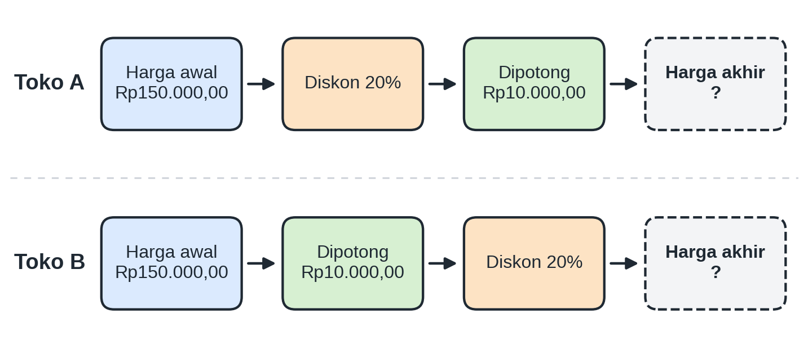
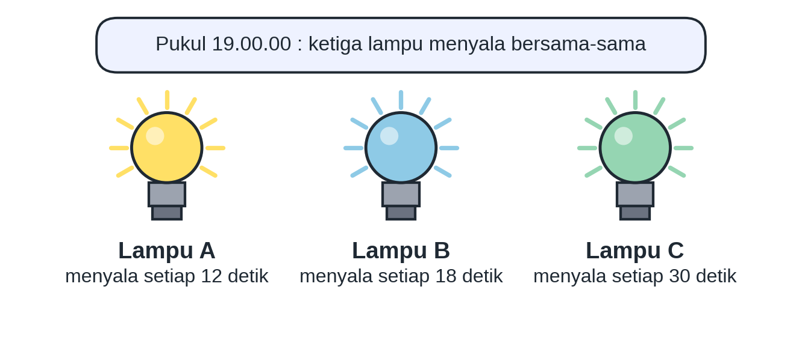
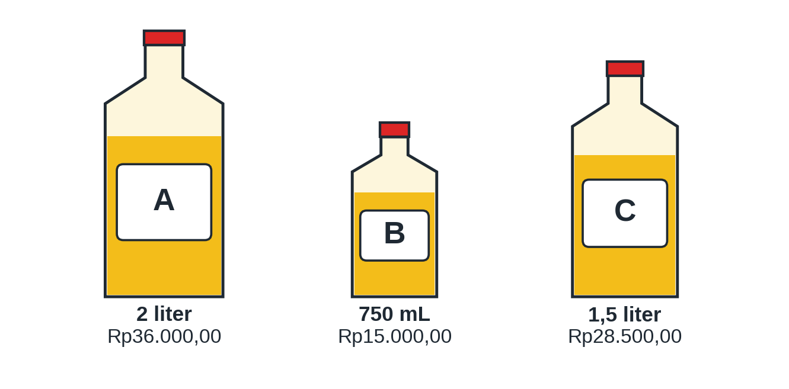
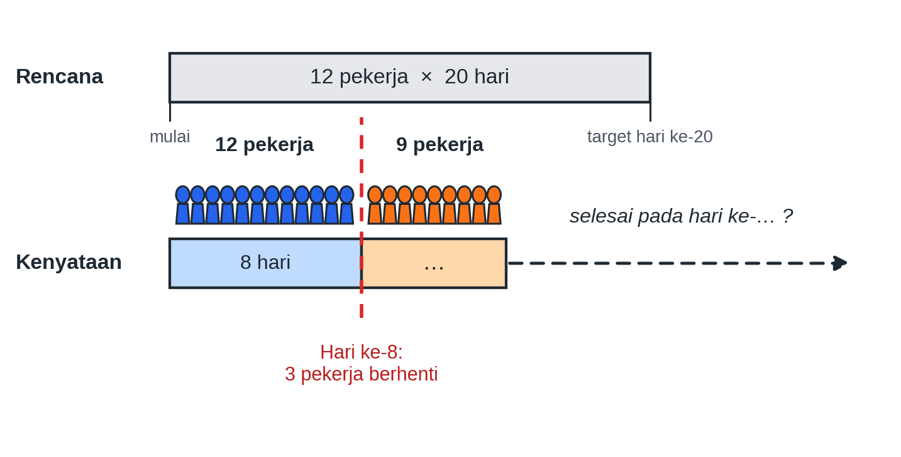
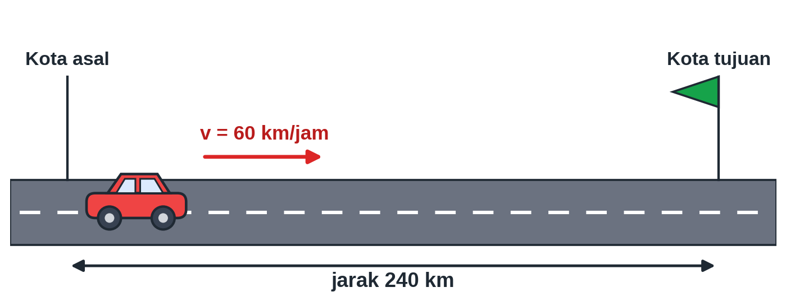

# Pretest Bab 1 — ekstraksi sumber

STAGED_ONLY; belum diaudit atau diimpor. DOCX asli menjadi acuan.

PRETEST BAB 1

BILANGAN

<!-- table-001 -->
<table>
<tr><td>Bab / Sub Bab</td><td>Indikator Esensial</td></tr>
<tr><td colspan="2">Bab 1 : Bilangan</td></tr>
<tr><td colspan="2">Sub Bab 1 : Bilangan Real</td></tr>
<tr><td></td><td>1. Perbandingan dan sifat-sifat bilangan</td></tr>
<tr><td></td><td>2. Operasi aritmetika pada bilangan</td></tr>
<tr><td></td><td>3. Estimasi/ perkiraan hasil perhitungan</td></tr>
<tr><td></td><td>4. Faktorisasi prima bilangan asli</td></tr>
<tr><td></td><td>5. Rasio (skala, proporsi, dan laju perubahan)</td></tr>
<tr><td></td><td>6. Perbandingan senilai dan berbalik nilai.</td></tr>
</table>

PRETEST BAB 1 Terdiri dari 20 soal dengan komposisi kesulitan 5 Mudah (C3), 10 Sedang (C4), dan 5 Sulit (C5), serta 3 tipe soal: PG (10), PG MCMA (6), PGK Kategori (4) tiap bab.

KOMPOSISI SOAL PRETEST

<!-- table-002 -->
<table>
<tr><td>Bab / Sub Bab</td><td>Jumlah Soal</td><td>C3</td><td>C4</td><td>C5</td><td>PG</td><td>PG MCMA</td><td>PGK</td></tr>
<tr><td>Bab 1 – Sub Bab 1 : Bilangan Real</td><td>20</td><td>5</td><td>10</td><td>5</td><td>10</td><td>6</td><td>4</td></tr>
</table>

BAB 1 : BILANGAN

SUB BAB 1 : BILANGAN REAL

SOAL 1 (Bentuk Soal: PG)

Indikator 1.3 | Level Kognitif: C3 (Mudah)

KUNCI JAWABAN : B

Perhatikan empat bilangan real berikut: $−\frac{3}{4}$, $0,6$, $−0,8$, dan $\frac{5}{8}$. Urutan bilangan tersebut dari yang terkecil ke yang terbesar adalah…

A. $−\frac{3}{4}; −0,8; 0,6; \frac{5}{8}$

B. $−0,8; −\frac{3}{4}; 0,6; \frac{5}{8}$

C. $−0,8; −\frac{3}{4}; \frac{5}{8}; 0,6$

D. $0,6; \frac{5}{8}; −\frac{3}{4}; −0,8$

Pembahasan :

Ubah semua bilangan ke bentuk desimal: $−\frac{3}{4}=−0,75$ dan $\frac{5}{8}=0,625$. Pada garis bilangan, bilangan yang lebih ke kiri bernilai lebih kecil sehingga $−0,8<−0,75<0,6<0,625$. Urutannya: $−0,8; −\frac{3}{4}; 0,6; \frac{5}{8}$.

SOAL 2 (Bentuk Soal: PG MCMA)

Indikator 1.1 | Level Kognitif: C3 (Mudah)

KUNCI JAWABAN : Pernyataan 1, Pernyataan 3

Perhatikan bilangan-bilangan berikut: $\sqrt{16}$, $−5$, $\sqrt{7}$, dan $0,121212…$ (angka 12 berulang terus-menerus). Pilihlah semua pernyataan yang benar!

[ ] Pernyataan 1: $\sqrt{16}$ merupakan bilangan rasional.

[ ] Pernyataan 2: $\sqrt{7}$ merupakan bilangan rasional.

[ ] Pernyataan 3: $−5$ merupakan bilangan bulat tetapi bukan bilangan asli.

[ ] Pernyataan 4: $0,121212…$ merupakan bilangan irasional.

Pembahasan :

$\sqrt{16}=4$ yang dapat ditulis sebagai $\frac{4}{1}$, sehingga rasional (Pernyataan 1 Benar).

$\sqrt{7}$ tidak dapat dinyatakan sebagai pecahan $\frac{a}{b}$ sehingga irasional (Pernyataan 2 Salah).

$−5$ adalah bilangan bulat negatif, sedangkan bilangan asli hanya $1,2,3,…$ (Pernyataan 3 Benar).

Desimal berulang dapat dinyatakan sebagai pecahan ($0,\overline{12}=\frac{12}{99}=\frac{4}{33}$), sehingga rasional (Pernyataan 4 Salah).

SOAL 3 (Bentuk Soal: PG Kategori)

Indikator 1.4 | Level Kognitif: C4 (Sedang)

KUNCI JAWABAN : A. Salah, B. Benar, C. Salah

Perhatikan sifat-sifat operasi pada himpunan bilangan bulat. Tentukan Benar atau Salah untuk setiap pernyataan berikut!

<!-- table-003 -->
<table>
<tr><td>Pernyataan</td><td>Benar</td><td>Salah</td></tr>
<tr><td>A. Operasi pengurangan pada bilangan bulat bersifat komutatif.</td><td>[ ]</td><td>[ ]</td></tr>
<tr><td>B. Operasi penjumlahan pada bilangan bulat bersifat tertutup.</td><td>[ ]</td><td>[ ]</td></tr>
<tr><td>C. Operasi pembagian pada bilangan bulat bersifat tertutup.</td><td>[ ]</td><td>[ ]</td></tr>
</table>

Pembahasan :

Pernyataan A salah, contoh penyangkal: $5−3=2$ tetapi $3−5=−2$.

Pernyataan B benar, hasil penjumlahan dua bilangan bulat selalu bilangan bulat.

Pernyataan C salah, contoh penyangkal: $6÷4=\frac{3}{2}$ yang bukan bilangan bulat.

SOAL 4 (Bentuk Soal: PG)

Indikator 1.4 | Level Kognitif: C5 (Sulit)

KUNCI JAWABAN : D

Andi menyelesaikan $3×\left(4+5\right)$ dengan cara $3×4+5=17$ dan menyatakan bahwa ia telah menggunakan sifat distributif perkalian terhadap penjumlahan. Penilaian yang paling tepat terhadap pekerjaan Andi adalah…

A. Benar, karena pengali cukup disebarkan ke suku pertama saja.

B. Benar, karena hasil kedua ruas sama-sama bilangan bulat.

C. Salah, karena sifat distributif hanya berlaku pada operasi pengurangan.

D. Salah, karena sifat distributif menyebarkan pengali ke kedua suku, yaitu $3×4+3×5=27$, bukan $17$.

Pembahasan :

Sifat distributif: $a×\left(b+c\right)=a×b+a×c$. Maka $3×\left(4+5\right)=3×4+3×5=12+15=27$. Hasil Andi ($17$) berbeda dengan $3×9=27$ karena ia tidak menyebarkan pengali $3$ ke suku kedua.

SOAL 5 (Bentuk Soal: PG)

Indikator 2.2 | Level Kognitif: C3 (Mudah)

KUNCI JAWABAN : A

Hasil dari $24−36÷4×2+5$ adalah…

A. $11$

B. $−1$

C. $16$

D. $29$

Pembahasan :

Urutan operasi: perkalian/pembagian dikerjakan lebih dulu dari kiri ke kanan, baru penjumlahan/pengurangan. $36÷4=9$, lalu $9×2=18$. Sehingga $24−18+5=11$.

SOAL 6 (Bentuk Soal: PG MCMA)

Indikator 2.3 | Level Kognitif: C4 (Sedang)

KUNCI JAWABAN : Pernyataan 1, Pernyataan 2

Perhatikan pernyataan tentang bilangan berpangkat berikut. Pilihlah semua pernyataan yang benar!

[ ] Pernyataan 1: $\frac{{2}^{5}×{4}^{2}}{{8}^{2}}=8$

[ ] Pernyataan 2: ${\left({3}^{2}\right)}^{3}×{3}^{−2}={3}^{4}$

[ ] Pernyataan 3: $\sqrt{{2}^{6}}={2}^{4}$

[ ] Pernyataan 4: ${5}^{0}+{5}^{−1}={5}^{−1}$

Pembahasan :

$\frac{{2}^{5}×{\left({2}^{2}\right)}^{2}}{{\left({2}^{3}\right)}^{2}}=\frac{{2}^{9}}{{2}^{6}}={2}^{3}=8$ (Pernyataan 1 Benar).

${\left({3}^{2}\right)}^{3}={3}^{6}$, kemudian ${3}^{6}×{3}^{−2}={3}^{4}$ (Pernyataan 2 Benar).

$\sqrt{{2}^{6}}={2}^{6⋅\frac{1}{2}}={2}^{3}$, bukan ${2}^{4}$ (Pernyataan 3 Salah).

${5}^{0}+{5}^{−1}=1+\frac{1}{5}=\frac{6}{5}$, bukan ${5}^{−1}$ (Pernyataan 4 Salah).

SOAL 7 (Bentuk Soal: PG)

Indikator 2.3 | Level Kognitif: C4 (Sedang)

KUNCI JAWABAN : C

Bentuk paling sederhana dari $\frac{6}{\sqrt{3}}+\sqrt{48}−\sqrt{27}$ adalah…

A. $7\sqrt{3}$

B. $9\sqrt{3}$

C. $3\sqrt{3}$

D. $\sqrt{3}$

Pembahasan :

Rasionalkan penyebut: $\frac{6}{\sqrt{3}}=\frac{6}{\sqrt{3}}×\frac{\sqrt{3}}{\sqrt{3}}=2\sqrt{3}$. Kemudian $\sqrt{48}=4\sqrt{3}$ dan $\sqrt{27}=3\sqrt{3}$. Jadi $2\sqrt{3}+4\sqrt{3}−3\sqrt{3}=3\sqrt{3}$.

SOAL 8 (Bentuk Soal: PG)

Indikator 2.4 | Level Kognitif: C5 (Sulit)

KUNCI JAWABAN : A

Sebuah barang seharga Rp150.000,00 dijual di dua toko dengan penawaran berikut. Toko A: diskon $20%$ terlebih dahulu, kemudian dipotong Rp10.000,00. Toko B: dipotong Rp10.000,00 terlebih dahulu, kemudian diskon $20%$. Penilaian yang tepat mengenai harga akhir kedua toko adalah…

A. Toko A lebih murah Rp2.000,00 dibandingkan Toko B.

B. Toko B lebih murah Rp2.000,00 dibandingkan Toko A.

C. Kedua toko memberikan harga akhir yang sama karena potongan totalnya sama.

D. Toko A lebih murah Rp10.000,00 dibandingkan Toko B.

Pembahasan :

Toko A: $150.000×0,8=120.000$, lalu $120.000−10.000=110.000$. Toko B: $150.000−10.000=140.000$, lalu $140.000×0,8=112.000$. Selisihnya $112.000−110.000=2.000$, sehingga Toko A lebih murah Rp2.000,00. Urutan potongan memengaruhi hasil akhir.

SOAL 9 (Bentuk Soal: PG MCMA)

Indikator 3.2 | Level Kognitif: C4 (Sedang)

KUNCI JAWABAN : Pernyataan 1, Pernyataan 2, Pernyataan 3

Perhatikan nilai $\sqrt{150}$. Pilihlah semua pernyataan yang benar!

[ ] Pernyataan 1: $12<\sqrt{150}<13$

[ ] Pernyataan 2: Pembulatan $\sqrt{150}$ sampai satu angka desimal adalah $12,2$.

[ ] Pernyataan 3: $\sqrt{150}$ lebih dekat ke $12$ daripada ke $13$.

[ ] Pernyataan 4: $\sqrt{150}>12,5$

Pembahasan :

${12}^{2}=144$ dan ${13}^{2}=169$, sehingga $12<\sqrt{150}<13$ (Pernyataan 1 Benar).

$12,{2}^{2}=148,84$ dan $12,{3}^{2}=151,29$; karena $12,{25}^{2}=150,0625>150$, maka $\sqrt{150}<12,25$ sehingga dibulatkan menjadi $12,2$ (Pernyataan 2 Benar).

$\sqrt{150}≈12,25$, selisihnya dengan $12$ sekitar $0,25$ sedangkan dengan $13$ sekitar $0,75$ (Pernyataan 3 Benar).

$12,{5}^{2}=156,25>150$, sehingga $\sqrt{150}<12,5$ (Pernyataan 4 Salah).

SOAL 10 (Bentuk Soal: PG Kategori)

Indikator 3.3 | Level Kognitif: C4 (Sedang)

KUNCI JAWABAN : A. Benar, B. Salah, C. Benar

Dalam memeriksa kewajaran hasil perhitungan, Rani melakukan estimasi dengan pembulatan. Tentukan Benar atau Salah untuk setiap pernyataan berikut!

<!-- table-004 -->
<table>
<tr><td>Pernyataan</td><td>Benar</td><td>Salah</td></tr>
<tr><td>A. Hasil $49,8×2,03$ dapat diperkirakan sekitar $100$.</td><td>[ ]</td><td>[ ]</td></tr>
<tr><td>B. Nilai $\sqrt{80}$ terletak di antara $9$ dan $10$.</td><td>[ ]</td><td>[ ]</td></tr>
<tr><td>C. Hasil $19,6+30,7$ dapat diperkirakan sekitar $50$.</td><td>[ ]</td><td>[ ]</td></tr>
</table>

Pembahasan :

Pernyataan A benar, $49,8≈50$ dan $2,03≈2$ sehingga $50×2=100$.

Pernyataan B salah, ${8}^{2}=64$ dan ${9}^{2}=81$ sehingga $\sqrt{80}$ terletak di antara $8$ dan $9$.

Pernyataan C benar, $19,6≈20$ dan $30,7≈30$ sehingga $20+30=50$.

SOAL 11 (Bentuk Soal: PG)

Indikator 4.2 | Level Kognitif: C3 (Mudah)

KUNCI JAWABAN : D

Faktorisasi prima dari bilangan $180$ adalah…

A. ${2}^{3}×3×5$

B. ${2}^{2}×3×{5}^{2}$

C. $2×{3}^{2}×{5}^{2}$

D. ${2}^{2}×{3}^{2}×5$

Pembahasan :

$180=2×90=2×2×45=2×2×3×15=2×2×3×3×5$. Jadi $180={2}^{2}×{3}^{2}×5$.

SOAL 12 (Bentuk Soal: PG MCMA)

Indikator 4.3 | Level Kognitif: C4 (Sedang)

KUNCI JAWABAN : Pernyataan 1, Pernyataan 2

Diketahui dua bilangan $48$ dan $180$. Pilihlah semua pernyataan yang benar!

[ ] Pernyataan 1: FPB dari $48$ dan $180$ adalah $12$.

[ ] Pernyataan 2: KPK dari $48$ dan $180$ adalah $720$.

[ ] Pernyataan 3: Banyak faktor persekutuan dari $48$ dan $180$ adalah $8$.

[ ] Pernyataan 4: KPK dari $48$ dan $180$ adalah $8.640$.

Pembahasan :

$48={2}^{4}×3$ dan $180={2}^{2}×{3}^{2}×5$. FPB $={2}^{2}×3=12$ (Pernyataan 1 Benar).

KPK $={2}^{4}×{3}^{2}×5=720$ (Pernyataan 2 Benar).

Faktor persekutuan adalah faktor dari FPB $=12$, yaitu $1,2,3,4,6,12$ (ada $6$), bukan $8$ (Pernyataan 3 Salah).

$8.640=48×180$ adalah hasil kali kedua bilangan, bukan KPK (Pernyataan 4 Salah).

SOAL 13 (Bentuk Soal: PG)

Indikator 4.3 | Level Kognitif: C4 (Sedang)

KUNCI JAWABAN : B

Diketahui $54=2×{3}^{3}$ dan $90=2×{3}^{2}×5$. Jika FPB dari $54$ dan $90$ adalah $p$ dan KPK-nya adalah $q$, maka nilai $q÷p$ adalah…

A. $5$

B. $15$

C. $18$

D. $270$

Pembahasan :

$p=2×{3}^{2}=18$ dan $q=2×{3}^{3}×5=270$. Maka $q÷p=270÷18=15$.

SOAL 14 (Bentuk Soal: PG)

Indikator 4.4 | Level Kognitif: C5 (Sulit)

KUNCI JAWABAN : C

Tiga lampu hias A, B, dan C menyala bersama-sama pada pukul 19.00.00. Lampu A menyala setiap $12$ detik, lampu B setiap $18$ detik, dan lampu C setiap $30$ detik. Dina menghitung bahwa ketiga lampu akan menyala bersama-sama lagi setiap $360$ detik karena KPK dari $12$, $18$, dan $30$ adalah $360$. Penilaian yang paling tepat terhadap hitungan Dina adalah…

A. Benar, karena $360$ merupakan kelipatan persekutuan dari $12$, $18$, dan $30$.

B. Salah, karena KPK dari $12$, $18$, dan $30$ adalah $60$.

C. Kurang tepat, karena $360$ memang kelipatan persekutuan ketiganya tetapi bukan yang terkecil; KPK-nya adalah $180$ sehingga lampu menyala bersama setiap $3$ menit.

D. Salah, karena KPK dari $12$, $18$, dan $30$ adalah $540$.

Pembahasan :

$12={2}^{2}×3$, $18=2×{3}^{2}$, $30=2×3×5$. KPK $={2}^{2}×{3}^{2}×5=180$. Nilai $360=2×180$ memang kelipatan persekutuan, tetapi KPK menuntut kelipatan persekutuan yang terkecil. Jadi ketiga lampu menyala bersama setiap $180$ detik ($3$ menit).

SOAL 15 (Bentuk Soal: PG MCMA)

Indikator 5.2 | Level Kognitif: C3 (Mudah)

KUNCI JAWABAN : Pernyataan 1, Pernyataan 2

Pada sebuah peta digunakan skala $1:2.500.000$. Pilihlah semua pernyataan yang benar!

[ ] Pernyataan 1: Jarak $6$ cm pada peta mewakili jarak sebenarnya $150$ km.

[ ] Pernyataan 2: Jarak sebenarnya $80$ km digambarkan dengan jarak $3,2$ cm pada peta.

[ ] Pernyataan 3: Jarak $1$ cm pada peta mewakili jarak sebenarnya $2,5$ km.

[ ] Pernyataan 4: Jarak $10$ cm pada peta mewakili jarak sebenarnya $2.500$ km.

Pembahasan :

$6×2.500.000=15.000.000$ cm $=150$ km (Pernyataan 1 Benar).

$80$ km $=8.000.000$ cm, sehingga jarak pada peta $=8.000.000÷2.500.000=3,2$ cm (Pernyataan 2 Benar).

$1$ cm pada peta mewakili $2.500.000$ cm $=25$ km, bukan $2,5$ km (Pernyataan 3 Salah).

$10×25=250$ km, bukan $2.500$ km (Pernyataan 4 Salah).

SOAL 16 (Bentuk Soal: PG Kategori)

Indikator 5.4 | Level Kognitif: C4 (Sedang)

KUNCI JAWABAN : A. Salah, B. Benar, C. Benar

Tabel berikut menunjukkan jarak yang ditempuh sebuah mobil pada kecepatan tetap.

<!-- table-005 -->
<table>
<tr><td>Waktu (jam)</td><td>1</td><td>2</td><td>3</td><td>4</td></tr>
<tr><td>Jarak (km)</td><td>45</td><td>90</td><td>135</td><td>180</td></tr>
</table>

Tentukan Benar atau Salah untuk setiap pernyataan berikut!

<!-- table-006 -->
<table>
<tr><td>Pernyataan</td><td>Benar</td><td>Salah</td></tr>
<tr><td>A. Laju mobil berubah-ubah pada setiap jamnya.</td><td>[ ]</td><td>[ ]</td></tr>
<tr><td>B. Grafik jarak terhadap waktu berupa garis lurus yang melalui titik $\left(0,0\right)$.</td><td>[ ]</td><td>[ ]</td></tr>
<tr><td>C. Setelah $6,5$ jam, jarak yang ditempuh mobil adalah $292,5$ km.</td><td>[ ]</td><td>[ ]</td></tr>
</table>

Pembahasan :

Pernyataan A salah, rasio $\frac{jarak}{waktu}=45$ km/jam selalu sama sehingga lajunya tetap.

Pernyataan B benar, hubungan jarak dan waktu berbanding lurus ($J=45t$), sehingga grafiknya garis lurus melalui $\left(0,0\right)$.

Pernyataan C benar, $J=45×6,5=292,5$ km.

SOAL 17 (Bentuk Soal: PG)

Indikator 5.3 | Level Kognitif: C4 (Sedang)

KUNCI JAWABAN : A

Tiga merek minyak goreng dijual dengan harga: A (2 liter) Rp36.000,00; B (750 mL) Rp15.000,00; dan C (1,5 liter) Rp28.500,00. Urutan merek dari harga per liter yang paling murah hingga paling mahal adalah…

A. A, C, B

B. A, B, C

C. B, C, A

D. C, A, B

Pembahasan :

Harga per liter: A $=\frac{36.000}{2}=18.000$; B $=\frac{15.000}{0,75}=20.000$; C $=\frac{28.500}{1,5}=19.000$. Dari termurah: A ($18.000$), C ($19.000$), B ($20.000$).

SOAL 18 (Bentuk Soal: PG MCMA)

Indikator 6.1 | Level Kognitif: C4 (Sedang)

KUNCI JAWABAN : Pernyataan 1, Pernyataan 2

Perhatikan hubungan dua besaran berikut. Pilihlah semua pernyataan yang benar!

[ ] Pernyataan 1: Banyak pekerja dan lama waktu penyelesaian suatu pekerjaan yang sama termasuk perbandingan berbalik nilai.

[ ] Pernyataan 2: Banyak barang yang dibeli dan total harga (harga satuan tetap) termasuk perbandingan senilai.

[ ] Pernyataan 3: Kecepatan kendaraan dan waktu tempuh untuk jarak yang tetap termasuk perbandingan senilai.

[ ] Pernyataan 4: Banyak mesin dan lama produksi untuk target produksi yang sama termasuk perbandingan senilai.

Pembahasan :

Pekerja bertambah, waktu berkurang (hasil kali tetap) sehingga berbalik nilai (Pernyataan 1 Benar).

Barang bertambah, total harga bertambah dengan rasio tetap sehingga senilai (Pernyataan 2 Benar).

Kecepatan bertambah, waktu tempuh berkurang (jarak $=$ kecepatan $×$ waktu tetap) sehingga berbalik nilai (Pernyataan 3 Salah).

Mesin bertambah, waktu produksi berkurang sehingga berbalik nilai (Pernyataan 4 Salah).

SOAL 19 (Bentuk Soal: PG)

Indikator 6.4 | Level Kognitif: C5 (Sulit)

KUNCI JAWABAN : B

Sebuah proyek direncanakan selesai dalam $20$ hari oleh $12$ pekerja. Setelah bekerja $8$ hari, $3$ orang pekerja berhenti dan tidak ada pekerja pengganti. Dengan kecepatan kerja yang sama, proyek tersebut selesai dalam total… hari.

A. $22$

B. $24$

C. $26$

D. $28$

Pembahasan :

Total beban kerja $=12×20=240$ pekerja-hari. Setelah $8$ hari terselesaikan $12×8=96$, sisa $=240−96=144$ pekerja-hari. Dengan $9$ pekerja, sisa selesai dalam $144÷9=16$ hari. Total waktu $=8+16=24$ hari.

SOAL 20 (Bentuk Soal: PG Kategori)

Indikator 6.3 | Level Kognitif: C5 (Sulit)

KUNCI JAWABAN : A. Benar, B. Benar, C. Salah

Sebuah mobil menempuh jarak $240$ km dengan kecepatan tetap $60$ km/jam. Dino berpendapat bahwa jika kecepatan hanya ditambah $10$ km/jam, mobil sudah tiba $1$ jam lebih cepat. Tentukan Benar atau Salah untuk setiap pernyataan berikut!

<!-- table-007 -->
<table>
<tr><td>Pernyataan</td><td>Benar</td><td>Salah</td></tr>
<tr><td>A. Waktu tempuh semula adalah $4$ jam.</td><td>[ ]</td><td>[ ]</td></tr>
<tr><td>B. Agar tiba $1$ jam lebih cepat, diperlukan kecepatan $80$ km/jam.</td><td>[ ]</td><td>[ ]</td></tr>
<tr><td>C. Pendapat Dino benar karena penambahan kecepatan $10$ km/jam menghemat waktu tepat $1$ jam.</td><td>[ ]</td><td>[ ]</td></tr>
</table>

Pembahasan :

Pernyataan A benar, $t=\frac{240}{60}=4$ jam.

Pernyataan B benar, waktu yang diinginkan $=3$ jam sehingga $v=\frac{240}{3}=80$ km/jam.

Pernyataan C salah, dengan kecepatan $70$ km/jam waktu tempuhnya $\frac{240}{70}≈3,43$ jam ($≈3$ jam $26$ menit), hanya menghemat sekitar $34$ menit. Kecepatan dan waktu berbanding terbalik, bukan berubah linear.

LAMPIRAN : REKAP KUNCI JAWABAN DAN PETA SOAL

Bab 1 : Bilangan

<!-- table-008 -->
<table>
<tr><td>No</td><td>Sub Bab</td><td>Indikator</td><td>Level</td><td>Bentuk Soal</td><td>Kunci Jawaban</td></tr>
<tr><td>1</td><td>Bilangan Real</td><td>1.3</td><td>C3</td><td>PG</td><td>B</td></tr>
<tr><td>2</td><td>Bilangan Real</td><td>1.1</td><td>C3</td><td>PG MCMA</td><td>Pernyataan 1, Pernyataan 3</td></tr>
<tr><td>3</td><td>Bilangan Real</td><td>1.4</td><td>C4</td><td>PG Kategori</td><td>A. Salah, B. Benar, C. Salah</td></tr>
<tr><td>4</td><td>Bilangan Real</td><td>1.4</td><td>C5</td><td>PG</td><td>D</td></tr>
<tr><td>5</td><td>Bilangan Real</td><td>2.2</td><td>C3</td><td>PG</td><td>A</td></tr>
<tr><td>6</td><td>Bilangan Real</td><td>2.3</td><td>C4</td><td>PG MCMA</td><td>Pernyataan 1, Pernyataan 2</td></tr>
<tr><td>7</td><td>Bilangan Real</td><td>2.3</td><td>C4</td><td>PG</td><td>C</td></tr>
<tr><td>8</td><td>Bilangan Real</td><td>2.4</td><td>C5</td><td>PG</td><td>A</td></tr>
<tr><td>9</td><td>Bilangan Real</td><td>3.2</td><td>C4</td><td>PG MCMA</td><td>Pernyataan 1, Pernyataan 2, Pernyataan 3</td></tr>
<tr><td>10</td><td>Bilangan Real</td><td>3.3</td><td>C4</td><td>PG Kategori</td><td>A. Benar, B. Salah, C. Benar</td></tr>
<tr><td>11</td><td>Bilangan Real</td><td>4.2</td><td>C3</td><td>PG</td><td>D</td></tr>
<tr><td>12</td><td>Bilangan Real</td><td>4.3</td><td>C4</td><td>PG MCMA</td><td>Pernyataan 1, Pernyataan 2</td></tr>
<tr><td>13</td><td>Bilangan Real</td><td>4.3</td><td>C4</td><td>PG</td><td>B</td></tr>
<tr><td>14</td><td>Bilangan Real</td><td>4.4</td><td>C5</td><td>PG</td><td>C</td></tr>
<tr><td>15</td><td>Bilangan Real</td><td>5.2</td><td>C3</td><td>PG MCMA</td><td>Pernyataan 1, Pernyataan 2</td></tr>
<tr><td>16</td><td>Bilangan Real</td><td>5.4</td><td>C4</td><td>PG Kategori</td><td>A. Salah, B. Benar, C. Benar</td></tr>
<tr><td>17</td><td>Bilangan Real</td><td>5.3</td><td>C4</td><td>PG</td><td>A</td></tr>
<tr><td>18</td><td>Bilangan Real</td><td>6.1</td><td>C4</td><td>PG MCMA</td><td>Pernyataan 1, Pernyataan 2</td></tr>
<tr><td>19</td><td>Bilangan Real</td><td>6.4</td><td>C5</td><td>PG</td><td>B</td></tr>
<tr><td>20</td><td>Bilangan Real</td><td>6.3</td><td>C5</td><td>PG Kategori</td><td>A. Benar, B. Benar, C. Salah</td></tr>
</table>

