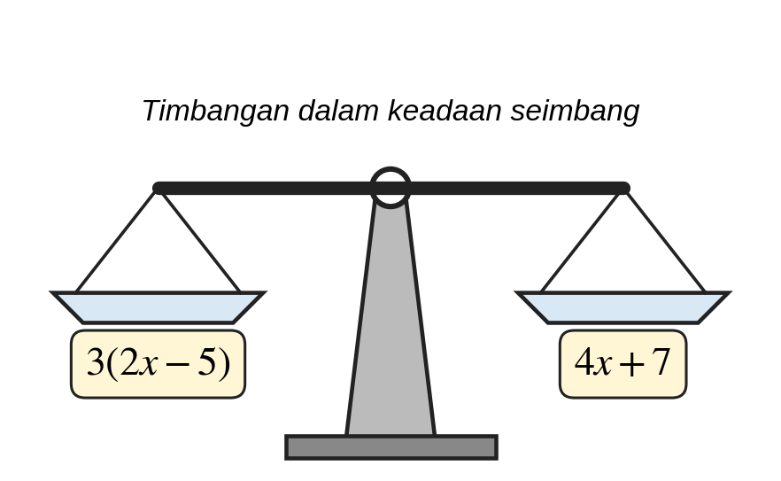
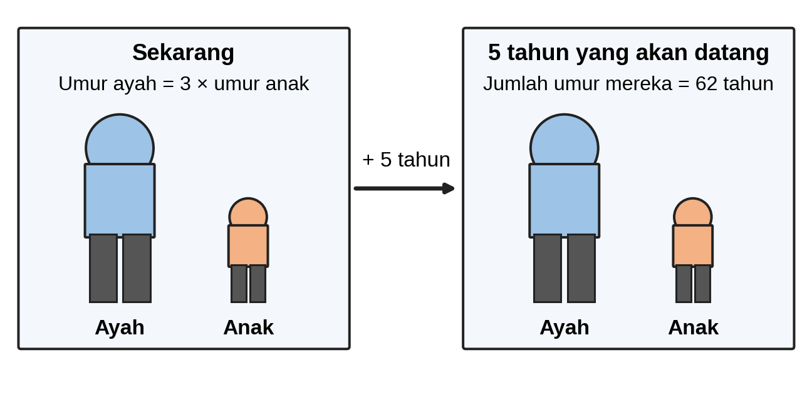
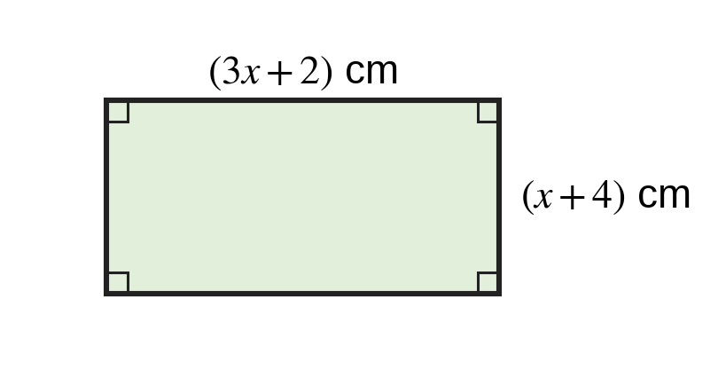
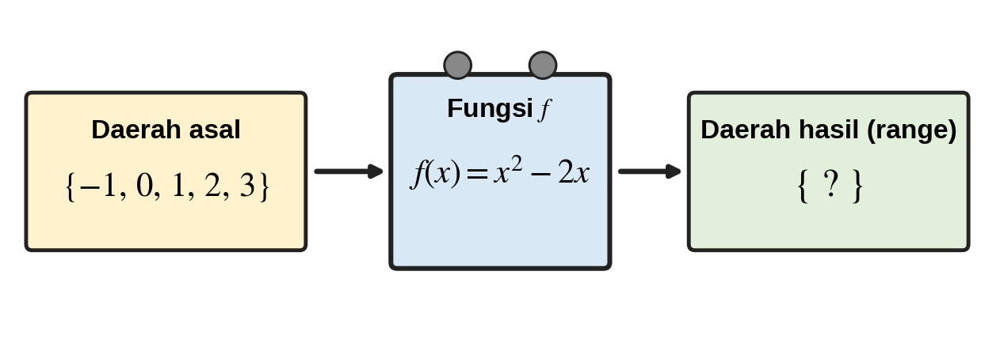
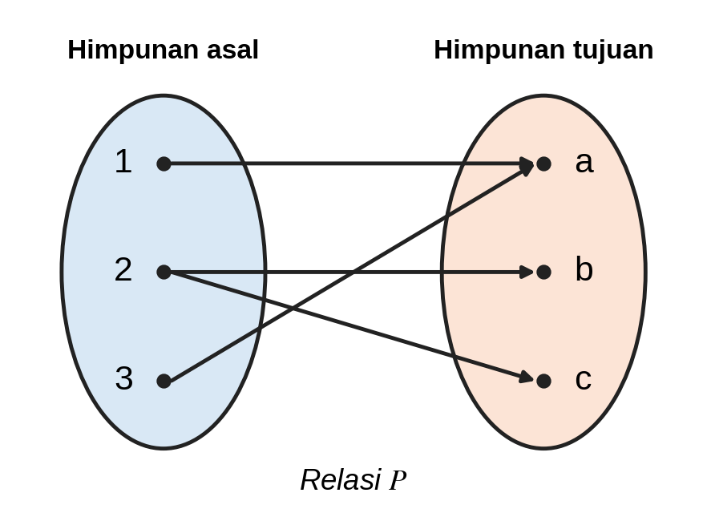
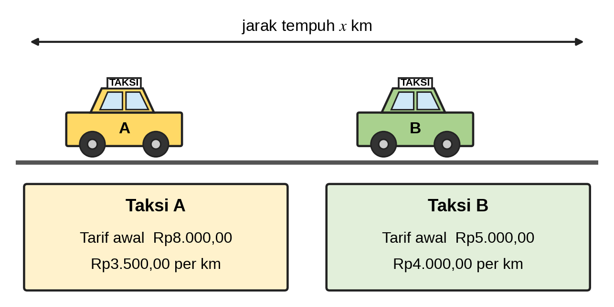
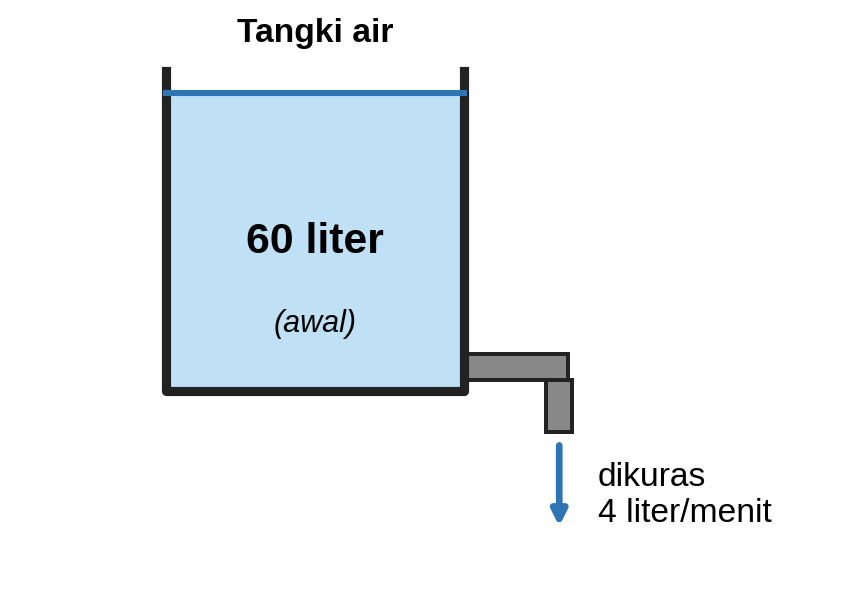
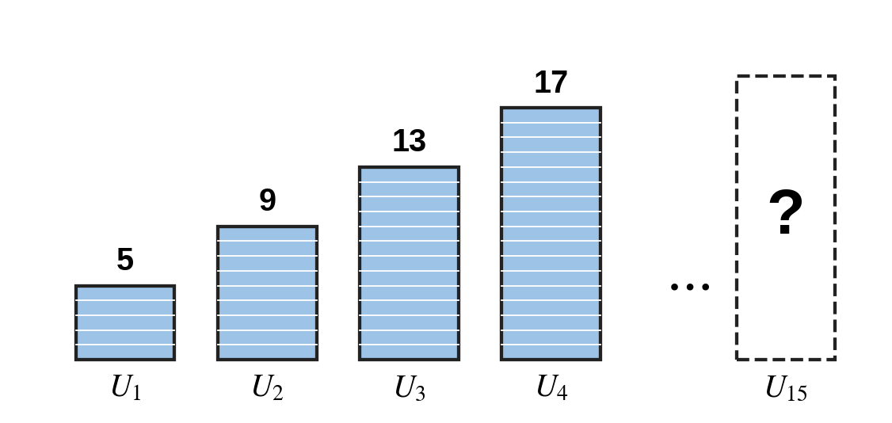
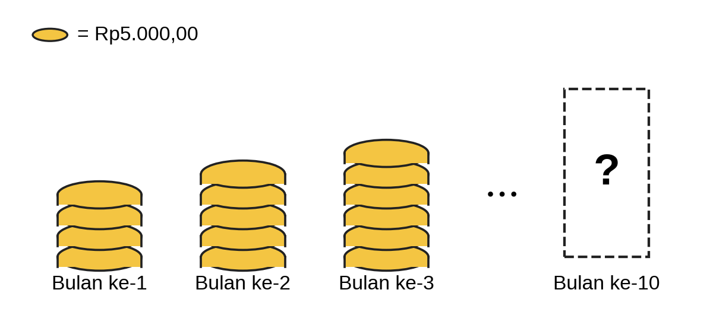
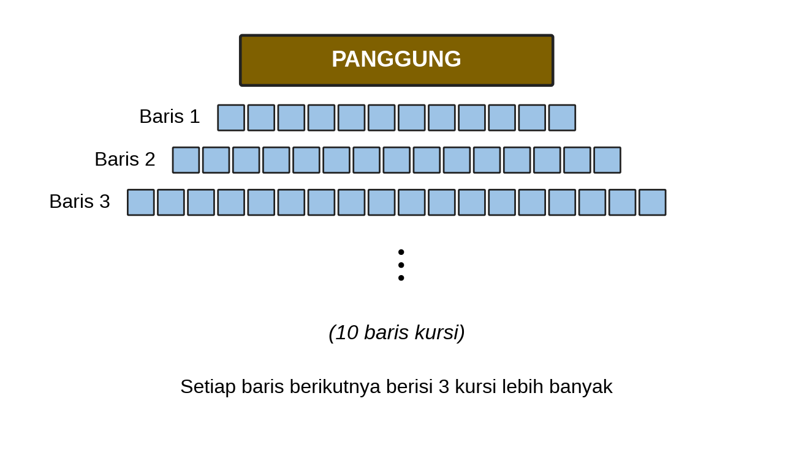

# Pretest Bab 2 — ekstraksi sumber

STAGED_ONLY; belum diaudit atau diimpor. DOCX asli menjadi acuan.

PRETEST BAB 2

ALJABAR

<!-- table-001 -->
<table>
<tr><td>Bab / Sub Bab</td><td>Indikator Esensial</td></tr>
<tr><td colspan="2">Bab 2 : Aljabar</td></tr>
<tr><td colspan="2">Sub Bab 1 : Persamaan dan Pertidaksamaan Linier</td></tr>
<tr><td></td><td>7. Persamaan linear satu variabel</td></tr>
<tr><td></td><td>8. Pertidaksamaan linear satu variabel</td></tr>
<tr><td></td><td>9. Sistem persamaan linear dua variabel</td></tr>
<tr><td colspan="2">Sub Bab 2 : Bentuk Aljabar</td></tr>
<tr><td></td><td>10. Bentuk aljabar dan sifat-sifat operasinya (komutatif, asosiatif, dan distributif)</td></tr>
<tr><td colspan="2">Sub Bab 3 : Fungsi</td></tr>
<tr><td></td><td>11. Relasi dan fungsi (domain, kodomain, range), serta penyajiannya.</td></tr>
<tr><td colspan="2">Sub Bab 4 : Barisan dan Deret</td></tr>
<tr><td></td><td>12. Barisan berhingga bilangan</td></tr>
<tr><td></td><td>13. Deret berhingga bilangan.</td></tr>
</table>

PRETEST BAB 2 Terdiri dari 20 soal dengan komposisi kesulitan 5 Mudah (C3), 10 Sedang (C4), dan 5 Sulit (C5), serta 3 tipe soal: PG (10), PG MCMA (6), PGK Kategori (4) tiap bab.

KOMPOSISI SOAL PRETEST

<!-- table-002 -->
<table>
<tr><td>Bab / Sub Bab</td><td>Jumlah Soal</td><td>C3</td><td>C4</td><td>C5</td><td>PG</td><td>PG MCMA</td><td>PGK</td></tr>
<tr><td>Bab 2 – Sub Bab 1 : Persamaan dan Pertidaksamaan Linier</td><td>5</td><td>2</td><td>2</td><td>1</td><td>3</td><td>1</td><td>1</td></tr>
<tr><td>Bab 2 – Sub Bab 2 : Bentuk Aljabar</td><td>5</td><td>1</td><td>3</td><td>1</td><td>2</td><td>2</td><td>1</td></tr>
<tr><td>Bab 2 – Sub Bab 3 : Fungsi</td><td>5</td><td>1</td><td>2</td><td>2</td><td>3</td><td>1</td><td>1</td></tr>
<tr><td>Bab 2 – Sub Bab 4 : Barisan dan Deret</td><td>5</td><td>1</td><td>3</td><td>1</td><td>2</td><td>2</td><td>1</td></tr>
<tr><td>Total Bab 2</td><td>20</td><td>5</td><td>10</td><td>5</td><td>10</td><td>6</td><td>4</td></tr>
</table>

BAB 2 : ALJABAR

SUB BAB 1 : PERSAMAAN DAN PERTIDAKSAMAAN LINIER

SOAL 1 (Bentuk Soal: PG)

Indikator 7.2 | Level Kognitif: C3 (Mudah)

KUNCI JAWABAN : C

Penyelesaian dari persamaan $3\left(2x−5\right)=4x+7$ adalah…

A. $x=6$

B. $x=1$

C. $x=11$

D. $x=16$

Pembahasan :

$6x−15=4x+7⇒6x−4x=7+15⇒2x=22⇒x=11$.

SOAL 2 (Bentuk Soal: PG)

Indikator 8.2 | Level Kognitif: C3 (Mudah)

KUNCI JAWABAN : A

Himpunan penyelesaian dari pertidaksamaan $−3x+5>17$ adalah…

A. $x<−4$

B. $x>−4$

C. $x<4$

D. $x>4$

Pembahasan :

$−3x+5>17⇒−3x>12$. Karena kedua ruas dibagi bilangan negatif ($−3$), tanda pertidaksamaan dibalik: $x<−4$.

SOAL 3 (Bentuk Soal: PG)

Indikator 7.3 | Level Kognitif: C4 (Sedang)

KUNCI JAWABAN : D

Umur seorang ayah tiga kali umur anaknya. Lima tahun yang akan datang, jumlah umur mereka adalah $62$ tahun. Umur ayah sekarang adalah… tahun.

A. $13$

B. $44$

C. $52$

D. $39$

Pembahasan :

Misalkan umur anak $=a$, maka umur ayah $=3a$. Lima tahun lagi: $\left(3a+5\right)+\left(a+5\right)=62⇒4a+10=62⇒a=13$. Umur ayah sekarang $=3×13=39$ tahun.

SOAL 4 (Bentuk Soal: PG MCMA)

Indikator 9.3 | Level Kognitif: C4 (Sedang)

KUNCI JAWABAN : Pernyataan 1, Pernyataan 2, Pernyataan 4

Diketahui sistem persamaan linear dua variabel:

$2x+3y=12$

$4x+6y=24$

Pilihlah semua pernyataan yang benar!

[ ] Pernyataan 1: Sistem tersebut memiliki tak hingga banyak penyelesaian.

[ ] Pernyataan 2: Grafik kedua persamaan saling berimpit.

[ ] Pernyataan 3: Sistem tersebut hanya memiliki satu penyelesaian, yaitu $\left(3,2\right)$.

[ ] Pernyataan 4: Pasangan $\left(3,2\right)$ merupakan salah satu penyelesaian sistem tersebut.

Pembahasan :

Persamaan kedua adalah $2$ kali persamaan pertama sehingga keduanya ekuivalen dan memiliki tak hingga banyak penyelesaian (Pernyataan 1 Benar).

Karena ekuivalen, kedua garis berimpit (Pernyataan 2 Benar).

Pernyataan tersebut salah karena $\left(3,2\right)$ bukan satu-satunya penyelesaian; misalnya $\left(6,0\right)$ juga memenuhi (Pernyataan 3 Salah).

$2\left(3\right)+3\left(2\right)=12$ dan $4\left(3\right)+6\left(2\right)=24$ sehingga $\left(3,2\right)$ memenuhi keduanya (Pernyataan 4 Benar).

SOAL 5 (Bentuk Soal: PG Kategori)

Indikator 8.5 | Level Kognitif: C5 (Sulit)

KUNCI JAWABAN : A. Benar, B. Benar, C. Salah

Seorang siswa menyelesaikan pertidaksamaan $2−3x≥14$ dengan langkah berikut:

Langkah 1: $−3x≥12$

Langkah 2: $x≥−4$

Tentukan Benar atau Salah untuk setiap pernyataan evaluasi berikut!

<!-- table-003 -->
<table>
<tr><td>Pernyataan</td><td>Benar</td><td>Salah</td></tr>
<tr><td>A. Penyelesaian yang benar dari pertidaksamaan tersebut adalah $x≤−4$.</td><td>[ ]</td><td>[ ]</td></tr>
<tr><td>B. Kesalahan siswa terjadi pada Langkah 2 karena tanda pertidaksamaan tidak dibalik saat kedua ruas dibagi $−3$.</td><td>[ ]</td><td>[ ]</td></tr>
<tr><td>C. Nilai $x=0$ memenuhi pertidaksamaan semula.</td><td>[ ]</td><td>[ ]</td></tr>
</table>

Pembahasan :

Pernyataan A benar, $−3x≥12⇒x≤−4$ (tanda dibalik).

Pernyataan B benar, Langkah 1 sudah benar, sedangkan Langkah 2 lupa membalik tanda.

Pernyataan C salah, substitusi $x=0$ menghasilkan $2−0=2≥14$ yang tidak benar.

SUB BAB 2 : BENTUK ALJABAR

SOAL 6 (Bentuk Soal: PG)

Indikator 10.2 | Level Kognitif: C3 (Mudah)

KUNCI JAWABAN : B

Bentuk paling sederhana dari $4a+7b−2a+3b−5+8$ adalah…

A. $6a+10b+3$

B. $2a+10b+3$

C. $2a+4b+3$

D. $2a+10b−13$

Pembahasan :

Kelompokkan suku sejenis: $\left(4a−2a\right)+\left(7b+3b\right)+\left(−5+8\right)=2a+10b+3$.

SOAL 7 (Bentuk Soal: PG MCMA)

Indikator 10.4 | Level Kognitif: C4 (Sedang)

KUNCI JAWABAN : Pernyataan 1, Pernyataan 3

Pilihlah semua pernyataan tentang penjabaran dan pemfaktoran bentuk aljabar yang benar!

[ ] Pernyataan 1: $\left(x+3\right)\left(x−2\right)={x}^{2}+x−6$

[ ] Pernyataan 2: ${x}^{2}−9={\left(x−3\right)}^{2}$

[ ] Pernyataan 3: $2{x}^{2}+6x=2x\left(x+3\right)$

[ ] Pernyataan 4: ${\left(x−4\right)}^{2}={x}^{2}−16$

Pembahasan :

$\left(x+3\right)\left(x−2\right)={x}^{2}−2x+3x−6={x}^{2}+x−6$ (Pernyataan 1 Benar).

${x}^{2}−9=\left(x−3\right)\left(x+3\right)$, sedangkan ${\left(x−3\right)}^{2}={x}^{2}−6x+9$ (Pernyataan 2 Salah).

Faktor persekutuan $2x$ dikeluarkan: $2x\left(x+3\right)=2{x}^{2}+6x$ (Pernyataan 3 Benar).

${\left(x−4\right)}^{2}={x}^{2}−8x+16$, bukan ${x}^{2}−16$ (Pernyataan 4 Salah).

SOAL 8 (Bentuk Soal: PG)

Indikator 10.3 | Level Kognitif: C4 (Sedang)

KUNCI JAWABAN : C

Bentuk sederhana dari $3\left(2x−4\right)−2\left(x−5\right)$ adalah…

A. $4x−22$

B. $8x−2$

C. $4x−2$

D. $8x−22$

Pembahasan :

Gunakan sifat distributif: $3\left(2x−4\right)−2\left(x−5\right)=6x−12−2x+10=4x−2$. (Perhatikan bahwa $−2×\left(−5\right)=+10$.)

SOAL 9 (Bentuk Soal: PG MCMA)

Indikator 10.4 | Level Kognitif: C4 (Sedang)

KUNCI JAWABAN : Pernyataan 1, Pernyataan 2

Sebuah persegi panjang memiliki panjang $\left(3x+2\right)$ cm dan lebar $\left(x+4\right)$ cm. Pilihlah semua pernyataan yang benar!

[ ] Pernyataan 1: Keliling persegi panjang tersebut adalah $\left(8x+12\right)$ cm.

[ ] Pernyataan 2: Luas persegi panjang tersebut adalah $\left(3{x}^{2}+14x+8\right)$ cm${​}^{2}$.

[ ] Pernyataan 3: Untuk $x=2$, luas persegi panjang tersebut adalah $56$ cm${​}^{2}$.

[ ] Pernyataan 4: Konstanta pada bentuk aljabar luas persegi panjang tersebut adalah $6$.

Pembahasan :

Keliling $=2\left[\left(3x+2\right)+\left(x+4\right)\right]=2\left(4x+6\right)=8x+12$ (Pernyataan 1 Benar).

Luas $=\left(3x+2\right)\left(x+4\right)=3{x}^{2}+12x+2x+8=3{x}^{2}+14x+8$ (Pernyataan 2 Benar).

Untuk $x=2$: panjang $=8$ dan lebar $=6$ sehingga luas $=48$ cm${​}^{2}$, bukan $56$ (Pernyataan 3 Salah).

Konstanta pada $3{x}^{2}+14x+8$ adalah $8$, bukan $6$ (Pernyataan 4 Salah).

SOAL 10 (Bentuk Soal: PG Kategori)

Indikator 10.5 | Level Kognitif: C5 (Sulit)

KUNCI JAWABAN : A. Salah, B. Benar, C. Benar

Tentukan Benar atau Salah untuk setiap pernyataan tentang kesetaraan (ekuivalensi) bentuk aljabar berikut!

<!-- table-004 -->
<table>
<tr><td>Pernyataan</td><td>Benar</td><td>Salah</td></tr>
<tr><td>A. ${\left(x+2\right)}^{2}$ ekuivalen dengan ${x}^{2}+4$.</td><td>[ ]</td><td>[ ]</td></tr>
<tr><td>B. $2\left(x+3\right)+x$ ekuivalen dengan $3x+6$.</td><td>[ ]</td><td>[ ]</td></tr>
<tr><td>C. ${x}^{2}−4x+4$ ekuivalen dengan ${\left(x−2\right)}^{2}$.</td><td>[ ]</td><td>[ ]</td></tr>
</table>

Pembahasan :

Pernyataan A salah, ${\left(x+2\right)}^{2}={x}^{2}+4x+4$. Uji $x=1$: $9≠5$.

Pernyataan B benar, $2x+6+x=3x+6$.

Pernyataan C benar, ${\left(x−2\right)}^{2}={x}^{2}−4x+4$.

SUB BAB 3 : FUNGSI

SOAL 11 (Bentuk Soal: PG)

Indikator 11.4 | Level Kognitif: C3 (Mudah)

KUNCI JAWABAN : A

Diketahui fungsi $f\left(x\right)=2{x}^{2}−3x+1$. Nilai dari $f\left(−2\right)$ adalah…

A. $15$

B. $3$

C. $−1$

D. $7$

Pembahasan :

$f\left(−2\right)=2{\left(−2\right)}^{2}−3\left(−2\right)+1=2\left(4\right)+6+1=8+6+1=15$.

SOAL 12 (Bentuk Soal: PG)

Indikator 11.2 | Level Kognitif: C4 (Sedang)

KUNCI JAWABAN : D

Fungsi $f$ didefinisikan dengan rumus $f\left(x\right)={x}^{2}−2x$ dengan daerah asal ${−1,0,1,2,3}$. Daerah hasil (range) fungsi tersebut adalah…

A. ${−1,0,1,2,3}$

B. ${0,3}$

C. ${−1,0,3,8}$

D. ${−1,0,3}$

Pembahasan :

$f\left(−1\right)=1+2=3$; $f\left(0\right)=0$; $f\left(1\right)=1−2=−1$; $f\left(2\right)=4−4=0$; $f\left(3\right)=9−6=3$. Anggota himpunan hasil yang sama ditulis satu kali sehingga range $={−1,0,3}$.

SOAL 13 (Bentuk Soal: PG MCMA)

Indikator 11.1 | Level Kognitif: C4 (Sedang)

KUNCI JAWABAN : Pernyataan 1, Pernyataan 2, Pernyataan 4

Diberikan relasi $P={\left(1,a\right),\left(2,b\right),\left(2,c\right),\left(3,a\right)}$ dari himpunan ${1,2,3}$ ke himpunan ${a,b,c}$. Pilihlah semua pernyataan yang benar!

[ ] Pernyataan 1: $P$ bukan fungsi karena anggota $2$ dipasangkan dengan $b$ dan $c$.

[ ] Pernyataan 2: Domain relasi $P$ adalah ${1,2,3}$.

[ ] Pernyataan 3: Range relasi $P$ adalah ${1,2,3}$.

[ ] Pernyataan 4: Jika pasangan $\left(2,c\right)$ dihapus, maka $P$ menjadi fungsi.

Pembahasan :

Fungsi mensyaratkan setiap anggota domain berpasangan tepat satu kali; anggota $2$ berpasangan dengan dua anggota (Pernyataan 1 Benar).

Domain adalah semua elemen pertama: ${1,2,3}$ (Pernyataan 2 Benar).

Range adalah semua elemen kedua: ${a,b,c}$, bukan ${1,2,3}$ (Pernyataan 3 Salah).

Setelah $\left(2,c\right)$ dihapus, tiap anggota domain tepat satu pasangan: ${\left(1,a\right),\left(2,b\right),\left(3,a\right)}$ (Pernyataan 4 Benar).

SOAL 14 (Bentuk Soal: PG)

Indikator 11.5 | Level Kognitif: C5 (Sulit)

KUNCI JAWABAN : B

Dua perusahaan taksi menetapkan tarif: Taksi A Rp8.000,00 ditambah Rp3.500,00 per km, sedangkan Taksi B Rp5.000,00 ditambah Rp4.000,00 per km. Jika jarak tempuh $x$ km, maka Taksi A lebih murah daripada Taksi B jika jarak tempuhnya…

A. kurang dari $6$ km

B. lebih dari $6$ km

C. lebih dari $3$ km

D. lebih dari $12$ km

Pembahasan :

Model fungsi biaya: $A\left(x\right)=8.000+3.500x$ dan $B\left(x\right)=5.000+4.000x$. Taksi A lebih murah jika $A\left(x\right)<B\left(x\right)$: $8.000+3.500x<5.000+4.000x⇒3.000<500x⇒x>6$. Pada $x=6$ kedua tarif sama ($29.000$).

SOAL 15 (Bentuk Soal: PG Kategori)

Indikator 11.5 | Level Kognitif: C5 (Sulit)

KUNCI JAWABAN : A. Salah, B. Benar, C. Benar

Sebuah tangki berisi $60$ liter air kemudian dikuras dengan debit tetap $4$ liter/menit sehingga volume air dinyatakan dengan fungsi $V\left(t\right)=60−4t$ ($t$ dalam menit). Tentukan Benar atau Salah untuk setiap pernyataan evaluasi model berikut!

<!-- table-005 -->
<table>
<tr><td>Pernyataan</td><td>Benar</td><td>Salah</td></tr>
<tr><td>A. Domain yang masuk akal untuk fungsi $V\left(t\right)$ adalah semua bilangan real $t$.</td><td>[ ]</td><td>[ ]</td></tr>
<tr><td>B. Grafik $V\left(t\right)$ merupakan garis lurus yang turun dari kiri ke kanan.</td><td>[ ]</td><td>[ ]</td></tr>
<tr><td>C. Tangki menjadi kosong pada menit ke-$15$.</td><td>[ ]</td><td>[ ]</td></tr>
</table>

Pembahasan :

Pernyataan A salah, waktu tidak boleh negatif dan volume tidak boleh negatif sehingga domain yang masuk akal adalah $0≤t≤15$.

Pernyataan B benar, gradien $−4<0$ sehingga grafik turun.

Pernyataan C benar, $V\left(t\right)=0⇒60−4t=0⇒t=15$.

SUB BAB 4 : BARISAN DAN DERET

SOAL 16 (Bentuk Soal: PG)

Indikator 12.3 | Level Kognitif: C3 (Mudah)

KUNCI JAWABAN : A

Diketahui barisan aritmetika $5,9,13,17,…$ Suku ke-$15$ barisan tersebut adalah…

A. $61$

B. $65$

C. $60$

D. $57$

Pembahasan :

$a=5$ dan $b=4$. ${U}_{n}=a+\left(n−1\right)b$ sehingga ${U}_{15}=5+14×4=5+56=61$.

SOAL 17 (Bentuk Soal: PG MCMA)

Indikator 12.4 | Level Kognitif: C4 (Sedang)

KUNCI JAWABAN : Pernyataan 1, Pernyataan 4

Diketahui barisan $81,27,9,3,…$ Pilihlah semua pernyataan yang benar!

[ ] Pernyataan 1: Barisan tersebut memiliki rasio $\frac{1}{3}$.

[ ] Pernyataan 2: Suku ke-$5$ barisan tersebut adalah $\frac{1}{3}$.

[ ] Pernyataan 3: Karena rasionya positif, nilai suku-suku barisan tersebut semakin besar.

[ ] Pernyataan 4: Rumus suku ke-$n$ barisan tersebut adalah ${U}_{n}={3}^{5−n}$.

Pembahasan :

$r=\frac{27}{81}=\frac{1}{3}$ (Pernyataan 1 Benar).

${U}_{5}=81×{\left(\frac{1}{3}\right)}^{4}=1$, bukan $\frac{1}{3}$ (Pernyataan 2 Salah).

Rasio $0<r<1$ membuat suku-suku semakin kecil (barisan turun), sehingga pernyataan salah (Pernyataan 3 Salah).

${U}_{n}=81×{\left(\frac{1}{3}\right)}^{n−1}={3}^{4}×{3}^{−\left(n−1\right)}={3}^{5−n}$ (Pernyataan 4 Benar).

SOAL 18 (Bentuk Soal: PG)

Indikator 13.3 | Level Kognitif: C4 (Sedang)

KUNCI JAWABAN : C

Jumlah deret aritmetika $3+7+11+…+51$ adalah…

A. $702$

B. $324$

C. $351$

D. $378$

Pembahasan :

$a=3$, $b=4$. Cari banyak suku: ${U}_{n}=51⇒3+\left(n−1\right)4=51⇒n=13$. Jumlahnya ${S}_{13}=\frac{13}{2}\left(3+51\right)=\frac{13}{2}×54=351$.

SOAL 19 (Bentuk Soal: PG MCMA)

Indikator 13.4 | Level Kognitif: C4 (Sedang)

KUNCI JAWABAN : Pernyataan 1, Pernyataan 2

Sari menabung Rp20.000,00 pada bulan pertama, dan setiap bulan berikutnya tabungannya bertambah Rp5.000,00 dari bulan sebelumnya. Pilihlah semua pernyataan yang benar!

[ ] Pernyataan 1: Besar tabungan Sari pada bulan ke-$10$ adalah Rp65.000,00.

[ ] Pernyataan 2: Total tabungan Sari selama $10$ bulan adalah Rp425.000,00.

[ ] Pernyataan 3: Total tabungan Sari selama $12$ bulan adalah Rp540.000,00.

[ ] Pernyataan 4: Nilai ${U}_{10}$ dan ${S}_{10}$ pada masalah ini sama besar.

Pembahasan :

${U}_{10}=20.000+9×5.000=65.000$ (Pernyataan 1 Benar).

${S}_{10}=\frac{10}{2}\left(20.000+65.000\right)=425.000$ (Pernyataan 2 Benar).

${U}_{12}=20.000+11×5.000=75.000$ sehingga ${S}_{12}=\frac{12}{2}\left(20.000+75.000\right)=570.000$, bukan $540.000$ (Pernyataan 3 Salah).

${U}_{10}$ adalah suku ke-$10$ (tabungan bulan ke-$10$, Rp65.000,00), sedangkan ${S}_{10}$ adalah jumlah $10$ suku pertama (Rp425.000,00) (Pernyataan 4 Salah).

SOAL 20 (Bentuk Soal: PG Kategori)

Indikator 13.5 | Level Kognitif: C5 (Sulit)

KUNCI JAWABAN : A. Benar, B. Salah, C. Benar

Sebuah gedung pertunjukan memiliki $10$ baris kursi. Baris pertama berisi $12$ kursi dan setiap baris berikutnya berisi $3$ kursi lebih banyak daripada baris di depannya. Panitia berencana mengundang $250$ tamu. Tentukan Benar atau Salah untuk setiap pernyataan evaluasi berikut!

<!-- table-006 -->
<table>
<tr><td>Pernyataan</td><td>Benar</td><td>Salah</td></tr>
<tr><td>A. Baris ke-$10$ berisi $39$ kursi.</td><td>[ ]</td><td>[ ]</td></tr>
<tr><td>B. Jumlah seluruh kursi di gedung tersebut adalah $250$ kursi.</td><td>[ ]</td><td>[ ]</td></tr>
<tr><td>C. Gedung tersebut cukup untuk menampung $250$ tamu undangan.</td><td>[ ]</td><td>[ ]</td></tr>
</table>

Pembahasan :

Pernyataan A benar, ${U}_{10}=12+9×3=39$.

Pernyataan B salah, ${S}_{10}=\frac{10}{2}\left(12+39\right)=255$ kursi, bukan $250$.

Pernyataan C benar, kapasitas $255≥250$ sehingga cukup (tersisa $5$ kursi).

LAMPIRAN : REKAP KUNCI JAWABAN DAN PETA SOAL

Bab 2 : Aljabar

<!-- table-007 -->
<table>
<tr><td>No</td><td>Sub Bab</td><td>Indikator</td><td>Level</td><td>Bentuk Soal</td><td>Kunci Jawaban</td></tr>
<tr><td>1</td><td>Persamaan dan Pertidaksamaan Linier</td><td>7.2</td><td>C3</td><td>PG</td><td>C</td></tr>
<tr><td>2</td><td>Persamaan dan Pertidaksamaan Linier</td><td>8.2</td><td>C3</td><td>PG</td><td>A</td></tr>
<tr><td>3</td><td>Persamaan dan Pertidaksamaan Linier</td><td>7.3</td><td>C4</td><td>PG</td><td>D</td></tr>
<tr><td>4</td><td>Persamaan dan Pertidaksamaan Linier</td><td>9.3</td><td>C4</td><td>PG MCMA</td><td>Pernyataan 1, Pernyataan 2, Pernyataan 4</td></tr>
<tr><td>5</td><td>Persamaan dan Pertidaksamaan Linier</td><td>8.5</td><td>C5</td><td>PG Kategori</td><td>A. Benar, B. Benar, C. Salah</td></tr>
<tr><td>6</td><td>Bentuk Aljabar</td><td>10.2</td><td>C3</td><td>PG</td><td>B</td></tr>
<tr><td>7</td><td>Bentuk Aljabar</td><td>10.4</td><td>C4</td><td>PG MCMA</td><td>Pernyataan 1, Pernyataan 3</td></tr>
<tr><td>8</td><td>Bentuk Aljabar</td><td>10.3</td><td>C4</td><td>PG</td><td>C</td></tr>
<tr><td>9</td><td>Bentuk Aljabar</td><td>10.4</td><td>C4</td><td>PG MCMA</td><td>Pernyataan 1, Pernyataan 2</td></tr>
<tr><td>10</td><td>Bentuk Aljabar</td><td>10.5</td><td>C5</td><td>PG Kategori</td><td>A. Salah, B. Benar, C. Benar</td></tr>
<tr><td>11</td><td>Fungsi</td><td>11.4</td><td>C3</td><td>PG</td><td>A</td></tr>
<tr><td>12</td><td>Fungsi</td><td>11.2</td><td>C4</td><td>PG</td><td>D</td></tr>
<tr><td>13</td><td>Fungsi</td><td>11.1</td><td>C4</td><td>PG MCMA</td><td>Pernyataan 1, Pernyataan 2, Pernyataan 4</td></tr>
<tr><td>14</td><td>Fungsi</td><td>11.5</td><td>C5</td><td>PG</td><td>B</td></tr>
<tr><td>15</td><td>Fungsi</td><td>11.5</td><td>C5</td><td>PG Kategori</td><td>A. Salah, B. Benar, C. Benar</td></tr>
<tr><td>16</td><td>Barisan dan Deret</td><td>12.3</td><td>C3</td><td>PG</td><td>A</td></tr>
<tr><td>17</td><td>Barisan dan Deret</td><td>12.4</td><td>C4</td><td>PG MCMA</td><td>Pernyataan 1, Pernyataan 4</td></tr>
<tr><td>18</td><td>Barisan dan Deret</td><td>13.3</td><td>C4</td><td>PG</td><td>C</td></tr>
<tr><td>19</td><td>Barisan dan Deret</td><td>13.4</td><td>C4</td><td>PG MCMA</td><td>Pernyataan 1, Pernyataan 2</td></tr>
<tr><td>20</td><td>Barisan dan Deret</td><td>13.5</td><td>C5</td><td>PG Kategori</td><td>A. Benar, B. Salah, C. Benar</td></tr>
</table>

