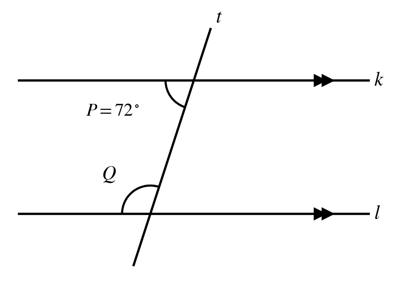
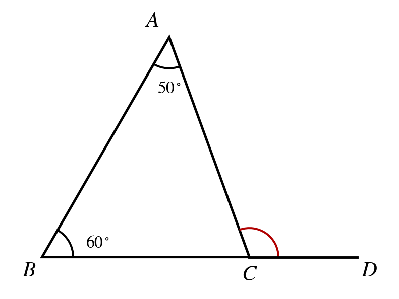
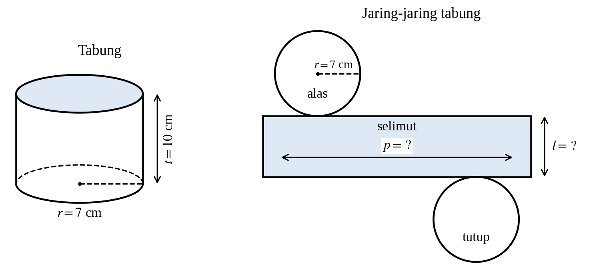
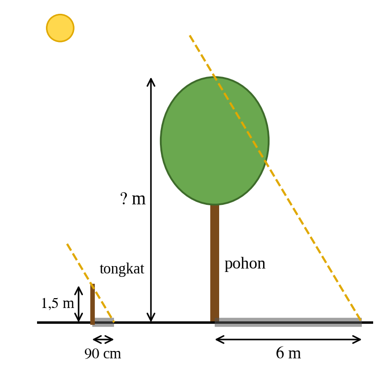
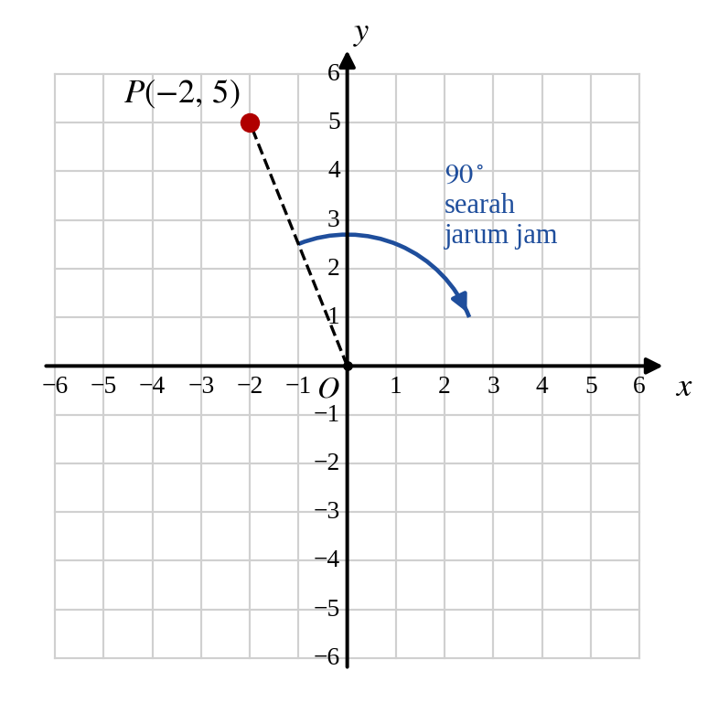
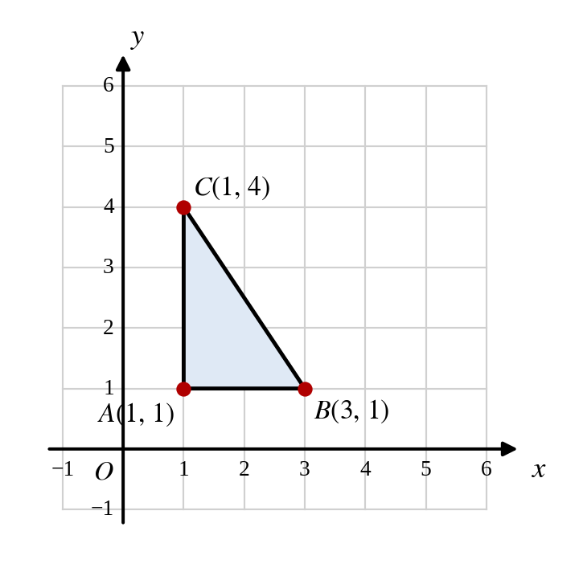
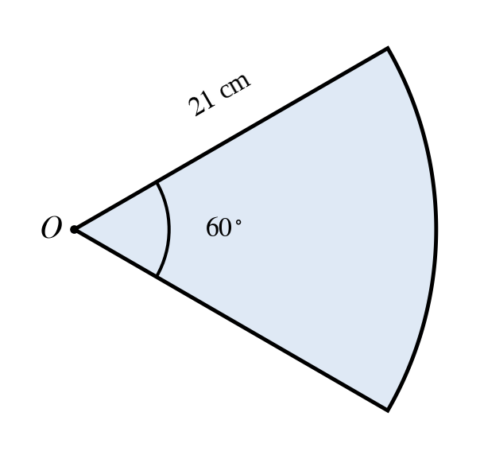
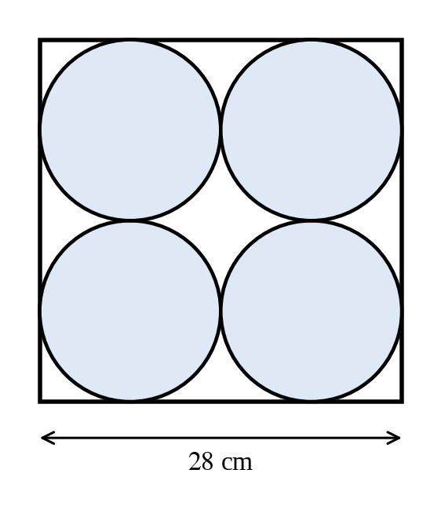
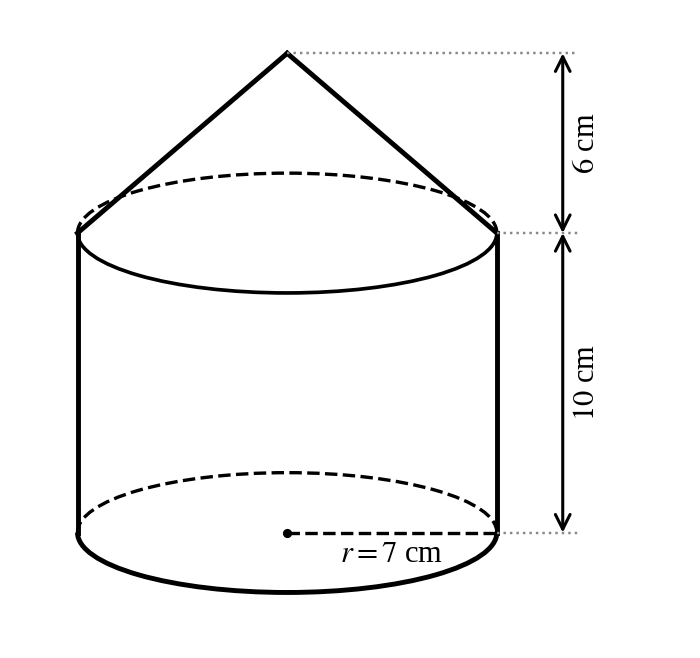
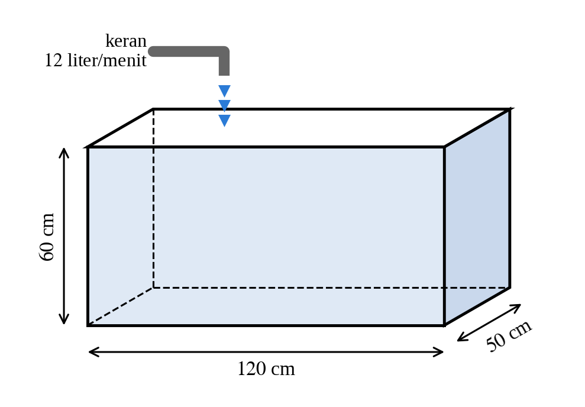

# Pretest Bab 3 — ekstraksi sumber

STAGED_ONLY; belum diaudit atau diimpor. DOCX asli menjadi acuan.

PRETEST BAB 3

GEOMETRI & PENGUKURAN

<!-- table-001 -->
<table>
<tr><td>Bab / Sub Bab</td><td>Indikator Esensial</td></tr>
<tr><td colspan="2">Bab 3 : Geometri dan Pengukuran</td></tr>
<tr><td colspan="2">Sub Bab 1 : Objek Geometri</td></tr>
<tr><td></td><td>14. Hubungan antar- sudut yang terbentuk oleh dua garis yang berpotongan, dan oleh dua garis sejajar yang dipotong suatu garis transversal (termasuk penentuan besar sudut dalam segitiga)</td></tr>
<tr><td></td><td>15. Teorema Pythagoras. Kekongruenan dan kesebangunan bangun datar</td></tr>
<tr><td></td><td>16. Jaring-jaring bangun ruang (prisma, tabung, limas dan kerucut)</td></tr>
<tr><td colspan="2">Sub Bab 2 : Transformasi Geometri</td></tr>
<tr><td></td><td>17. Transformasi tunggal (refleksi, translasi, rotasi, dan dilatasi) terhadap titik, garis, dan bangun datar pada bidang.</td></tr>
<tr><td colspan="2">Sub Bab 3 : Pengukuran</td></tr>
<tr><td></td><td>18. Keliling dan luas bangun datar (daerah segi banyak dan daerah lingkaran, serta daerah gabungannya)</td></tr>
<tr><td></td><td>19. Volume bangun ruang (prisma, limas, dan bola)</td></tr>
</table>

PRETEST BAB 3 Terdiri dari 20 soal dengan komposisi kesulitan 5 Mudah (C3), 10 Sedang (C4), dan 5 Sulit (C5), serta 3 tipe soal: PG (10), PG MCMA (6), PGK Kategori (4) tiap bab.

KOMPOSISI SOAL PRETEST

<!-- table-002 -->
<table>
<tr><td>Bab / Sub Bab</td><td>Jumlah Soal</td><td>C3</td><td>C4</td><td>C5</td><td>PG</td><td>PG MCMA</td><td>PGK</td></tr>
<tr><td>Bab 3 – Sub Bab 1 : Objek Geometri</td><td>7</td><td>2</td><td>3</td><td>2</td><td>4</td><td>2</td><td>1</td></tr>
<tr><td>Bab 3 – Sub Bab 2 : Transformasi Geometri</td><td>6</td><td>1</td><td>4</td><td>1</td><td>3</td><td>2</td><td>1</td></tr>
<tr><td>Bab 3 – Sub Bab 3 : Pengukuran</td><td>7</td><td>2</td><td>3</td><td>2</td><td>3</td><td>2</td><td>2</td></tr>
<tr><td>Total Bab 3</td><td>20</td><td>5</td><td>10</td><td>5</td><td>10</td><td>6</td><td>4</td></tr>
</table>

BAB 3 : GEOMETRI DAN PENGUKURAN

SUB BAB 1 : OBJEK GEOMETRI

SOAL 1 (Bentuk Soal: PG)

Indikator 14.2 | Level Kognitif: C3 (Mudah)

KUNCI JAWABAN : C

Dua garis sejajar $k$ dan $l$ dipotong oleh garis transversal $t$. Sudut $P$ terletak di bagian dalam pada garis $k$ dan besarnya ${72}^{∘}$. Sudut $Q$ terletak di bagian dalam pada garis $l$ dan merupakan sudut dalam sepihak dengan sudut $P$. Besar sudut $Q$ adalah…

A. ${72}^{∘}$

B. ${118}^{∘}$

C. ${108}^{∘}$

D. ${98}^{∘}$

Pembahasan :

Sudut dalam sepihak pada dua garis sejajar saling berpelurus (jumlahnya ${180}^{∘}$). Jadi $∠Q={180}^{∘}−{72}^{∘}={108}^{∘}$.

SOAL 2 (Bentuk Soal: PG MCMA)

Indikator 14.4 | Level Kognitif: C4 (Sedang)

KUNCI JAWABAN : Pernyataan 1, Pernyataan 2, Pernyataan 4

Pada segitiga $ABC$ diketahui $∠A={50}^{∘}$ dan $∠B={60}^{∘}$. Sisi $BC$ diperpanjang ke titik $D$ sehingga terbentuk sudut luar $∠ACD$. Pilihlah semua pernyataan yang benar!

[ ] Pernyataan 1: $∠ACB={70}^{∘}$

[ ] Pernyataan 2: $∠ACD={110}^{∘}$

[ ] Pernyataan 3: $∠ACD=∠B+∠ACB$

[ ] Pernyataan 4: $∠ACB+∠ACD={180}^{∘}$

Pembahasan :

Jumlah sudut dalam segitiga ${180}^{∘}$ sehingga $∠ACB={180}^{∘}−{50}^{∘}−{60}^{∘}={70}^{∘}$ (Pernyataan 1 Benar).

Sudut luar sama dengan jumlah dua sudut dalam yang tidak bersisian: $∠ACD=∠A+∠B={110}^{∘}$ (Pernyataan 2 Benar).

$∠B+∠ACB={130}^{∘}≠{110}^{∘}$; sudut luar di $C$ seharusnya sama dengan $∠A+∠B$ (Pernyataan 3 Salah).

$∠ACB$ dan $∠ACD$ saling berpelurus: ${70}^{∘}+{110}^{∘}={180}^{∘}$ (Pernyataan 4 Benar).

SOAL 3 (Bentuk Soal: PG)

Indikator 16.1 | Level Kognitif: C3 (Mudah)

KUNCI JAWABAN : A

Jaring-jaring sebuah tabung terdiri atas dua lingkaran dan sebuah persegi panjang (selimut tabung). Jika jari-jari lingkaran $7$ cm dan tinggi tabung $10$ cm, ukuran persegi panjang selimut tersebut adalah… (gunakan $π=\frac{22}{7}$)

A. panjang $44$ cm dan lebar $10$ cm

B. panjang $22$ cm dan lebar $10$ cm

C. panjang $44$ cm dan lebar $7$ cm

D. panjang $14$ cm dan lebar $10$ cm

Pembahasan :

Pada jaring-jaring tabung, panjang persegi panjang selimut sama dengan keliling alas: $2πr=2×\frac{22}{7}×7=44$ cm, sedangkan lebarnya sama dengan tinggi tabung, yaitu $10$ cm.

SOAL 4 (Bentuk Soal: PG)

Indikator 15.5 | Level Kognitif: C4 (Sedang)

KUNCI JAWABAN : D

Pada suatu siang hari, sebuah tongkat setinggi $1,5$ m memiliki bayangan sepanjang $90$ cm. Pada saat yang sama, bayangan sebuah pohon adalah $6$ m. Tinggi pohon tersebut adalah… m.

A. $9$

B. $4$

C. $6,5$

D. $10$

Pembahasan :

Samakan satuan: $90$ cm $=0,9$ m. Segitiga yang dibentuk tongkat dan bayangannya sebangun dengan segitiga pohon dan bayangannya: $\frac{tinggi pohon}{6}=\frac{1,5}{0,9}⇒tinggi pohon=\frac{1,5×6}{0,9}=10$ m.

SOAL 5 (Bentuk Soal: PG MCMA)

Indikator 15.3 | Level Kognitif: C4 (Sedang)

KUNCI JAWABAN : Pernyataan 1, Pernyataan 2

Segitiga $ABC$ dan segitiga $PQR$ memiliki $AB=PQ=6$ cm, $BC=QR=8$ cm, dan $∠B=∠Q={50}^{∘}$. Pilihlah semua pernyataan yang benar!

[ ] Pernyataan 1: Kedua segitiga kongruen berdasarkan kriteria sisi-sudut-sisi (SAS).

[ ] Pernyataan 2: Panjang $AC$ sama dengan panjang $PR$.

[ ] Pernyataan 3: Jika yang diketahui hanya $AB=PQ$, $BC=QR$, dan $∠A=∠P$, kedua segitiga pasti kongruen.

[ ] Pernyataan 4: Besar $∠A$ sama dengan besar $∠R$.

Pembahasan :

Dua sisi bersesuaian sama panjang dan sudut yang diapit sisi tersebut ($∠B=∠Q$) sama besar, sehingga kongruen (SAS) (Pernyataan 1 Benar).

Pada bangun yang kongruen, sisi-sisi yang bersesuaian sama panjang, sehingga $AC=PR$ (Pernyataan 2 Benar).

Sudut $A$ bukan sudut yang diapit sisi $AB$ dan $BC$ (susunan sisi-sisi-sudut), sehingga tidak menjamin kekongruenan (Pernyataan 3 Salah).

Sudut yang bersesuaian dengan $∠A$ adalah $∠P$, bukan $∠R$ (Pernyataan 4 Salah).

SOAL 6 (Bentuk Soal: PG Kategori)

Indikator 15.6 | Level Kognitif: C5 (Sulit)

KUNCI JAWABAN : A. Salah, B. Benar, C. Benar

Dua segitiga sebangun dengan perbandingan panjang sisi-sisi yang bersesuaian $2:3$. Luas segitiga yang lebih kecil adalah $20$ cm${​}^{2}$. Rina menyimpulkan bahwa luas segitiga yang lebih besar adalah $30$ cm${​}^{2}$ karena perbandingannya $2:3$. Tentukan Benar atau Salah untuk setiap pernyataan evaluasi berikut!

<!-- table-003 -->
<table>
<tr><td>Pernyataan</td><td>Benar</td><td>Salah</td></tr>
<tr><td>A. Perbandingan luas kedua segitiga tersebut adalah $2:3$.</td><td>[ ]</td><td>[ ]</td></tr>
<tr><td>B. Luas segitiga yang lebih besar adalah $45$ cm${​}^{2}$.</td><td>[ ]</td><td>[ ]</td></tr>
<tr><td>C. Kesimpulan Rina keliru karena perbandingan luas sama dengan kuadrat perbandingan sisi.</td><td>[ ]</td><td>[ ]</td></tr>
</table>

Pembahasan :

Pernyataan A salah, perbandingan luas $={2}^{2}:{3}^{2}=4:9$.

Pernyataan B benar, $\frac{20}{L}=\frac{4}{9}⇒L=45$ cm${​}^{2}$.

Pernyataan C benar, Rina menggunakan perbandingan sisi ($2:3$) langsung untuk luas, padahal luas berbanding sebagai kuadrat perbandingan sisi ($4:9$).

SOAL 7 (Bentuk Soal: PG)

Indikator 16.4 | Level Kognitif: C5 (Sulit)

KUNCI JAWABAN : B

Seorang siswa menghitung luas permukaan kerucut yang berjari-jari $6$ cm dan tinggi $8$ cm dengan rumus $πr\left(r+t\right)$ dan memperoleh $84π$ cm${​}^{2}$. Penilaian yang paling tepat terhadap hasil siswa tersebut adalah…

A. Benar, karena rumus luas permukaan kerucut adalah $πr\left(r+t\right)$.

B. Salah, karena pada jaring-jaring kerucut selimutnya memakai garis pelukis $s=10$ cm sehingga luas permukaannya $96π$ cm${​}^{2}$.

C. Salah, karena luas permukaan kerucut hanya luas selimutnya, yaitu $60π$ cm${​}^{2}$.

D. Salah, karena luas permukaan kerucut adalah $132π$ cm${​}^{2}$.

Pembahasan :

Jaring-jaring kerucut terdiri atas lingkaran alas dan juring selimut. Garis pelukis $s=\sqrt{{6}^{2}+{8}^{2}}=10$ cm. Luas permukaan $=π{r}^{2}+πrs=πr\left(r+s\right)=π×6×\left(6+10\right)=96π$ cm${​}^{2}$. Siswa memakai tinggi ($t=8$) sebagai pengganti garis pelukis sehingga hasilnya keliru.

SUB BAB 2 : TRANSFORMASI GEOMETRI

SOAL 8 (Bentuk Soal: PG)

Indikator 17.1 | Level Kognitif: C3 (Mudah)

KUNCI JAWABAN : C

Titik $A\left(3,−2\right)$ ditranslasikan oleh $T=\left(−5 4 \right)$. Koordinat bayangan titik $A$ adalah…

A. $\left(8,−6\right)$

B. $\left(−2,−6\right)$

C. $\left(−2,2\right)$

D. $\left(2,2\right)$

Pembahasan :

$A′\left(3+\left(−5\right), −2+4\right)=A′\left(−2,2\right)$.

SOAL 9 (Bentuk Soal: PG)

Indikator 17.3 | Level Kognitif: C4 (Sedang)

KUNCI JAWABAN : B

Titik $P\left(−2,5\right)$ dirotasikan sebesar ${90}^{∘}$ searah jarum jam dengan pusat $O\left(0,0\right)$. Koordinat bayangan titik $P$ adalah…

A. $\left(−5,−2\right)$

B. $\left(5,2\right)$

C. $\left(2,5\right)$

D. $\left(−2,−5\right)$

Pembahasan :

Rotasi ${90}^{∘}$ searah jarum jam (pusat $O$) memetakan $\left(x,y\right)$ menjadi $\left(y,−x\right)$. Maka $P\left(−2,5\right)→P′\left(5,2\right)$.

SOAL 10 (Bentuk Soal: PG MCMA)

Indikator 17.2 | Level Kognitif: C4 (Sedang)

KUNCI JAWABAN : Pernyataan 1, Pernyataan 3

Titik $C\left(4,−1\right)$ dicerminkan (direfleksikan) terhadap beberapa garis. Pilihlah semua pernyataan yang benar!

[ ] Pernyataan 1: Bayangan hasil refleksi terhadap sumbu $X$ adalah $\left(4,1\right)$.

[ ] Pernyataan 2: Bayangan hasil refleksi terhadap sumbu $Y$ adalah $\left(4,1\right)$.

[ ] Pernyataan 3: Bayangan hasil refleksi terhadap garis $y=x$ adalah $\left(−1,4\right)$.

[ ] Pernyataan 4: Bayangan hasil refleksi terhadap garis $y=−x$ adalah $\left(−1,4\right)$.

Pembahasan :

Refleksi terhadap sumbu $X$: $\left(x,y\right)→\left(x,−y\right)=\left(4,1\right)$ (Pernyataan 1 Benar).

Refleksi terhadap sumbu $Y$: $\left(x,y\right)→\left(−x,y\right)=\left(−4,−1\right)$ (Pernyataan 2 Salah).

Refleksi terhadap $y=x$: $\left(x,y\right)→\left(y,x\right)=\left(−1,4\right)$ (Pernyataan 3 Benar).

Refleksi terhadap $y=−x$: $\left(x,y\right)→\left(−y,−x\right)=\left(1,−4\right)$ (Pernyataan 4 Salah).

SOAL 11 (Bentuk Soal: PG)

Indikator 17.4 | Level Kognitif: C4 (Sedang)

KUNCI JAWABAN : A

Segitiga $ABC$ dengan titik-titik $A\left(1,1\right)$, $B\left(3,1\right)$, dan $C\left(1,4\right)$ didilatasikan dengan pusat $O\left(0,0\right)$ dan faktor skala $3$. Luas bayangan segitiga $A′B′C′$ adalah… satuan luas.

A. $27$

B. $9$

C. $18$

D. $36$

Pembahasan :

Segitiga $ABC$ siku-siku di $A$ dengan $AB=2$ dan $AC=3$ sehingga luasnya $\frac{1}{2}×2×3=3$. Dilatasi faktor $k=3$ memperbesar panjang sisi $3$ kali sehingga luas menjadi ${k}^{2}=9$ kali: $3×9=27$.

SOAL 12 (Bentuk Soal: PG MCMA)

Indikator 17.5 | Level Kognitif: C4 (Sedang)

KUNCI JAWABAN : Pernyataan 1, Pernyataan 4

Perhatikan sifat bayangan hasil transformasi pada bidang. Pilihlah semua pernyataan yang benar!

[ ] Pernyataan 1: Bayangan hasil translasi kongruen dengan bangun semula.

[ ] Pernyataan 2: Bayangan hasil dilatasi dengan faktor skala $2$ kongruen dengan bangun semula.

[ ] Pernyataan 3: Rotasi mengubah ukuran bangun yang diputar.

[ ] Pernyataan 4: Refleksi mempertahankan ukuran dan bentuk, tetapi membalik orientasi bangun.

Pembahasan :

Translasi hanya menggeser, tanpa mengubah bentuk dan ukuran sehingga bayangannya kongruen (Pernyataan 1 Benar).

Dilatasi dengan faktor $2$ mengubah ukuran sehingga bayangannya sebangun, tidak kongruen (Pernyataan 2 Salah).

Rotasi tidak mengubah ukuran (bayangan kongruen) (Pernyataan 3 Salah).

Refleksi menghasilkan bayangan kongruen, tetapi seperti bayangan pada cermin, orientasinya berbalik (Pernyataan 4 Benar).

SOAL 13 (Bentuk Soal: PG Kategori)

Indikator 17.4 | Level Kognitif: C5 (Sulit)

KUNCI JAWABAN : A. Benar, B. Benar, C. Salah

Titik $A\left(3,4\right)$ didilatasikan dengan pusat $\left(1,2\right)$ dan faktor skala $3$. Seorang siswa menjawab bayangannya adalah $\left(9,12\right)$. Tentukan Benar atau Salah untuk setiap pernyataan evaluasi berikut!

<!-- table-004 -->
<table>
<tr><td>Pernyataan</td><td>Benar</td><td>Salah</td></tr>
<tr><td>A. Dilatasi dengan pusat $O\left(0,0\right)$ dan faktor skala $3$ memetakan $A$ ke $\left(9,12\right)$.</td><td>[ ]</td><td>[ ]</td></tr>
<tr><td>B. Bayangan titik $A$ pada dilatasi dengan pusat $\left(1,2\right)$ dan faktor skala $3$ adalah $\left(7,8\right)$.</td><td>[ ]</td><td>[ ]</td></tr>
<tr><td>C. Jawaban siswa benar untuk dilatasi berpusat di $\left(1,2\right)$.</td><td>[ ]</td><td>[ ]</td></tr>
</table>

Pembahasan :

Pernyataan A benar, $\left(3×3, 3×4\right)=\left(9,12\right)$.

Pernyataan B benar, $x′=1+3\left(3−1\right)=7$ dan $y′=2+3\left(4−2\right)=8$.

Pernyataan C salah, siswa memakai pusat $O\left(0,0\right)$ padahal pusat dilatasi adalah $\left(1,2\right)$.

SUB BAB 3 : PENGUKURAN

SOAL 14 (Bentuk Soal: PG)

Indikator 18.1 | Level Kognitif: C3 (Mudah)

KUNCI JAWABAN : D

Sebuah lingkaran memiliki diameter $28$ cm. Luas lingkaran tersebut adalah… cm${​}^{2}$. (gunakan $π=\frac{22}{7}$)

A. $88$

B. $308$

C. $2.464$

D. $616$

Pembahasan :

Jari-jari $r=28÷2=14$ cm. Luas $=π{r}^{2}=\frac{22}{7}×14×14=616$ cm${​}^{2}$.

SOAL 15 (Bentuk Soal: PG Kategori)

Indikator 18.2 | Level Kognitif: C4 (Sedang)

KUNCI JAWABAN : A. Benar, B. Salah, C. Benar

Sebuah juring lingkaran memiliki sudut pusat ${60}^{∘}$ dan jari-jari $21$ cm (gunakan $π=\frac{22}{7}$). Tentukan Benar atau Salah untuk setiap pernyataan berikut!

<!-- table-005 -->
<table>
<tr><td>Pernyataan</td><td>Benar</td><td>Salah</td></tr>
<tr><td>A. Panjang busur juring tersebut adalah $22$ cm.</td><td>[ ]</td><td>[ ]</td></tr>
<tr><td>B. Luas juring tersebut adalah $462$ cm${​}^{2}$.</td><td>[ ]</td><td>[ ]</td></tr>
<tr><td>C. Keliling juring tersebut adalah $64$ cm.</td><td>[ ]</td><td>[ ]</td></tr>
</table>

Pembahasan :

Pernyataan A benar, $\frac{60}{360}×2×\frac{22}{7}×21=\frac{1}{6}×132=22$ cm.

Pernyataan B salah, luas juring $=\frac{1}{6}×\frac{22}{7}×{21}^{2}=\frac{1}{6}×1.386=231$ cm${​}^{2}$.

Pernyataan C benar, keliling juring $=$ panjang busur $+2r=22+42=64$ cm.

SOAL 16 (Bentuk Soal: PG MCMA)

Indikator 18.3 | Level Kognitif: C4 (Sedang)

KUNCI JAWABAN : Pernyataan 1, Pernyataan 2, Pernyataan 3

Empat lingkaran yang identik disusun $2×2$ di dalam sebuah persegi bersisi $28$ cm. Setiap lingkaran menyinggung dua sisi persegi dan dua lingkaran lainnya. Pilihlah semua pernyataan yang benar! (gunakan $π=\frac{22}{7}$)

[ ] Pernyataan 1: Jari-jari setiap lingkaran adalah $7$ cm.

[ ] Pernyataan 2: Luas persegi adalah $784$ cm${​}^{2}$.

[ ] Pernyataan 3: Jumlah luas keempat lingkaran adalah $616$ cm${​}^{2}$.

[ ] Pernyataan 4: Luas daerah di dalam persegi tetapi di luar keempat lingkaran adalah $336$ cm${​}^{2}$.

Pembahasan :

Dua diameter menyusun satu sisi persegi: $2d=28⇒d=14$, $r=7$ cm (Pernyataan 1 Benar).

Luas persegi $={28}^{2}=784$ cm${​}^{2}$ (Pernyataan 2 Benar).

Luas satu lingkaran $=\frac{22}{7}×{7}^{2}=154$, empat lingkaran $=616$ cm${​}^{2}$ (Pernyataan 3 Benar).

Luas daerah di luar lingkaran $=784−616=168$ cm${​}^{2}$, bukan $336$ (Pernyataan 4 Salah).

SOAL 17 (Bentuk Soal: PG MCMA)

Indikator 19.1 | Level Kognitif: C3 (Mudah)

KUNCI JAWABAN : Pernyataan 1, Pernyataan 2

Pilihlah semua pernyataan tentang volume bangun ruang berikut yang benar! (gunakan $π=\frac{22}{7}$)

[ ] Pernyataan 1: Volume tabung dengan jari-jari $7$ cm dan tinggi $10$ cm adalah $1.540$ cm${​}^{3}$.

[ ] Pernyataan 2: Volume kerucut dengan jari-jari $7$ cm dan tinggi $12$ cm adalah $616$ cm${​}^{3}$.

[ ] Pernyataan 3: Volume limas dengan alas persegi bersisi $6$ cm dan tinggi $10$ cm adalah $360$ cm${​}^{3}$.

[ ] Pernyataan 4: Volume bola dengan jari-jari $3$ cm adalah $12π$ cm${​}^{3}$.

Pembahasan :

$V=π{r}^{2}t=\frac{22}{7}×49×10=1.540$ (Pernyataan 1 Benar).

$V=\frac{1}{3}π{r}^{2}t=\frac{1}{3}×154×12=616$ (Pernyataan 2 Benar).

$V=\frac{1}{3}×36×10=120$ cm${​}^{3}$, bukan $360$ (Pernyataan 3 Salah).

$V=\frac{4}{3}π{r}^{3}=\frac{4}{3}π×27=36π$ cm${​}^{3}$, bukan $12π$ (Pernyataan 4 Salah).

SOAL 18 (Bentuk Soal: PG)

Indikator 19.4 | Level Kognitif: C4 (Sedang)

KUNCI JAWABAN : B

Sebuah bangun ruang tersusun dari tabung dengan jari-jari $7$ cm dan tinggi $10$ cm, dan di atasnya terdapat kerucut dengan jari-jari alas $7$ cm dan tinggi $6$ cm. Volume bangun ruang tersebut adalah… cm${​}^{3}$. (gunakan $π=\frac{22}{7}$)

A. $1.540$

B. $1.848$

C. $2.464$

D. $2.156$

Pembahasan :

${V}_{tabung}=\frac{22}{7}×49×10=1.540$. ${V}_{kerucut}=\frac{1}{3}×\frac{22}{7}×49×6=308$. Total $=1.540+308=1.848$ cm${​}^{3}$.

SOAL 19 (Bentuk Soal: PG)

Indikator 19.6 | Level Kognitif: C5 (Sulit)

KUNCI JAWABAN : C

Jari-jari alas sebuah tabung diperbesar $50%$ dan tingginya dikurangi $20%$. Doni menyimpulkan bahwa volume tabung bertambah $30%$ ($50%−20%$). Penilaian yang tepat terhadap kesimpulan Doni adalah…

A. Benar, karena perubahan volume adalah selisih kedua persentase.

B. Salah, volume bertambah $120%$ karena jari-jari dikuadratkan saja.

C. Salah, volume bertambah $80%$ karena volume sebanding dengan ${r}^{2}$ dan $t$, yaitu ${\left(1,5\right)}^{2}×0,8=1,8$.

D. Salah, volume bertambah $25%$ karena tinggi berubah lebih kecil.

Pembahasan :

Volume baru $=π{\left(1,5r\right)}^{2}\left(0,8t\right)=π{r}^{2}t×2,25×0,8=1,8 π{r}^{2}t$. Volume menjadi $180%$ dari semula, atau bertambah $80%$, bukan $30%$.

SOAL 20 (Bentuk Soal: PG Kategori)

Indikator 19.5 | Level Kognitif: C5 (Sulit)

KUNCI JAWABAN : A. Benar, B. Benar, C. Salah

Sebuah bak mandi berbentuk balok berukuran $120$ cm $×$ $50$ cm $×$ $60$ cm diisi air dari keran dengan debit $12$ liter/menit. Andi berpendapat bahwa jika bak sudah terisi $\frac{1}{3}$ bagian, sisa waktu pengisian sampai penuh adalah $15$ menit. Tentukan Benar atau Salah untuk setiap pernyataan evaluasi berikut!

<!-- table-006 -->
<table>
<tr><td>Pernyataan</td><td>Benar</td><td>Salah</td></tr>
<tr><td>A. Kapasitas bak mandi tersebut adalah $360$ liter.</td><td>[ ]</td><td>[ ]</td></tr>
<tr><td>B. Bak yang awalnya kosong terisi penuh dalam waktu $30$ menit.</td><td>[ ]</td><td>[ ]</td></tr>
<tr><td>C. Pendapat Andi benar.</td><td>[ ]</td><td>[ ]</td></tr>
</table>

Pembahasan :

Pernyataan A benar, $V=120×50×60=360.000$ cm${​}^{3}$ $=360$ liter.

Pernyataan B benar, waktu $=\frac{360}{12}=30$ menit.

Pernyataan C salah, sisa $\frac{2}{3}$ bagian sehingga waktu sisa $=\frac{2}{3}×30=20$ menit, bukan $15$ menit.

LAMPIRAN : REKAP KUNCI JAWABAN DAN PETA SOAL

Bab 3 : Geometri dan Pengukuran

<!-- table-007 -->
<table>
<tr><td>No</td><td>Sub Bab</td><td>Indikator</td><td>Level</td><td>Bentuk Soal</td><td>Kunci Jawaban</td></tr>
<tr><td>1</td><td>Objek Geometri</td><td>14.2</td><td>C3</td><td>PG</td><td>C</td></tr>
<tr><td>2</td><td>Objek Geometri</td><td>14.4</td><td>C4</td><td>PG MCMA</td><td>Pernyataan 1, Pernyataan 2, Pernyataan 4</td></tr>
<tr><td>3</td><td>Objek Geometri</td><td>16.1</td><td>C3</td><td>PG</td><td>A</td></tr>
<tr><td>4</td><td>Objek Geometri</td><td>15.5</td><td>C4</td><td>PG</td><td>D</td></tr>
<tr><td>5</td><td>Objek Geometri</td><td>15.3</td><td>C4</td><td>PG MCMA</td><td>Pernyataan 1, Pernyataan 2</td></tr>
<tr><td>6</td><td>Objek Geometri</td><td>15.6</td><td>C5</td><td>PG Kategori</td><td>A. Salah, B. Benar, C. Benar</td></tr>
<tr><td>7</td><td>Objek Geometri</td><td>16.4</td><td>C5</td><td>PG</td><td>B</td></tr>
<tr><td>8</td><td>Transformasi Geometri</td><td>17.1</td><td>C3</td><td>PG</td><td>C</td></tr>
<tr><td>9</td><td>Transformasi Geometri</td><td>17.3</td><td>C4</td><td>PG</td><td>B</td></tr>
<tr><td>10</td><td>Transformasi Geometri</td><td>17.2</td><td>C4</td><td>PG MCMA</td><td>Pernyataan 1, Pernyataan 3</td></tr>
<tr><td>11</td><td>Transformasi Geometri</td><td>17.4</td><td>C4</td><td>PG</td><td>A</td></tr>
<tr><td>12</td><td>Transformasi Geometri</td><td>17.5</td><td>C4</td><td>PG MCMA</td><td>Pernyataan 1, Pernyataan 4</td></tr>
<tr><td>13</td><td>Transformasi Geometri</td><td>17.4</td><td>C5</td><td>PG Kategori</td><td>A. Benar, B. Benar, C. Salah</td></tr>
<tr><td>14</td><td>Pengukuran</td><td>18.1</td><td>C3</td><td>PG</td><td>D</td></tr>
<tr><td>15</td><td>Pengukuran</td><td>18.2</td><td>C4</td><td>PG Kategori</td><td>A. Benar, B. Salah, C. Benar</td></tr>
<tr><td>16</td><td>Pengukuran</td><td>18.3</td><td>C4</td><td>PG MCMA</td><td>Pernyataan 1, Pernyataan 2, Pernyataan 3</td></tr>
<tr><td>17</td><td>Pengukuran</td><td>19.1</td><td>C3</td><td>PG MCMA</td><td>Pernyataan 1, Pernyataan 2</td></tr>
<tr><td>18</td><td>Pengukuran</td><td>19.4</td><td>C4</td><td>PG</td><td>B</td></tr>
<tr><td>19</td><td>Pengukuran</td><td>19.6</td><td>C5</td><td>PG</td><td>C</td></tr>
<tr><td>20</td><td>Pengukuran</td><td>19.5</td><td>C5</td><td>PG Kategori</td><td>A. Benar, B. Benar, C. Salah</td></tr>
</table>

 

