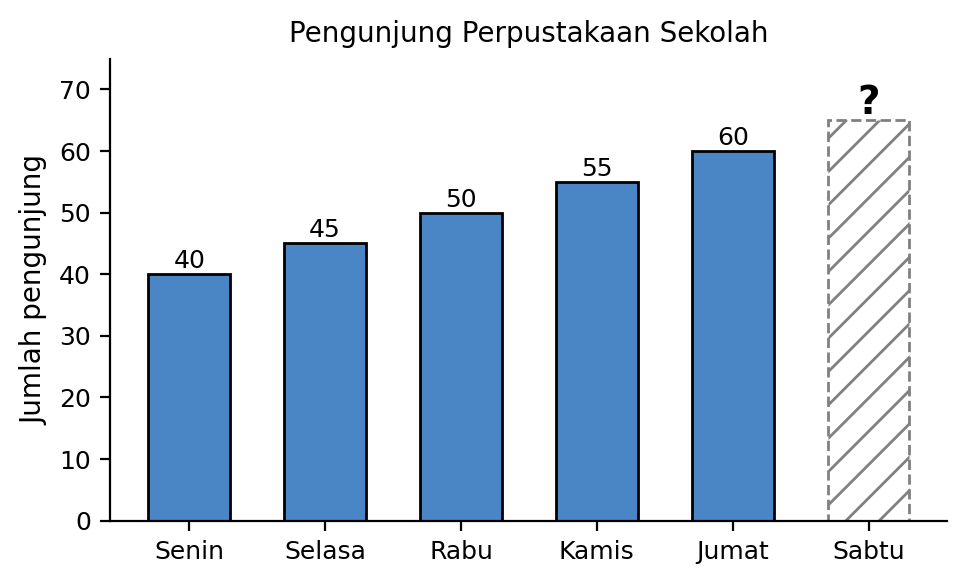
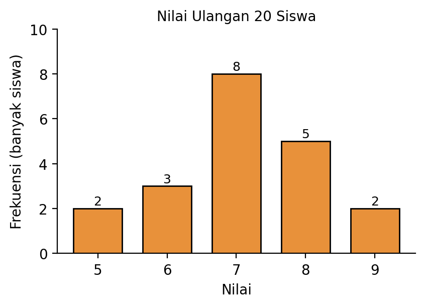
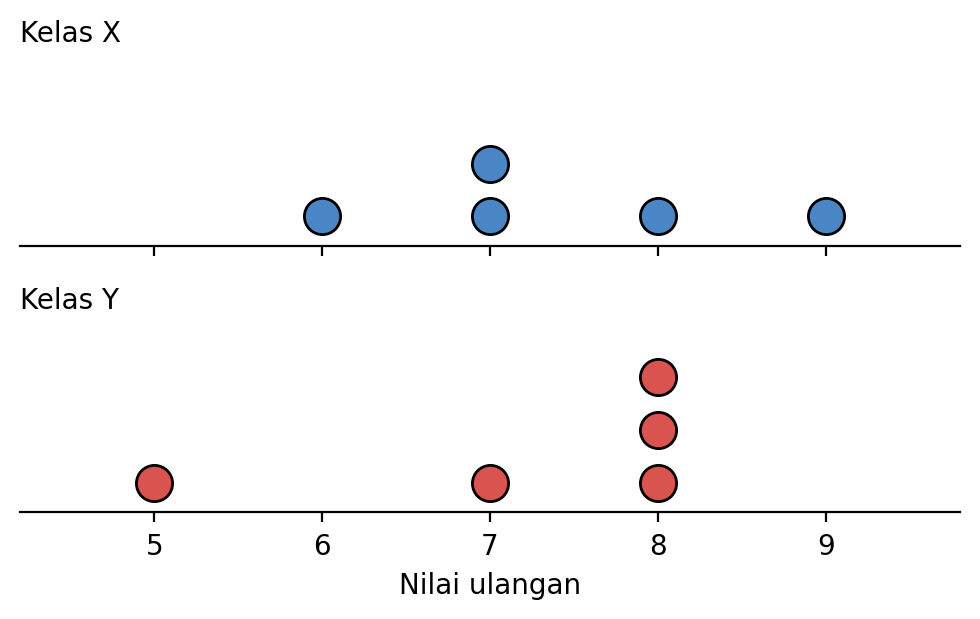
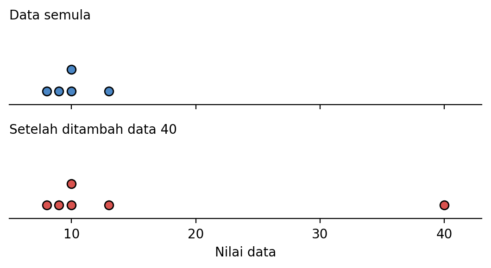
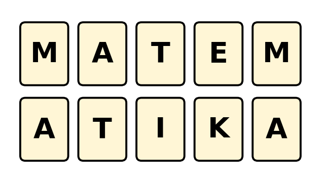
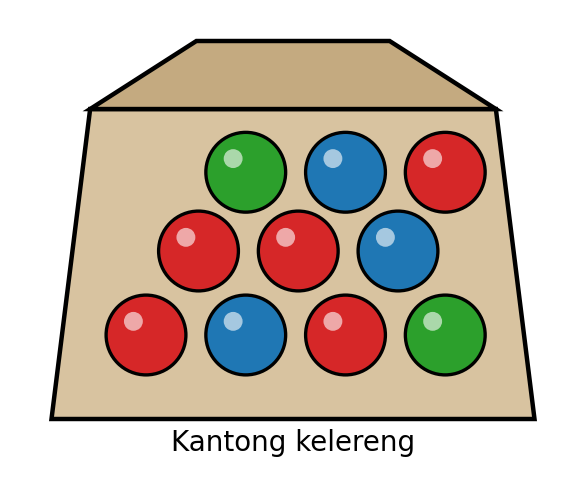
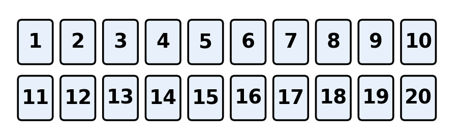
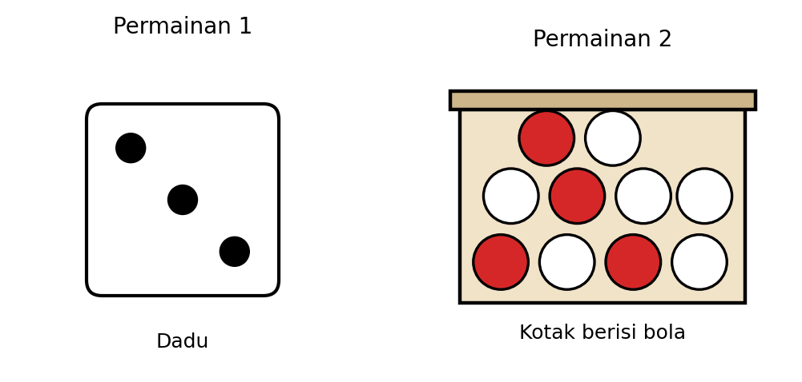
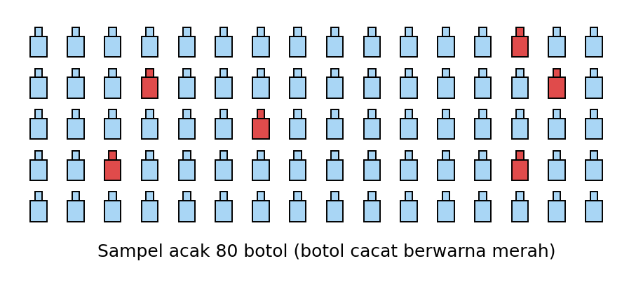

# Pretest Bab 4 — ekstraksi sumber

STAGED_ONLY; belum diaudit atau diimpor. DOCX asli menjadi acuan.

PRETEST BAB 4

DATA & PELUANG

<!-- table-001 -->
<table>
<tr><td>Bab / Sub Bab</td><td>Indikator Esensial</td></tr>
<tr><td colspan="2">Bab 4 : Data dan Peluang</td></tr>
<tr><td colspan="2">Sub Bab 1 : Data</td></tr>
<tr><td></td><td>20. Perumusan pertanyaan untuk mendapatkan data, serta penyajian, dan peginterpretasian data</td></tr>
<tr><td></td><td>21. Penentuan dan penaksiran rerata (mean), median, modus, dan jangkauan (range) dari data</td></tr>
<tr><td></td><td>22. Perbandingan ukuran pemusatan dan ukuran penyebaran beberapa kelompok data</td></tr>
<tr><td colspan="2">Sub Bab 2 : Peluang</td></tr>
<tr><td></td><td>23. Peluang dan frekuensi relatif dari kejadian tunggal.</td></tr>
</table>

PRETEST BAB 4 Terdiri dari 20 soal dengan komposisi kesulitan 5 Mudah (C3), 10 Sedang (C4), dan 5 Sulit (C5), serta 3 tipe soal: PG (10), PG MCMA (6), PGK Kategori (4) tiap bab.

KOMPOSISI SOAL PRETEST

<!-- table-002 -->
<table>
<tr><td>Bab / Sub Bab</td><td>Jumlah Soal</td><td>C3</td><td>C4</td><td>C5</td><td>PG</td><td>PG MCMA</td><td>PGK</td></tr>
<tr><td>Bab 4 – Sub Bab 1 : Data</td><td>10</td><td>3</td><td>5</td><td>2</td><td>5</td><td>3</td><td>2</td></tr>
<tr><td>Bab 4 – Sub Bab 2 : Peluang</td><td>10</td><td>2</td><td>5</td><td>3</td><td>5</td><td>3</td><td>2</td></tr>
<tr><td>Total Bab 4</td><td>20</td><td>5</td><td>10</td><td>5</td><td>10</td><td>6</td><td>4</td></tr>
</table>

BAB 4 : DATA DAN PELUANG

SUB BAB 1 : DATA

SOAL 1 (Bentuk Soal: PG)

Indikator 21.1 | Level Kognitif: C3 (Mudah)

KUNCI JAWABAN : A

Lima siswa mengumpulkan sampah plastik (dalam botol) sebanyak $12$, $15$, $18$, $15$, dan $20$. Rata-rata (mean) banyak botol yang dikumpulkan adalah…

A. $16$

B. $15$

C. $18$

D. $17$

Pembahasan :

Mean $=\frac{12+15+18+15+20}{5}=\frac{80}{5}=16$.

SOAL 2 (Bentuk Soal: PG)

Indikator 21.2 | Level Kognitif: C3 (Mudah)

KUNCI JAWABAN : C

Data banyak buku yang dibaca enam siswa dalam sebulan adalah $4,7,9,3,12,8$. Median dari data tersebut adalah…

A. $7$

B. $8$

C. $7,5$

D. $6,5$

Pembahasan :

Urutkan data: $3,4,7,8,9,12$. Banyak data genap ($6$) sehingga median $=$ rata-rata dua data tengah $=\frac{7+8}{2}=7,5$.

SOAL 3 (Bentuk Soal: PG Kategori)

Indikator 20.3 | Level Kognitif: C3 (Mudah)

KUNCI JAWABAN : A. Benar, B. Benar, C. Salah

Hasil survei olahraga favorit $30$ siswa disajikan pada tabel berikut.

<!-- table-003 -->
<table>
<tr><td>Olahraga</td><td>Sepak bola</td><td>Basket</td><td>Renang</td><td>Voli</td></tr>
<tr><td>Banyak siswa</td><td>12</td><td>8</td><td>6</td><td>4</td></tr>
</table>

Tentukan Benar atau Salah untuk setiap pernyataan berikut!

<!-- table-004 -->
<table>
<tr><td>Pernyataan</td><td>Benar</td><td>Salah</td></tr>
<tr><td>A. Jumlah seluruh siswa yang disurvei adalah $30$ orang.</td><td>[ ]</td><td>[ ]</td></tr>
<tr><td>B. Jika data disajikan dalam diagram lingkaran, sudut juring untuk sepak bola adalah ${144}^{∘}$.</td><td>[ ]</td><td>[ ]</td></tr>
<tr><td>C. Persentase siswa yang memilih basket adalah $20%$.</td><td>[ ]</td><td>[ ]</td></tr>
</table>

Pembahasan :

Pernyataan A benar, $12+8+6+4=30$.

Pernyataan B benar, $\frac{12}{30}×{360}^{∘}={144}^{∘}$.

Pernyataan C salah, $\frac{8}{30}×100%≈26,7%$.

SOAL 4 (Bentuk Soal: PG MCMA)

Indikator 20.1 | Level Kognitif: C4 (Sedang)

KUNCI JAWABAN : Pernyataan 1, Pernyataan 4

Seorang peneliti ingin mengetahui rata-rata waktu belajar di rumah siswa kelas VIII di suatu SMP yang memiliki $8$ kelas paralel. Pilihlah semua pernyataan yang benar!

[ ] Pernyataan 1: Pertanyaan "Berapa menit Anda belajar di rumah setiap hari?" tepat untuk tujuan penelitian tersebut.

[ ] Pernyataan 2: Pertanyaan "Apakah belajar itu sangat menyenangkan?" tepat untuk mengumpulkan data waktu belajar.

[ ] Pernyataan 3: Mensurvei satu kelas saja pasti sudah mewakili seluruh siswa kelas VIII.

[ ] Pernyataan 4: Memilih sampel secara acak dari setiap kelas membuat data lebih mewakili populasi.

Pembahasan :

Pertanyaan tersebut menghasilkan data numerik (menit) yang relevan dengan tujuan penelitian (Pernyataan 1 Benar).

Pertanyaan tersebut menanyakan perasaan, bukan lama belajar, sehingga tidak menghasilkan data yang dibutuhkan (Pernyataan 2 Salah).

Satu kelas belum tentu mewakili kelas lain sehingga hasilnya dapat bias (Pernyataan 3 Salah).

Sampel acak dari tiap kelas memberi peluang yang adil bagi seluruh kelompok sehingga lebih representatif (Pernyataan 4 Benar).

SOAL 5 (Bentuk Soal: PG)

Indikator 20.5 | Level Kognitif: C5 (Sulit)

KUNCI JAWABAN : B

Jumlah pengunjung perpustakaan sekolah pada hari Senin sampai Jumat berturut-turut adalah $40,45,50,55,60$ orang. Dika menyimpulkan bahwa jumlah pengunjung pada hari Sabtu pasti $65$ orang karena naik $5$ orang setiap hari. Penilaian yang paling tepat terhadap kesimpulan Dika adalah…

A. Benar, karena pola kenaikan $5$ orang per hari pasti berlaku untuk hari berikutnya.

B. Kurang tepat, karena pola kenaikan hanya teramati pada lima hari sehingga $65$ orang baru sebatas prediksi, bukan kepastian.

C. Benar, karena data lima hari sudah cukup untuk memastikan jumlah pengunjung hari Sabtu.

D. Kurang tepat, karena hasil hitung seharusnya $70$ orang.

Pembahasan :

Data menunjukkan tren naik $5$ orang per hari, sehingga hari berikutnya dapat diprediksi $60+5=65$ orang. Namun tren dari data yang terbatas hanya dapat dipakai untuk memperkirakan, tidak untuk memastikan (pola pada hari Sabtu bisa berbeda dengan hari kerja). Kata "pasti" pada kesimpulan Dika membuat kesimpulannya kurang tepat.

SOAL 6 (Bentuk Soal: PG MCMA)

Indikator 21.4 | Level Kognitif: C4 (Sedang)

KUNCI JAWABAN : Pernyataan 1, Pernyataan 2, Pernyataan 4

Diketahui data: $4,6,7,7,9,10,20$. Pilihlah semua pernyataan yang benar!

[ ] Pernyataan 1: Mean data tersebut adalah $9$.

[ ] Pernyataan 2: Median data tersebut adalah $7$.

[ ] Pernyataan 3: Mean data tersebut lebih kecil daripada median.

[ ] Pernyataan 4: Jangkauan (range) data tersebut adalah $16$.

Pembahasan :

Mean $=\frac{4+6+7+7+9+10+20}{7}=\frac{63}{7}=9$ (Pernyataan 1 Benar).

Data sudah terurut, $7$ data sehingga median adalah data ke-$4$, yaitu $7$ (Pernyataan 2 Benar).

Mean $9$ lebih besar daripada median $7$ (ditarik oleh nilai $20$) (Pernyataan 3 Salah).

Jangkauan $=20−4=16$ (Pernyataan 4 Benar).

SOAL 7 (Bentuk Soal: PG)

Indikator 21.1 | Level Kognitif: C4 (Sedang)

KUNCI JAWABAN : D

Tabel berikut menunjukkan nilai ulangan $20$ siswa.

<!-- table-005 -->
<table>
<tr><td>Nilai</td><td>5</td><td>6</td><td>7</td><td>8</td><td>9</td></tr>
<tr><td>Frekuensi</td><td>2</td><td>3</td><td>8</td><td>5</td><td>2</td></tr>
</table>

Rata-rata nilai ulangan tersebut adalah…

A. $7,0$

B. $7,2$

C. $7,5$

D. $7,1$

Pembahasan :

Jumlah nilai $=\left(5×2\right)+\left(6×3\right)+\left(7×8\right)+\left(8×5\right)+\left(9×2\right)=10+18+56+40+18=142$. Mean $=\frac{142}{20}=7,1$.

SOAL 8 (Bentuk Soal: PG)

Indikator 22.2 | Level Kognitif: C4 (Sedang)

KUNCI JAWABAN : A

Dua kelompok siswa mengikuti tes yang sama dan keduanya memperoleh nilai rata-rata $80$. Jangkauan nilai kelompok A adalah $20$ dan jangkauan nilai kelompok B adalah $35$. Kesimpulan yang paling tepat adalah…

A. Nilai kelompok A lebih konsisten (seragam) karena penyebaran datanya lebih kecil.

B. Nilai kelompok B lebih konsisten karena jangkauannya lebih besar.

C. Kedua kelompok sama konsistennya karena rata-ratanya sama.

D. Kelompok B lebih pandai karena jangkauannya lebih besar.

Pembahasan :

Dengan rata-rata sama, kelompok yang jangkauannya lebih kecil memiliki data yang lebih terkumpul di sekitar pusat sehingga lebih stabil/konsisten. Jadi kelompok A ($20<35$) lebih konsisten.

SOAL 9 (Bentuk Soal: PG MCMA)

Indikator 22.1 | Level Kognitif: C4 (Sedang)

KUNCI JAWABAN : Pernyataan 1, Pernyataan 2, Pernyataan 4

Nilai ulangan lima siswa dua kelas: Kelas X: $6,7,7,8,9$ dan Kelas Y: $5,7,8,8,8$. Pilihlah semua pernyataan yang benar!

[ ] Pernyataan 1: Mean Kelas X lebih besar daripada mean Kelas Y.

[ ] Pernyataan 2: Median Kelas Y lebih besar daripada median Kelas X.

[ ] Pernyataan 3: Modus Kelas X lebih besar daripada modus Kelas Y.

[ ] Pernyataan 4: Jangkauan kedua kelas sama besar.

Pembahasan :

Mean X $=\frac{37}{5}=7,4$ dan mean Y $=\frac{36}{5}=7,2$ (Pernyataan 1 Benar).

Median X $=7$ dan median Y $=8$ (Pernyataan 2 Benar).

Modus X $=7$ dan modus Y $=8$, sehingga modus X lebih kecil (Pernyataan 3 Salah).

Jangkauan X $=9−6=3$ dan jangkauan Y $=8−5=3$ (Pernyataan 4 Benar).

SOAL 10 (Bentuk Soal: PG Kategori)

Indikator 22.4 | Level Kognitif: C5 (Sulit)

KUNCI JAWABAN : A. Benar, B. Salah, C. Benar

Data semula: $8,9,10,10,13$. Kemudian ditambahkan satu data ekstrem (outlier) yaitu $40$ sehingga data menjadi $8,9,10,10,13,40$. Tentukan Benar atau Salah untuk setiap pernyataan evaluasi berikut!

<!-- table-006 -->
<table>
<tr><td>Pernyataan</td><td>Benar</td><td>Salah</td></tr>
<tr><td>A. Mean berubah dari $10$ menjadi $15$ setelah data $40$ ditambahkan.</td><td>[ ]</td><td>[ ]</td></tr>
<tr><td>B. Median berubah menjadi $15$ setelah data $40$ ditambahkan.</td><td>[ ]</td><td>[ ]</td></tr>
<tr><td>C. Untuk data yang memuat data ekstrem, median lebih baik mewakili pusat data daripada mean.</td><td>[ ]</td><td>[ ]</td></tr>
</table>

Pembahasan :

Pernyataan A benar, mean semula $\frac{50}{5}=10$ dan mean baru $\frac{90}{6}=15$.

Pernyataan B salah, data terurut $8,9,10,10,13,40$ sehingga median $=\frac{10+10}{2}=10$ (tidak berubah).

Pernyataan C benar, mean sangat dipengaruhi nilai ekstrem sedangkan median relatif tidak.

SUB BAB 2 : PELUANG

SOAL 11 (Bentuk Soal: PG)

Indikator 23.2 | Level Kognitif: C3 (Mudah)

KUNCI JAWABAN : D

Sebuah dadu bersisi enam dilempar satu kali. Peluang muncul mata dadu bilangan prima adalah…

A. $\frac{1}{3}$

B. $\frac{2}{3}$

C. $\frac{1}{6}$

D. $\frac{1}{2}$

Pembahasan :

Ruang sampel $S={1,2,3,4,5,6}$ sehingga $n\left(S\right)=6$. Kejadian bilangan prima $A={2,3,5}$ sehingga $n\left(A\right)=3$. $P\left(A\right)=\frac{3}{6}=\frac{1}{2}$.

SOAL 12 (Bentuk Soal: PG)

Indikator 23.3 | Level Kognitif: C3 (Mudah)

KUNCI JAWABAN : B

Sebuah koin dilempar sebanyak $50$ kali. Sisi angka muncul $21$ kali. Frekuensi relatif munculnya sisi angka adalah…

A. $\frac{29}{50}$

B. $\frac{21}{50}$

C. $\frac{1}{2}$

D. $\frac{21}{29}$

Pembahasan :

Frekuensi relatif $=\frac{banyak kejadian muncul}{banyak percobaan}=\frac{21}{50}$.

SOAL 13 (Bentuk Soal: PG MCMA)

Indikator 23.1 | Level Kognitif: C4 (Sedang)

KUNCI JAWABAN : Pernyataan 1, Pernyataan 2, Pernyataan 4

Sepuluh kartu masing-masing bertuliskan satu huruf dari kata MATEMATIKA, kemudian dimasukkan ke dalam kotak. Satu kartu diambil secara acak. Pilihlah semua pernyataan yang benar!

[ ] Pernyataan 1: Banyak titik sampel dalam ruang sampel adalah $10$.

[ ] Pernyataan 2: Peluang terambil kartu huruf A adalah $\frac{3}{10}$.

[ ] Pernyataan 3: Peluang terambil kartu huruf vokal adalah $\frac{2}{5}$.

[ ] Pernyataan 4: Peluang terambil kartu huruf T adalah $\frac{1}{5}$.

Pembahasan :

Terdapat $10$ kartu sehingga $n\left(S\right)=10$ (Pernyataan 1 Benar).

Huruf A ada $3$ kartu: $P\left(A\right)=\frac{3}{10}$ (Pernyataan 2 Benar).

Vokal: A, A, A, E, I berjumlah $5$ kartu sehingga peluangnya $\frac{5}{10}=\frac{1}{2}$, bukan $\frac{2}{5}$ (Pernyataan 3 Salah).

Huruf T ada $2$ kartu: $\frac{2}{10}=\frac{1}{5}$ (Pernyataan 4 Benar).

SOAL 14 (Bentuk Soal: PG MCMA)

Indikator 23.2 | Level Kognitif: C4 (Sedang)

KUNCI JAWABAN : Pernyataan 1, Pernyataan 2, Pernyataan 4

Sebuah kantong berisi $5$ kelereng merah, $3$ kelereng biru, dan $2$ kelereng hijau. Satu kelereng diambil secara acak. Pilihlah semua pernyataan yang benar!

[ ] Pernyataan 1: Peluang terambil kelereng biru adalah $\frac{3}{10}$.

[ ] Pernyataan 2: Peluang terambil kelereng bukan hijau adalah $\frac{4}{5}$.

[ ] Pernyataan 3: Jika ditambahkan $2$ kelereng merah ke dalam kantong, peluang terambil kelereng bukan merah menjadi $\frac{1}{2}$.

[ ] Pernyataan 4: Peluang terambil kelereng merah adalah $\frac{1}{2}$.

Pembahasan :

$P\left(biru\right)=\frac{3}{10}$ (Pernyataan 1 Benar).

$P\left(bukan hijau\right)=\frac{8}{10}=\frac{4}{5}$ (Pernyataan 2 Benar).

Setelah penambahan: merah $=7$, total $=12$, sehingga $P\left(bukan merah\right)=\frac{5}{12}$, bukan $\frac{1}{2}$ (Pernyataan 3 Salah).

$P\left(merah\right)=\frac{5}{10}=\frac{1}{2}$ (Pernyataan 4 Benar).

SOAL 15 (Bentuk Soal: PG)

Indikator 23.4 | Level Kognitif: C4 (Sedang)

KUNCI JAWABAN : C

Sebuah dadu dilempar sebanyak $600$ kali dan mata $6$ muncul $90$ kali. Selisih antara peluang teoretis dan frekuensi relatif munculnya mata $6$ adalah…

A. $\frac{1}{30}$

B. $\frac{1}{20}$

C. $\frac{1}{60}$

D. $\frac{1}{6}$

Pembahasan :

Peluang teoretis $=\frac{1}{6}=\frac{10}{60}$. Frekuensi relatif $=\frac{90}{600}=\frac{3}{20}=\frac{9}{60}$. Selisihnya $=\frac{10}{60}−\frac{9}{60}=\frac{1}{60}$.

SOAL 16 (Bentuk Soal: PG MCMA)

Indikator 23.4 | Level Kognitif: C4 (Sedang)

KUNCI JAWABAN : Pernyataan 1, Pernyataan 3

Sebuah dadu dilempar $1.200$ kali dan mata $4$ muncul $210$ kali. Pilihlah semua pernyataan yang benar!

[ ] Pernyataan 1: Frekuensi relatif munculnya mata $4$ adalah $\frac{7}{40}$.

[ ] Pernyataan 2: Peluang teoretis munculnya mata $4$ adalah $\frac{1}{4}$.

[ ] Pernyataan 3: Jika percobaan diulang sangat banyak kali, frekuensi relatif cenderung mendekati peluang teoretisnya.

[ ] Pernyataan 4: Frekuensi relatif harus selalu tepat sama dengan peluang teoretis.

Pembahasan :

$\frac{210}{1.200}=\frac{7}{40}$ (Pernyataan 1 Benar).

Dadu memiliki $6$ sisi sehingga peluang mata $4$ adalah $\frac{1}{6}$, bukan $\frac{1}{4}$ (Pernyataan 2 Salah).

Menurut Hukum Bilangan Besar, makin banyak percobaan makin dekat frekuensi relatif ke peluang teoretis (Pernyataan 3 Benar).

Frekuensi relatif bersifat acak dan tidak selalu sama persis dengan peluang teoretis (Pernyataan 4 Salah).

SOAL 17 (Bentuk Soal: PG Kategori)

Indikator 23.2 | Level Kognitif: C4 (Sedang)

KUNCI JAWABAN : A. Benar, B. Salah, C. Salah

Sebuah kartu diambil secara acak dari $20$ kartu bernomor $1$ sampai $20$. Tentukan Benar atau Salah untuk setiap pernyataan berikut!

<!-- table-007 -->
<table>
<tr><td>Pernyataan</td><td>Benar</td><td>Salah</td></tr>
<tr><td>A. Peluang terambil kartu bernomor genap adalah $\frac{1}{2}$.</td><td>[ ]</td><td>[ ]</td></tr>
<tr><td>B. Peluang terambil kartu bernomor prima adalah $\frac{7}{20}$.</td><td>[ ]</td><td>[ ]</td></tr>
<tr><td>C. Peluang terambil kartu yang bukan kelipatan $5$ adalah $\frac{3}{4}$.</td><td>[ ]</td><td>[ ]</td></tr>
</table>

Pembahasan :

Pernyataan A benar, bilangan genap ada $10$: $\frac{10}{20}=\frac{1}{2}$.

Pernyataan B salah, bilangan prima $2,3,5,7,11,13,17,19$ ada $8$ sehingga peluangnya $\frac{8}{20}=\frac{2}{5}$.

Pernyataan C salah, kelipatan $5$ ada $4$ ($5,10,15,20$), sehingga bukan kelipatan $5$ ada $16$: $\frac{16}{20}=\frac{4}{5}$.

SOAL 18 (Bentuk Soal: PG)

Indikator 23.5 | Level Kognitif: C5 (Sulit)

KUNCI JAWABAN : A

Dina akan memilih satu dari dua permainan. Permainan 1: melempar sebuah dadu dan menang jika muncul mata lebih dari $4$. Permainan 2: mengambil satu bola secara acak dari kotak berisi $4$ bola merah dan $6$ bola putih dan menang jika terambil bola merah. Keputusan yang paling tepat adalah…

A. Memilih Permainan 2, karena peluang menangnya $\frac{2}{5}$ lebih besar daripada peluang menang Permainan 1 yaitu $\frac{1}{3}$.

B. Memilih Permainan 1, karena peluang menangnya $\frac{1}{3}$ lebih besar daripada $\frac{2}{5}$.

C. Memilih salah satu saja karena kedua permainan memiliki peluang menang yang sama.

D. Tidak dapat memutuskan karena hasil lemparan dan pengambilan bersifat acak.

Pembahasan :

Permainan 1: kejadian menang $={5,6}$ sehingga $P=\frac{2}{6}=\frac{1}{3}≈0,33$. Permainan 2: $P=\frac{4}{10}=\frac{2}{5}=0,4$. Karena $0,4>0,33$, keputusan yang rasional adalah memilih Permainan 2. Walaupun hasilnya acak, peluang dapat dipakai untuk membandingkan pilihan.

SOAL 19 (Bentuk Soal: PG)

Indikator 23.5 | Level Kognitif: C5 (Sulit)

KUNCI JAWABAN : B

Sebuah pabrik memproduksi $2.000$ botol. Dari sampel acak $80$ botol ditemukan $6$ botol cacat. Manajer menetapkan batas toleransi botol cacat maksimal $6%$. Berdasarkan sampel tersebut, kesimpulan yang paling tepat adalah…

A. Produksi memenuhi toleransi dan diperkirakan sekitar $120$ botol cacat.

B. Produksi belum memenuhi toleransi, karena frekuensi relatif cacat $7,5%>6%$ dan diperkirakan sekitar $150$ botol cacat.

C. Produksi belum memenuhi toleransi dan diperkirakan sekitar $75$ botol cacat.

D. Produksi memenuhi toleransi dan diperkirakan sekitar $150$ botol cacat.

Pembahasan :

Frekuensi relatif cacat $=\frac{6}{80}=0,075=7,5%$, lebih besar dari batas $6%$ sehingga belum memenuhi toleransi. Prediksi botol cacat $=0,075×2.000=150$ botol (bandingkan dengan batas $6%×2.000=120$ botol).

SOAL 20 (Bentuk Soal: PG Kategori)

Indikator 23.4 | Level Kognitif: C5 (Sulit)

KUNCI JAWABAN : A. Benar, B. Salah, C. Benar

Sari melempar sebuah koin sebanyak $10$ kali dan sisi angka muncul $7$ kali. Ia menyimpulkan bahwa peluang teoretis muncul angka adalah $\frac{7}{10}$ dan koin tersebut tidak seimbang. Tentukan Benar atau Salah untuk setiap pernyataan evaluasi berikut!

<!-- table-008 -->
<table>
<tr><td>Pernyataan</td><td>Benar</td><td>Salah</td></tr>
<tr><td>A. Frekuensi relatif munculnya sisi angka pada percobaan Sari adalah $\frac{7}{10}$.</td><td>[ ]</td><td>[ ]</td></tr>
<tr><td>B. Kesimpulan Sari bahwa peluang teoretis angka adalah $\frac{7}{10}$ sudah tepat.</td><td>[ ]</td><td>[ ]</td></tr>
<tr><td>C. Jika koin seimbang dan dilempar $1.000$ kali, frekuensi relatif angka cenderung mendekati $\frac{1}{2}$.</td><td>[ ]</td><td>[ ]</td></tr>
</table>

Pembahasan :

Pernyataan A benar, $\frac{7}{10}$ adalah hasil percobaan (frekuensi relatif).

Pernyataan B salah, $\frac{7}{10}$ hanya frekuensi relatif dari $10$ percobaan; peluang teoretis didasarkan pada ruang sampel, yaitu $\frac{1}{2}$ untuk koin seimbang. Percobaan yang sedikit belum cukup untuk menyimpulkan koin tidak seimbang.

Pernyataan C benar, sesuai Hukum Bilangan Besar.

LAMPIRAN : REKAP KUNCI JAWABAN DAN PETA SOAL

Bab 4 : Data dan Peluang

<!-- table-009 -->
<table>
<tr><td>No</td><td>Sub Bab</td><td>Indikator</td><td>Level</td><td>Bentuk Soal</td><td>Kunci Jawaban</td></tr>
<tr><td>1</td><td>Data</td><td>21.1</td><td>C3</td><td>PG</td><td>A</td></tr>
<tr><td>2</td><td>Data</td><td>21.2</td><td>C3</td><td>PG</td><td>C</td></tr>
<tr><td>3</td><td>Data</td><td>20.3</td><td>C3</td><td>PG Kategori</td><td>A. Benar, B. Benar, C. Salah</td></tr>
<tr><td>4</td><td>Data</td><td>20.1</td><td>C4</td><td>PG MCMA</td><td>Pernyataan 1, Pernyataan 4</td></tr>
<tr><td>5</td><td>Data</td><td>20.5</td><td>C5</td><td>PG</td><td>B</td></tr>
<tr><td>6</td><td>Data</td><td>21.4</td><td>C4</td><td>PG MCMA</td><td>Pernyataan 1, Pernyataan 2, Pernyataan 4</td></tr>
<tr><td>7</td><td>Data</td><td>21.1</td><td>C4</td><td>PG</td><td>D</td></tr>
<tr><td>8</td><td>Data</td><td>22.2</td><td>C4</td><td>PG</td><td>A</td></tr>
<tr><td>9</td><td>Data</td><td>22.1</td><td>C4</td><td>PG MCMA</td><td>Pernyataan 1, Pernyataan 2, Pernyataan 4</td></tr>
<tr><td>10</td><td>Data</td><td>22.4</td><td>C5</td><td>PG Kategori</td><td>A. Benar, B. Salah, C. Benar</td></tr>
<tr><td>11</td><td>Peluang</td><td>23.2</td><td>C3</td><td>PG</td><td>D</td></tr>
<tr><td>12</td><td>Peluang</td><td>23.3</td><td>C3</td><td>PG</td><td>B</td></tr>
<tr><td>13</td><td>Peluang</td><td>23.1</td><td>C4</td><td>PG MCMA</td><td>Pernyataan 1, Pernyataan 2, Pernyataan 4</td></tr>
<tr><td>14</td><td>Peluang</td><td>23.2</td><td>C4</td><td>PG MCMA</td><td>Pernyataan 1, Pernyataan 2, Pernyataan 4</td></tr>
<tr><td>15</td><td>Peluang</td><td>23.4</td><td>C4</td><td>PG</td><td>C</td></tr>
<tr><td>16</td><td>Peluang</td><td>23.4</td><td>C4</td><td>PG MCMA</td><td>Pernyataan 1, Pernyataan 3</td></tr>
<tr><td>17</td><td>Peluang</td><td>23.2</td><td>C4</td><td>PG Kategori</td><td>A. Benar, B. Salah, C. Salah</td></tr>
<tr><td>18</td><td>Peluang</td><td>23.5</td><td>C5</td><td>PG</td><td>A</td></tr>
<tr><td>19</td><td>Peluang</td><td>23.5</td><td>C5</td><td>PG</td><td>B</td></tr>
<tr><td>20</td><td>Peluang</td><td>23.4</td><td>C5</td><td>PG Kategori</td><td>A. Benar, B. Salah, C. Benar</td></tr>
</table>

